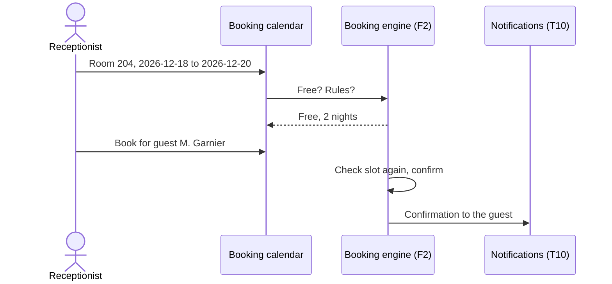

🏠 [Specs](../../../../README.md) › 🧩 [Functional capabilities](../../../README.md) ›
🔧 [F2 No-code configuration](../../README.md) › 📝 [Use cases](../README.md) ›
📝 [Use cases: FL-F2-08 Views and bookings](README.md) › 📝 UC-F2-19 Book a resource

# 📝 UC-F2-19 Book a resource

**Status:** 🔄 waiting for the owner

## Summary

A user, a portal user or a visitor of the booking page books a resource for a time: a room, a piece of equipment, a
venue or an appointment; the booking engine checks it is free and allowed.

## Personas

- [U28 Hotel receptionist](../../../../01-users/personas/u28-hotel-receptionist.md)
- [U33 Medical secretary](../../../../01-users/personas/u33-medical-secretary.md)
- [U38 Training coordinator](../../../../01-users/personas/u38-training-coordinator.md)
- [U09 Customer](../../../../01-users/personas/u09-customer.md)

## Goal

A confirmed booking, without double booking, that every calendar shows.

## Trigger

A guest, a patient, a learner or a colleague needs a resource.

## Frequency

Many times a day in hotels and health practices; weekly elsewhere.

## Preconditions

- The record type is bookable ([UC-F2-18](uc-f02-18-make-a-record-type-bookable.md)).

## Postconditions

- **Succeeded:** the booking is confirmed, the resource's slot is taken, and what the booking creates is created.
- **Failed:** nothing is booked; the person sees why and other slots.

## Main flow

1. The receptionist opens the booking calendar
   ([S-F2-19](../../screens/08-views-and-bookings/s-f02-19-booking-calendar.md)) on the resources and dates wanted.
2. They pick a free slot, or search by need (capacity, equipment, dates); the engine shows what is free.
3. They fill the booking: who, what for, the record it is linked to (a guest, a patient, a course).
4. The engine checks the rules and the slot again
   ([BR-F2-18](../../business-rules/br-f02-18-one-booking-per-resource-and-slot.md)) and confirms; the customer gets the
   confirmation.
5. Changes and cancellations follow the rules; a cancelled slot is free at once.

## Alternative flows

- 1a. A portal user or a visitor books from the portal or the booking page within the rules.
- 2a. Nothing free: the engine offers the nearest free slots and other resources of the same kind.
- 4a. The booking needs approval: it waits as requested until approved.

## Error flows

- 4e. Someone took the slot meanwhile: refused, the next free slots shown.
- 5e. A cancellation after the limit: refused, or charged as the rules say.

## Business rules

- [BR-F2-18 One booking per resource and slot](../../business-rules/br-f02-18-one-booking-per-resource-and-slot.md)
- [BR-F2-19 Booking rules decide who books what and when](../../business-rules/br-f02-19-booking-rules-decide-who-books-what-and-when.md)

## Entities

- [E-F2-18 Resource booking](../../data/e-f02-18-resource-booking.md)
- [E-F2-17 Bookable resource setting](../../data/e-f02-17-bookable-resource-setting.md)

## Permissions

Users with the booking right on that record type; portal users and visitors as the record type allows. Record rules
limit whose bookings a user sees.

## Notifications

- The booker gets the confirmation, the changes and a reminder the day before (Proposed).
- The resource's owner sees the booking in their calendar.

## Audit events

Booking created, changed, cancelled, approved, with who and when.

## AI involvement

The AI assistant can find a free slot and prepare the booking for confirmation
([BR-F3-07](../../../f03-assistant/business-rules/br-f03-07-no-deletes-no-irreversible-acts.md)).

## API, MCP and A2A exposure

T5 booking operations (availability, book, change, cancel); the MCP tool of F2 with the caller's rights; the A2A booking
skill for partner agents (Proposed).

## Screens

- [S-F2-19 Booking calendar](../../screens/08-views-and-bookings/s-f02-19-booking-calendar.md)

## Flowchart

See [FL-F2-08 Views and bookings](../../flows/fl-f02-08-views-and-bookings.md#flowchart).

## Sequence diagram

## Acceptance criteria

1. **Given** room 204 free on 2026-12-18 and 19 **when** the receptionist books it for M. Garnier **then** the booking
   is confirmed for 2 nights and the guest gets the confirmation.
2. **Given** consulting room 3 booked 10:00 to 10:30 **when** another booking for 10:15 is tried **then** it is refused
   and 10:35 is offered.
3. **Given** a cancellation limit of 24 hours **when** a learner cancels a room 3 hours before **then** the cancellation
   is refused as the rules say.
4. **Given** no free training room on 2027-01-12 **when** the coordinator searches **then** the nearest free days and
   the other rooms are offered.

## Non-functional notes

Availability answers within 1 second (Proposed); two bookings of the same slot at the same time: one wins, the other is
refused.

## Regulatory references

None.

## Related use cases

- [UC-F2-18 Make a record type bookable](uc-f02-18-make-a-record-type-bookable.md)
- [UC-F4-18 Let customers book appointments](../../../f04-meetings/use-cases/10-benchmark-additions/uc-f04-18-let-customers-book-appointments.md)
- [UC-F4-21 Book a meeting room and equipment](../../../f04-meetings/use-cases/12-rooms-and-client-video/uc-f04-21-book-a-meeting-room-and-equipment.md)

## Open questions

None.

---

⬅️ [UC-F2-18 Make a record type bookable](uc-f02-18-make-a-record-type-bookable.md) · ⬆️ [Up](README.md) ·
➡️ [UC-F2-20](../09-portals-and-offline-forms/uc-f02-20-expose-a-record-type-on-a-portal.md)
