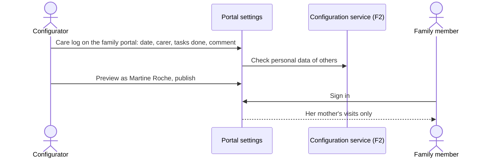

🏠 [Specs](../../../../README.md) › 🧩 [Functional capabilities](../../../README.md) ›
🔧 [F2 No-code configuration](../../README.md) › 📝 [Use cases](../README.md) ›
📝 [Use cases: FL-F2-09 Portals and offline forms](README.md) › 📝 UC-F2-20 Expose a record type on a portal

# 📝 UC-F2-20 Expose a record type on a portal

**Status:** ✅ specified

## Summary

A configurator shows a record type to outside people on a portal: which records (those linked to the person), which
fields and which actions, for families, tenants, landlords, co-owners, learners or parents.

## Personas

- [U07 Administrator](../../../../01-users/personas/u07-administrator.md)
- [U09 Customer](../../../../01-users/personas/u09-customer.md)

## Goal

Outside people see their own records and do the few things they need, without a custom portal.

## Trigger

A sector needs outside people to follow their records: a family the visits, a tenant the lease, a learner the course.

## Frequency

Once per record type and audience.

## Preconditions

- The record type has a link to a contact (a person with an email).

## Postconditions

- **Succeeded:** portal accounts linked to a record see its chosen fields and actions,
  [UC-F1-19](../../../f01-administration/use-cases/12-portal-accounts-and-integrations/uc-f01-19-manage-portal-accounts.md).
- **Failed:** nothing is shown outside.

## Main flow

1. The configurator opens the record type and chooses Portal
   ([S-F2-20](../../screens/09-portals-and-offline-forms/s-f02-20-portal-settings.md)).
2. They choose the audience (the contact field that links a person), the fields shown, the related lists shown (visits,
   documents, invoices) and the actions allowed (comment, upload, confirm, pay).
3. SimpleERP flags fields holding personal data of other people,
   [BR-F2-20](../../business-rules/br-f02-20-a-portal-shows-only-the-chosen-fields-of-the-persons-own-records.md); the
   configurator confirms or removes them.
4. They preview the portal as one real contact and publish.
5. The administrator or a user invites the contacts,
   [UC-F1-19](../../../f01-administration/use-cases/12-portal-accounts-and-integrations/uc-f01-19-manage-portal-accounts.md);
   they see their records.

## Alternative flows

- 2a. Several audiences on one record type (tenant and landlord on a lease): each gets its own fields.
- 5a. An outside person linked to several records sees them all in one portal.

## Error flows

- 3e. A field of another person's health or payroll data: cannot be shown, with the reason.
- 4e. No contact has an email: the preview says so.

## Business rules

- [BR-F2-20 A portal shows only the chosen fields of the person's own records](../../business-rules/br-f02-20-a-portal-shows-only-the-chosen-fields-of-the-persons-own-records.md)
- [BR-F1-26 Portal accounts see only their own records](../../../f01-administration/business-rules/br-f01-26-portal-accounts-see-only-their-own-records.md)
- [BR-F2-02 Custom data follows permissions](../../business-rules/br-f02-02-custom-data-follows-permissions.md)

## Entities

- [E-F2-19 Portal exposure](../../data/e-f02-19-portal-exposure.md)
- [E-F2-05 Record type](../../data/e-f02-05-record-type.md)
- [E-F1-17 Portal account](../../../f01-administration/data/e-f01-17-portal-account.md)

## Permissions

The Configurator role ([D96](../../../../06-decisions/f02-no-code-configuration/d96-configurator-role.md));
administrators. Record rules of the record type apply to the data shown.

## Notifications

The administrator is told when a record type goes on a portal.

## Audit events

Portal exposure created and changed, with the fields and actions before and after.

## AI involvement

The build assistant can draft it from a plain description
([UC-F2-15](../07-benchmark-additions/uc-f02-15-build-with-plain-language.md)); what it builds is a draft for the
configurator to check and publish ([BR-F2-17](../../business-rules/br-f02-17-ai-built-items-are-drafts.md)).

## API, MCP and A2A exposure

T5 configuration operations with the Configurator rights; the MCP tool of F2 reads it; no A2A skill.

## Screens

- [S-F2-20 Portal settings](../../screens/09-portals-and-offline-forms/s-f02-20-portal-settings.md)
- [S-F1-19 Portal accounts](../../../f01-administration/screens/12-portal-accounts-and-integrations/s-f01-19-portal-accounts.md)

## Flowchart

See [FL-F2-09 Portals and offline forms](../../flows/fl-f02-09-portals-and-offline-forms.md#flowchart).

## Sequence diagram

## Acceptance criteria

1. **Given** the care log exposed with date, carer, tasks and comment **when** Martine Roche, contact of a recipient,
   signs in **then** she sees that recipient's visits and no other's.
2. **Given** a lease exposed to tenants and landlords **when** the landlord signs in **then** he sees the rent received
   and not the tenant's ID documents.
3. **Given** a field Health notes of another person **when** it is added to the portal **then** it is refused with the
   reason.
4. **Given** a course exposed to learners with Upload **when** a learner uploads a certificate **then** it is attached
   to her enrolment.

## Non-functional notes

Portal pages work on a phone and meet the accessibility level of the shop
([CR-FR-072](../../../../10-country-packs/france/consumer/cr-fr-072-web-accessibility-eaa.md)).

## Regulatory references

GDPR: only the data needed is shown
([CR-FR-050](../../../../10-country-packs/france/data-protection/cr-fr-050-privacy-by-design.md)); health data hosting
where it applies ([CR-FR-055](../../../../10-country-packs/france/data-protection/cr-fr-055-health-data-hosting.md)).

## Related use cases

- [UC-F1-19 Manage portal accounts](../../../f01-administration/use-cases/12-portal-accounts-and-integrations/uc-f01-19-manage-portal-accounts.md)
- [UC-F6-11 Use the customer portal](../../../f06-customers-and-sales/use-cases/02-quote-to-order/uc-f06-11-use-the-customer-portal.md)
- [UC-F2-21 Make a phone form work offline](uc-f02-21-make-a-phone-form-work-offline.md)

## Open questions

None.

---

⬅️ [UC-F2-19 Book a resource](../08-views-and-bookings/uc-f02-19-book-a-resource.md) · ⬆️ [Up](README.md) ·
➡️ [UC-F2-21 Make a phone form work offline](uc-f02-21-make-a-phone-form-work-offline.md)
