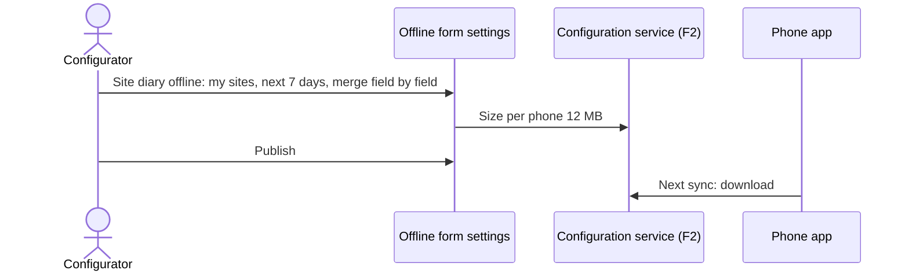

🏠 [Specs](../../../../README.md) › 🧩 [Functional capabilities](../../../README.md) ›
🔧 [F2 No-code configuration](../../README.md) › 📝 [Use cases](../README.md) ›
📝 [Use cases: FL-F2-09 Portals and offline forms](README.md) › 📝 UC-F2-21 Make a phone form work offline

# 📝 UC-F2-21 Make a phone form work offline

**Status:** 🔄 waiting for the owner

## Summary

A configurator marks a record type's phone form as offline: which records the phone keeps, how long, and what happens
when two people changed the same record.

## Personas

- [U07 Administrator](../../../../01-users/personas/u07-administrator.md)
- [U22 Site manager](../../../../01-users/personas/u22-site-manager.md)

## Goal

Site diaries, care logs and driver forms that work where the network does not.

## Trigger

Field staff work in basements, the countryside or on the road.

## Frequency

Once per record type.

## Preconditions

- The record type has a phone layout ([D110](../../../../06-decisions/f02-no-code-configuration/d110-phone-forms.md)).

## Postconditions

- **Succeeded:** the form works offline on the phones of the chosen roles.
- **Failed:** the form needs the network.

## Main flow

1. The configurator opens the record type and chooses Offline
   ([S-F2-21](../../screens/09-portals-and-offline-forms/s-f02-21-offline-form.md)).
2. They choose the records kept on the phone (today's, the user's own, the next 7 days), and the related lists and
   documents kept with them.
3. They choose the conflict rule: last change wins, merge field by field, or ask the user,
   [BR-F2-21](../../business-rules/br-f02-21-offline-forms-keep-only-what-is-needed-and-sync-in-order.md).
4. SimpleERP shows the size each phone will keep and publishes.
5. Phones of the chosen roles download the records at the next sign-in or sync.

## Alternative flows

- 2a. Photos and signatures are kept on the phone until they are sent, then removed.
- 3a. Numbered records (a delivery note): numbers come from a range reserved per phone.

## Error flows

- 4e. The size per phone is too large (Proposed: over 200 MB): the configurator narrows the records.
- 2e. A record type holding health data: kept encrypted on the phone and removed after sync.

## Business rules

- [BR-F2-21 Offline forms keep only what is needed and sync in order](../../business-rules/br-f02-21-offline-forms-keep-only-what-is-needed-and-sync-in-order.md)
- [BR-F2-02 Custom data follows permissions](../../business-rules/br-f02-02-custom-data-follows-permissions.md)

## Entities

- [E-F2-20 Offline form setting](../../data/e-f02-20-offline-form-setting.md)
- [E-F2-03 Form layout](../../data/e-f02-03-form-layout.md)

## Permissions

The Configurator role ([D96](../../../../06-decisions/f02-no-code-configuration/d96-configurator-role.md));
administrators. Record rules of the record type apply to the data shown.

## Notifications

Users of the roles are told the form works offline.

## Audit events

Offline settings created and changed.

## AI involvement

The build assistant can draft it from a plain description
([UC-F2-15](../07-benchmark-additions/uc-f02-15-build-with-plain-language.md)); what it builds is a draft for the
configurator to check and publish ([BR-F2-17](../../business-rules/br-f02-17-ai-built-items-are-drafts.md)).

## API, MCP and A2A exposure

T5 configuration operations with the Configurator rights; the MCP tool of F2 reads it; no A2A skill.

## Screens

- [S-F2-21 Offline form](../../screens/09-portals-and-offline-forms/s-f02-21-offline-form.md)

## Flowchart

See [FL-F2-09 Portals and offline forms](../../flows/fl-f02-09-portals-and-offline-forms.md#flowchart).

## Sequence diagram

## Acceptance criteria

1. **Given** the site diary made offline for Site manager, next 7 days **when** a site manager's phone syncs **then**
   her sites' diaries for 7 days are on the phone.
2. **Given** merge field by field **when** two people changed different fields of the same diary offline **then** both
   changes are kept.
3. **Given** ask the user **when** two people changed the same field **then** the second one to sync chooses which value
   to keep.
4. **Given** a care log with health data **when** it is synced **then** it is removed from the phone after sync.

## Non-functional notes

Sync of a day's records within 30 seconds on 4G (Proposed).

## Regulatory references

GDPR: phones keep only the data needed
([CR-FR-050](../../../../10-country-packs/france/data-protection/cr-fr-050-privacy-by-design.md)).

## Related use cases

- [UC-F2-22 Fill a form offline on the phone](uc-f02-22-fill-a-form-offline-on-the-phone.md)
- [UC-F2-03 Arrange a form](../01-configure-a-record-type/uc-f02-03-arrange-a-form.md)

## Open questions

None.

---

⬅️ [UC-F2-20 Expose a record type on a portal](uc-f02-20-expose-a-record-type-on-a-portal.md) · ⬆️ [Up](README.md) ·
➡️ [UC-F2-22 Fill a form offline on the phone](uc-f02-22-fill-a-form-offline-on-the-phone.md)
