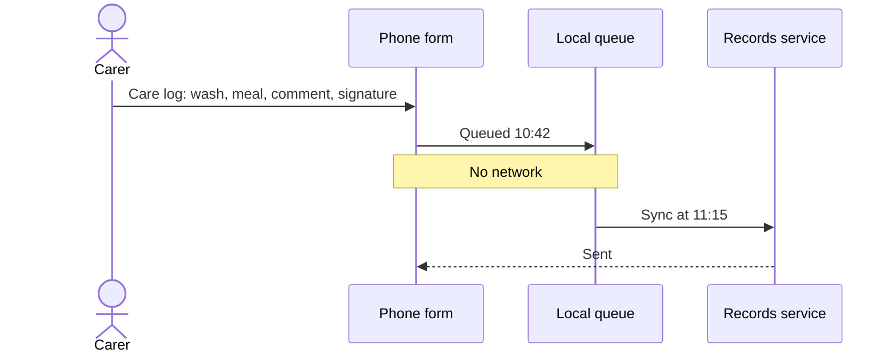

🏠 [Specs](../../../../README.md) › 🧩 [Functional capabilities](../../../README.md) ›
🔧 [F2 No-code configuration](../../README.md) › 📝 [Use cases](../README.md) ›
📝 [Use cases: FL-F2-09 Portals and offline forms](README.md) › 📝 UC-F2-22 Fill a form offline on the phone

# 📝 UC-F2-22 Fill a form offline on the phone

**Status:** 🔄 waiting for the owner

## Summary

A field worker, a carer or a driver fills a record type's form on the phone with no network; the changes wait in a queue
and sync when the network is back.

## Personas

- [U14 Field worker](../../../../01-users/personas/u14-field-worker.md)
- [U26 Carer](../../../../01-users/personas/u26-carer.md)
- [U30 Driver](../../../../01-users/personas/u30-driver.md)
- [U22 Site manager](../../../../01-users/personas/u22-site-manager.md)

## Goal

Record the work where it happens, never lose a line.

## Trigger

A visit, a delivery or a site day with no network.

## Frequency

Daily for field staff.

## Preconditions

- The form works offline ([UC-F2-21](uc-f02-21-make-a-phone-form-work-offline.md)) and the phone synced before leaving.

## Postconditions

- **Succeeded:** the records are on the server, with their photos and signatures, in the order they were made.
- **Failed:** the queue stays on the phone and the user sees what is waiting.

## Main flow

1. The carer opens today's visit on the phone
   ([S-F2-21](../../screens/09-portals-and-offline-forms/s-f02-21-offline-form.md)); the banner says Offline.
2. She fills the care log: tasks done, comment, photo, the recipient's signature.
3. She saves; the record joins the queue with its time and the count shows.
4. When the network is back, the queue syncs in order; each record shows Sent.
5. A conflict follows the record type's rule; when the user must choose, she sees both values.

## Alternative flows

- 1a. The record is not on the phone (not in the records kept): a new record can be created, linked later.
- 4a. The user taps Sync now on a weak network.

## Error flows

- 4e. A record refused by the server (a rule changed meanwhile): it stays in the queue marked with the reason, for the
  user to fix.
- 3e. The phone is almost full: the user is told before the queue is at risk.

## Business rules

- [BR-F2-21 Offline forms keep only what is needed and sync in order](../../business-rules/br-f02-21-offline-forms-keep-only-what-is-needed-and-sync-in-order.md)

## Entities

- [E-F2-20 Offline form setting](../../data/e-f02-20-offline-form-setting.md)
- [E-F2-28 Offline change queue](../../data/e-f02-28-offline-change-queue.md)

## Permissions

The roles the offline form is given to; record rules apply on sync.

## Notifications

The user is told when a queued record is refused; the manager when a phone has not synced for 24 hours (Proposed).

## Audit events

Each record carries the time it was made offline and the time it was synced.

## AI involvement

The phone assistant queues questions offline ([D182](../../../../06-decisions/f03-assistant/d182-offline-assistant.md));
it never fills the form itself.

## API, MCP and A2A exposure

T5 sync operations of the phone app; no MCP tool.

## Screens

- [S-F2-21 Offline form](../../screens/09-portals-and-offline-forms/s-f02-21-offline-form.md)

## Flowchart

See [FL-F2-09 Portals and offline forms](../../flows/fl-f02-09-portals-and-offline-forms.md#flowchart).

## Sequence diagram

## Acceptance criteria

1. **Given** no network at Mme Roche's home **when** the carer saves the care log at 10:42 **then** it is queued and the
   count shows 1.
2. **Given** the network back at 11:15 **when** the phone syncs **then** the care log is on the server with 10:42 as its
   time.
3. **Given** a rule changed meanwhile that requires a duration **when** the queue syncs **then** the record stays queued
   with the reason.
4. **Given** a driver's delivery form with a photo **when** it syncs **then** the photo is on the record and removed
   from the phone.

## Non-functional notes

Saving offline answers within 300 ms (Proposed).

## Regulatory references

Recordings and locations only when needed
([CR-FR-054](../../../../10-country-packs/france/data-protection/cr-fr-054-location-with-consent.md)).

## Related use cases

- [UC-F2-21 Make a phone form work offline](uc-f02-21-make-a-phone-form-work-offline.md)
- [UC-F9-18 Run field service](../../../f09-hr-and-projects/use-cases/06-plan-and-deliver-work/uc-f09-18-run-field-service.md)
- [UC-F6-21 Take orders offline on the road](../../../f06-customers-and-sales/use-cases/09-sell-on-the-road-and-steer-sales/uc-f06-21-take-orders-offline-on-the-road.md)
- [UC-F12-26 Keep working on the tablet without the network](../../../f12-manufacturing/use-cases/11-finite-schedule-and-the-tablet/uc-f12-26-keep-working-on-the-tablet-without-the-network.md)

## Open questions

None.

---

⬅️ [UC-F2-21 Make a phone form work offline](uc-f02-21-make-a-phone-form-work-offline.md) · ⬆️ [Up](README.md) ·
➡️ [UC-F2-23](../10-change-safely/uc-f02-23-see-the-impact-of-a-change-before-publishing.md)
