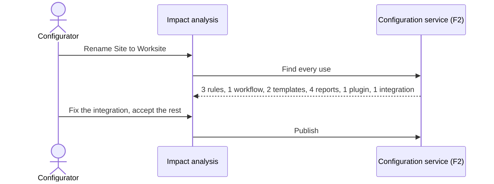

🏠 [Specs](../../../../README.md) › 🧩 [Functional capabilities](../../../README.md) ›
🔧 [F2 No-code configuration](../../README.md) › 📝 [Use cases](../README.md) ›
📝 [Use cases: FL-F2-10 Change safely](README.md) › 📝 UC-F2-23 See the impact of a change before publishing

# 📝 UC-F2-23 See the impact of a change before publishing

**Status:** ✅ specified

## Summary

Before renaming, changing or archiving a field, a status or a record type, the configurator sees every rule, workflow,
template, report, view, plugin and integration that uses it.

## Personas

- [U07 Administrator](../../../../01-users/personas/u07-administrator.md)

## Goal

No change breaks something nobody thought of.

## Trigger

A draft change on a field, status or record type.

## Frequency

At each change of a used item.

## Preconditions

- A draft change ([UC-F2-09](../05-publish-and-roll-back/uc-f02-09-draft-preview-and-publish-a-change.md)).

## Postconditions

- **Succeeded:** the configurator published knowing the impact, or changed the draft.
- **Failed:** nothing is published.

## Main flow

1. The configurator drafts a change, for example renaming the field Site to Worksite.
2. SimpleERP lists what uses the field ([S-F2-22](../../screens/10-change-safely/s-f02-22-impact-analysis.md)): 3
   rules, 1 workflow, 2 document templates, 4 reports, 1 plugin, 1 API integration.
3. For each, it says what the change does: renamed everywhere, or broken (a plugin reading the old name)
   ([BR-F2-22](../../business-rules/br-f02-22-a-change-that-breaks-something-is-not-published-unread.md)).
4. The configurator fixes or accepts each broken item, then publishes.

## Alternative flows

- 2a. Nothing uses it: the list says so and the change publishes.

## Error flows

- 3e. A plugin depends on the item: the change is blocked until the plugin's publisher's version allows it, or the
  configurator gives up.
- 4e. The configurator publishes without reading the broken items: refused.

## Business rules

- [BR-F2-22 A change that breaks something is not published unread](../../business-rules/br-f02-22-a-change-that-breaks-something-is-not-published-unread.md)
- [BR-F2-01 Archive, never delete](../../business-rules/br-f02-01-archive-never-delete.md)

## Entities

- [E-F2-10 Configuration version](../../data/e-f02-10-configuration-version.md)
- [E-F2-01 Custom field](../../data/e-f02-01-custom-field.md)
- [E-F2-26 Configuration draft](../../data/e-f02-26-configuration-draft.md)

## Permissions

The Configurator role ([D96](../../../../06-decisions/f02-no-code-configuration/d96-configurator-role.md));
administrators. Record rules of the record type apply to the data shown.

## Notifications

Owners of the reports and rules affected are told after publishing.

## Audit events

Impact list read and accepted, with the publication.

## AI involvement

The build assistant can draft it from a plain description
([UC-F2-15](../07-benchmark-additions/uc-f02-15-build-with-plain-language.md)); what it builds is a draft for the
configurator to check and publish ([BR-F2-17](../../business-rules/br-f02-17-ai-built-items-are-drafts.md)).

## API, MCP and A2A exposure

T5 configuration operations with the Configurator rights; the MCP tool of F2 reads it; no A2A skill.

## Screens

- [S-F2-22 Impact analysis](../../screens/10-change-safely/s-f02-22-impact-analysis.md)
- [S-F2-10 Publish and versions](../../screens/05-publish-and-roll-back/s-f02-10-publish-and-versions.md)
- [S-F2-30 Custom report](../../screens/10-change-safely/s-f02-30-custom-report.md)

## Flowchart

See [FL-F2-10 Change safely](../../flows/fl-f02-10-change-safely.md#flowchart).

## Sequence diagram

## Acceptance criteria

1. **Given** the field Site used by 3 rules and 1 plugin **when** it is renamed in a draft **then** the 3 rules and the
   plugin are listed with what happens to each.
2. **Given** a broken integration in the list **when** the configurator publishes without accepting it **then** it is
   refused.
3. **Given** a field nothing uses **when** it is archived **then** the list says nothing uses it.

## Non-functional notes

The impact list answers within 3 seconds.

## Regulatory references

None.

## Related use cases

- [UC-F2-09 Draft, preview and publish a change](../05-publish-and-roll-back/uc-f02-09-draft-preview-and-publish-a-change.md)
- [UC-F2-26 Find unused configuration](uc-f02-26-find-unused-configuration.md)

## Open questions

None.

---

⬅️ [UC-F2-22](../09-portals-and-offline-forms/uc-f02-22-fill-a-form-offline-on-the-phone.md) · ⬆️ [Up](README.md) ·
➡️ [UC-F2-24 Test rules and workflows with test cases](uc-f02-24-test-rules-and-workflows-with-test-cases.md)
