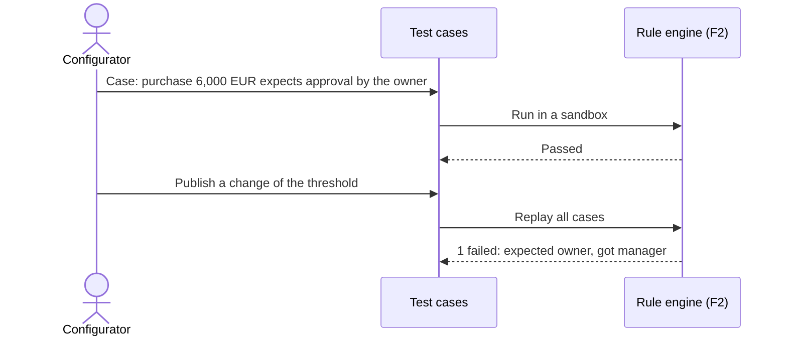

🏠 [Specs](../../../../README.md) › 🧩 [Functional capabilities](../../../README.md) ›
🔧 [F2 No-code configuration](../../README.md) › 📝 [Use cases](../README.md) ›
📝 [Use cases: FL-F2-10 Change safely](README.md) › 📝 UC-F2-24 Test rules and workflows with test cases

# 📝 UC-F2-24 Test rules and workflows with test cases

**Status:** 🔄 waiting for the owner

## Summary

A configurator writes test cases (sample records with the expected outcome) for a rule or a workflow; they are replayed
at each publish, and a failure blocks it.

## Personas

- [U07 Administrator](../../../../01-users/personas/u07-administrator.md)

## Goal

A rule that worked yesterday still works after today's change.

## Trigger

A new or changed rule or workflow.

## Frequency

At each rule change.

## Preconditions

- A rule ([UC-F2-07](../03-automate-with-a-rule/uc-f02-07-create-a-simple-rule.md)) or a workflow
  ([UC-F2-08](../04-design-a-visual-workflow/uc-f02-08-design-a-visual-workflow.md)) in draft.

## Postconditions

- **Succeeded:** the test cases pass and the change publishes.
- **Failed:** a failure blocks the publish
  ([BR-F2-23](../../business-rules/br-f02-23-a-failing-test-case-blocks-the-publish.md)).

## Main flow

1. The configurator opens the rule's Test cases ([S-F2-23](../../screens/10-change-safely/s-f02-23-test-cases.md)).
2. They add a case: a sample record (or a copy of a real one, anonymised) and the expected outcome.
3. They run the cases; each shows passed or failed with the difference.
4. At publish, every case of the changed rules and of the rules they trigger is replayed.

## Alternative flows

- 2a. The AI assistant proposes cases from the rule's conditions, for the configurator to check.

## Error flows

- 4e. A case fails: the publish is blocked and the failure shown with expected and actual.
- 3e. A case refers to a deleted field: marked as broken, to fix.

## Business rules

- [BR-F2-23 A failing test case blocks the publish](../../business-rules/br-f02-23-a-failing-test-case-blocks-the-publish.md)
- [BR-F2-13 Rules cannot loop](../../business-rules/br-f02-13-rules-cannot-loop.md)

## Entities

- [E-F2-21 Test case](../../data/e-f02-21-test-case.md)
- [E-F2-08 Automation rule](../../data/e-f02-08-automation-rule.md)

## Permissions

The Configurator role ([D96](../../../../06-decisions/f02-no-code-configuration/d96-configurator-role.md));
administrators. Record rules of the record type apply to the data shown.

## Notifications

The rule's author is told when a case fails at someone else's publish.

## Audit events

Cases added, changed, run, with results.

## AI involvement

The build assistant can draft it from a plain description
([UC-F2-15](../07-benchmark-additions/uc-f02-15-build-with-plain-language.md)); what it builds is a draft for the
configurator to check and publish ([BR-F2-17](../../business-rules/br-f02-17-ai-built-items-are-drafts.md)).

## API, MCP and A2A exposure

T5 configuration operations with the Configurator rights; the MCP tool of F2 reads it; no A2A skill.

## Screens

- [S-F2-23 Test cases](../../screens/10-change-safely/s-f02-23-test-cases.md)

## Flowchart

See [FL-F2-10 Change safely](../../flows/fl-f02-10-change-safely.md#flowchart).

## Sequence diagram

## Acceptance criteria

1. **Given** a case "purchase of 6,000 EUR goes to the owner" **when** it is run **then** it passes.
2. **Given** the threshold changed to 8,000 EUR **when** the change is published **then** the case fails and the publish
   is blocked.
3. **Given** a case on a deleted field **when** it is run **then** it is marked broken.

## Non-functional notes

Replaying 200 cases takes under 1 minute (Proposed).

## Regulatory references

None.

## Related use cases

- [UC-F2-07 Create a simple rule](../03-automate-with-a-rule/uc-f02-07-create-a-simple-rule.md)
- [UC-F2-08 Design a visual workflow](../04-design-a-visual-workflow/uc-f02-08-design-a-visual-workflow.md)
- [UC-F2-09 Draft, preview and publish a change](../05-publish-and-roll-back/uc-f02-09-draft-preview-and-publish-a-change.md)

## Open questions

None.

---

⬅️ [UC-F2-23 See the impact of a change before publishing](uc-f02-23-see-the-impact-of-a-change-before-publishing.md) ·
⬆️ [Up](README.md) · ➡️ [UC-F2-25](uc-f02-25-merge-a-sector-pack-upgrade-with-local-changes.md)
