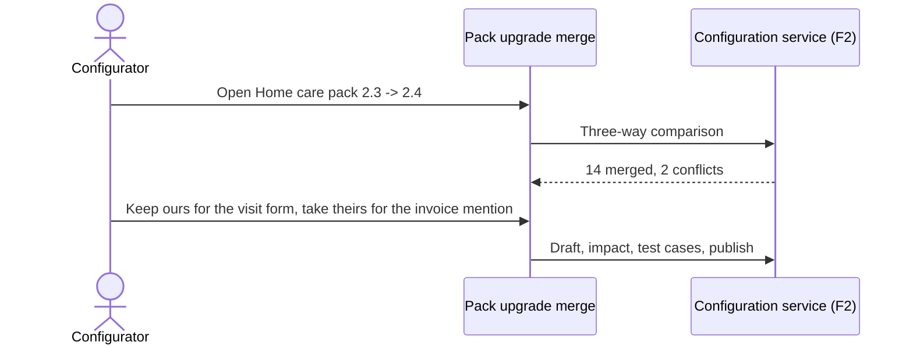

🏠 [Specs](../../../../README.md) › 🧩 [Functional capabilities](../../../README.md) ›
🔧 [F2 No-code configuration](../../README.md) › 📝 [Use cases](../README.md) ›
📝 [Use cases: FL-F2-10 Change safely](README.md) › 📝 UC-F2-25 Merge a sector pack upgrade with local changes

# 📝 UC-F2-25 Merge a sector pack upgrade with local changes

**Status:** ✅ specified

## Summary

When a sector pack's new version meets the company's local changes, the configurator sees a three-way comparison (the
pack before, the pack now, the company's version) and decides each conflict.

## Personas

- [U07 Administrator](../../../../01-users/personas/u07-administrator.md)
- [U11 IT provider administrator](../../../../01-users/personas/u11-provider-admin.md)

## Goal

Get the pack's fixes without losing the company's own changes.

## Trigger

A new version of an installed sector pack.

## Frequency

A few times a year per pack.

## Preconditions

- A sector pack installed
  ([UC-F2-11](../06-share-a-configuration/uc-f02-11-export-or-import-a-configuration-as-a-pack.md)) and changed locally.

## Postconditions

- **Succeeded:** the pack's changes are merged as a draft, then published.
- **Failed:** the company keeps the current version.

## Main flow

1. The configurator opens Packs › Update available
   ([S-F2-24](../../screens/10-change-safely/s-f02-24-pack-upgrade-merge.md)).
2. simple-ERP shows each item in three columns: the pack before, the pack now, the company's version; items changed only
   by the pack merge by themselves.
3. For each conflict, the configurator keeps the company's, takes the pack's, or edits a mix.
4. The merged result is a draft; impact and test cases run,
   [UC-F2-23](uc-f02-23-see-the-impact-of-a-change-before-publishing.md),
   [UC-F2-24](uc-f02-24-test-rules-and-workflows-with-test-cases.md), then it publishes.

## Alternative flows

- 3a. A locked legal block changed by the pack: the pack's version is taken
  ([BR-F2-24](../../business-rules/br-f02-24-local-changes-are-kept-unless-a-legal-block-changed.md)).

## Error flows

- 4e. A test case fails after the merge: the publish is blocked.
- 2e. The new version needs a plugin the company lacks: said so, with the plugin to install.

## Business rules

- [BR-F2-24 Local changes are kept unless a legal block changed](../../business-rules/br-f02-24-local-changes-are-kept-unless-a-legal-block-changed.md)
- [BR-F2-10 Legal mentions are locked](../../business-rules/br-f02-10-legal-mentions-are-locked.md)
- [BR-F2-15 Packs carry no data](../../business-rules/br-f02-15-packs-carry-no-data.md)

## Entities

- [E-F2-11 Configuration pack](../../data/e-f02-11-configuration-pack.md)
- [E-F2-10 Configuration version](../../data/e-f02-10-configuration-version.md)

## Permissions

The Configurator role ([D96](../../../../06-decisions/f02-no-code-configuration/d96-configurator-role.md));
administrators. Record rules of the record type apply to the data shown.

## Notifications

Administrators are told when an update is available and when it is merged.

## Audit events

Update merged, each conflict's decision.

## AI involvement

The build assistant can draft it from a plain description
([UC-F2-15](../07-benchmark-additions/uc-f02-15-build-with-plain-language.md)); what it builds is a draft for the
configurator to check and publish ([BR-F2-17](../../business-rules/br-f02-17-ai-built-items-are-drafts.md)).

## API, MCP and A2A exposure

T5 configuration operations with the Configurator rights; the MCP tool of F2 reads it; no A2A skill.

## Screens

- [S-F2-24 Pack upgrade merge](../../screens/10-change-safely/s-f02-24-pack-upgrade-merge.md)
- [S-F2-11 Packs](../../screens/06-share-a-configuration/s-f02-11-packs.md)

## Flowchart

See [FL-F2-10 Change safely](../../flows/fl-f02-10-change-safely.md#flowchart).

## Sequence diagram

## Acceptance criteria

1. **Given** the home care pack 2.4 changes 16 items, 2 also changed locally **when** the update opens **then** 14 merge
   by themselves and 2 are shown as conflicts.
2. **Given** a conflict on the visit form **when** the configurator keeps the company's **then** the company's form is
   kept.
3. **Given** the pack changes a locked legal mention **when** it merges **then** the pack's mention is taken.

## Non-functional notes

None.

## Regulatory references

None.

## Related use cases

- [UC-F2-11 Export or import a configuration as a pack](../06-share-a-configuration/uc-f02-11-export-or-import-a-configuration-as-a-pack.md)
- [UC-F14-02 Install a plugin or sector pack](../../../f14-plugin-store/use-cases/01-find-and-install/uc-f14-02-install-a-plugin-or-sector-pack.md)

## Open questions

None.

---

⬅️ [UC-F2-24 Test rules and workflows with test cases](uc-f02-24-test-rules-and-workflows-with-test-cases.md) ·
⬆️ [Up](README.md) · ➡️ [UC-F2-26 Find unused configuration](uc-f02-26-find-unused-configuration.md)
