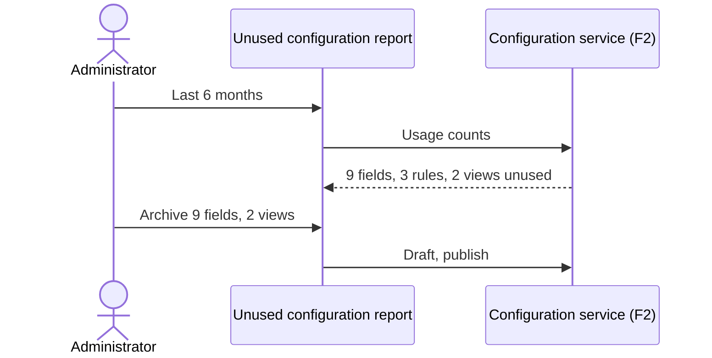

🏠 [Specs](../../../../README.md) › 🧩 [Functional capabilities](../../../README.md) ›
🔧 [F2 No-code configuration](../../README.md) › 📝 [Use cases](../README.md) ›
📝 [Use cases: FL-F2-10 Change safely](README.md) › 📝 UC-F2-26 Find unused configuration

# 📝 UC-F2-26 Find unused configuration

**Status:** 🔄 waiting for the owner

## Summary

The administrator reads the fields, rules, views, templates and record types nobody used in a period, and archives them.

## Personas

- [U07 Administrator](../../../../01-users/personas/u07-administrator.md)

## Goal

A configuration that stays simple.

## Trigger

A quarterly clean-up, or before a pack upgrade.

## Frequency

Quarterly (Proposed).

## Preconditions

- None.

## Postconditions

- **Succeeded:** the items chosen are archived ([BR-F2-01](../../business-rules/br-f02-01-archive-never-delete.md)).
- **Failed:** nothing changes.

## Main flow

1. The administrator opens the Unused configuration report
   ([S-F2-25](../../screens/10-change-safely/s-f02-25-unused-configuration-report.md)).
2. It lists items never used in the period: fields never filled, rules never fired, views never opened, templates never
   printed, record types with no record.
3. For each, the impact list shows if anything still refers to it.
4. The administrator archives the chosen items as one draft, which publishes as any change.

## Alternative flows

- 2a. The administrator changes the period: 90 days, 6 months, a year.

## Error flows

- 3e. An item used by a plugin: cannot be archived, with the plugin named.

## Business rules

- [BR-F2-01 Archive, never delete](../../business-rules/br-f02-01-archive-never-delete.md)
- [BR-F2-22 A change that breaks something is not published unread](../../business-rules/br-f02-22-a-change-that-breaks-something-is-not-published-unread.md)

## Entities

- [E-F2-10 Configuration version](../../data/e-f02-10-configuration-version.md)

## Permissions

Administrators; configurators read it.

## Notifications

None.

## Audit events

Items archived from the report.

## AI involvement

The build assistant can draft it from a plain description
([UC-F2-15](../07-benchmark-additions/uc-f02-15-build-with-plain-language.md)); what it builds is a draft for the
configurator to check and publish ([BR-F2-17](../../business-rules/br-f02-17-ai-built-items-are-drafts.md)).

## API, MCP and A2A exposure

T5 configuration operations with the Configurator rights; the MCP tool of F2 reads it; no A2A skill.

## Screens

- [S-F2-25 Unused configuration report](../../screens/10-change-safely/s-f02-25-unused-configuration-report.md)

## Flowchart

See [FL-F2-10 Change safely](../../flows/fl-f02-10-change-safely.md#flowchart).

## Sequence diagram

## Acceptance criteria

1. **Given** the field Fax filled on no record for 6 months **when** the report runs **then** Fax is listed with 0 uses.
2. **Given** Fax used by a document template **when** it is selected **then** the template is shown as still referring
   to it.
3. **Given** 9 fields archived **when** the draft publishes **then** they no longer show on forms and their data is
   kept.

## Non-functional notes

None.

## Regulatory references

None.

## Related use cases

- [UC-F2-23 See the impact of a change before publishing](uc-f02-23-see-the-impact-of-a-change-before-publishing.md)
- [UC-F2-10 Roll a configuration back](../05-publish-and-roll-back/uc-f02-10-roll-a-configuration-back.md)

## Open questions

None.

---

⬅️ [UC-F2-25](uc-f02-25-merge-a-sector-pack-upgrade-with-local-changes.md) · ⬆️ [Up](README.md) ·
➡️ [UC-F2-27](../11-rights-translations-and-approvals/uc-f02-27-set-field-level-rights-and-validation-rules.md)
