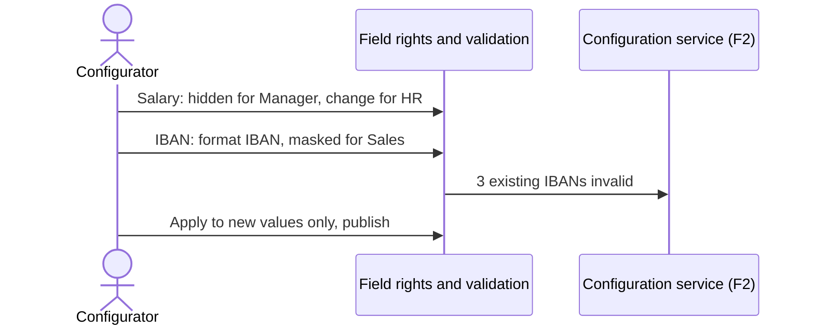

🏠 [Specs](../../../../README.md) › 🧩 [Functional capabilities](../../../README.md) ›
🔧 [F2 No-code configuration](../../README.md) › 📝 [Use cases](../README.md) ›
📝 [Use cases: FL-F2-11 Rights, translations and approvals](README.md) ›
📝 UC-F2-27 Set field-level rights and validation rules

# 📝 UC-F2-27 Set field-level rights and validation rules

**Status:** ✅ specified

## Summary

A configurator sets, per field, which roles see it, change it or see it masked, and the rules a value must meet (format,
range, required when).

## Personas

- [U07 Administrator](../../../../01-users/personas/u07-administrator.md)
- [U06 Human resources](../../../../01-users/personas/u06-hr.md)

## Goal

Sensitive fields hidden everywhere, and wrong values refused at entry.

## Trigger

A field holds sensitive data (salary, health, bank details) or must follow a format.

## Frequency

At setup, then as fields are added.

## Preconditions

- The field exists ([UC-F2-01](../01-configure-a-record-type/uc-f02-01-add-a-custom-field-to-a-record-type.md)).

## Postconditions

- **Succeeded:** the field is shown, masked or hidden per role on every channel
  ([BR-F2-25](../../business-rules/br-f02-25-field-rights-apply-on-every-channel.md)), and its values checked.
- **Failed:** the field stays as it was.

## Main flow

1. The configurator opens the field,
   [S-F2-26](../../screens/11-rights-translations-and-approvals/s-f02-26-field-rights-and-validation.md).
2. Per role: hidden, masked (the last four characters), read, or change.
3. They add validation: a format (IBAN, SIRET, phone), a range, required when another field has a value, unique.
4. They preview as each role and publish; the rule applies on screens, imports, the API, exports and the AI assistant.

## Alternative flows

- 3a. A validation with a custom message in each language
  ([UC-F2-28](uc-f02-28-translate-custom-labels-and-statuses.md)).

## Error flows

- 3e. A validation that existing records break: listed, and the configurator chooses to apply it to new values only.
- 2e. Hiding a field required by a role's layout: refused
  ([BR-F2-07](../../business-rules/br-f02-07-layout-is-not-security.md)).

## Business rules

- [BR-F2-25 Field rights apply on every channel](../../business-rules/br-f02-25-field-rights-apply-on-every-channel.md)
- [BR-F2-03 Field visibility per role](../../business-rules/br-f02-03-field-visibility-per-role.md)
- [BR-F2-07 Layout is not security](../../business-rules/br-f02-07-layout-is-not-security.md)

## Entities

- [E-F2-22 Field rule](../../data/e-f02-22-field-rule.md)
- [E-F2-01 Custom field](../../data/e-f02-01-custom-field.md)

## Permissions

The Configurator role ([D96](../../../../06-decisions/f02-no-code-configuration/d96-configurator-role.md));
administrators. Record rules of the record type apply to the data shown.

## Notifications

None.

## Audit events

Field rights and validations changed, before and after.

## AI involvement

The build assistant can draft it from a plain description
([UC-F2-15](../07-benchmark-additions/uc-f02-15-build-with-plain-language.md)); what it builds is a draft for the
configurator to check and publish ([BR-F2-17](../../business-rules/br-f02-17-ai-built-items-are-drafts.md)).

## API, MCP and A2A exposure

T5 configuration operations with the Configurator rights; the MCP tool of F2 reads it; no A2A skill.

## Screens

- [S-F2-26 Field rights and validation](../../screens/11-rights-translations-and-approvals/s-f02-26-field-rights-and-validation.md)

## Flowchart

See [FL-F2-11 Rights, translations and approvals](../../flows/fl-f02-11-rights-translations-and-approvals.md#flowchart).

## Sequence diagram

## Acceptance criteria

1. **Given** Salary hidden for Manager **when** a manager exports the employee list **then** the export has no salary
   column.
2. **Given** IBAN masked for Sales **when** a seller opens a customer **then** she sees ****1234.
3. **Given** an IBAN validation **when** FR76 1234 is typed **then** it is refused with the message.
4. **Given** 3 existing invalid IBANs **when** the validation is published for new values only **then** the 3 records
   are listed to fix.

## Non-functional notes

None.

## Regulatory references

GDPR: data protection by design
([CR-FR-050](../../../../10-country-packs/france/data-protection/cr-fr-050-privacy-by-design.md)).

## Related use cases

- [UC-F2-01 Add a custom field to a record type](../01-configure-a-record-type/uc-f02-01-add-a-custom-field-to-a-record-type.md)
- [UC-F1-06 Edit a role and its record rules](../../../f01-administration/use-cases/04-edit-a-role/uc-f01-06-edit-a-role-and-its-record-rules.md)

## Open questions

None.

---

⬅️ [UC-F2-26 Find unused configuration](../10-change-safely/uc-f02-26-find-unused-configuration.md) ·
⬆️ [Up](README.md) ·
➡️ [UC-F2-28 Translate custom labels and statuses](uc-f02-28-translate-custom-labels-and-statuses.md)
