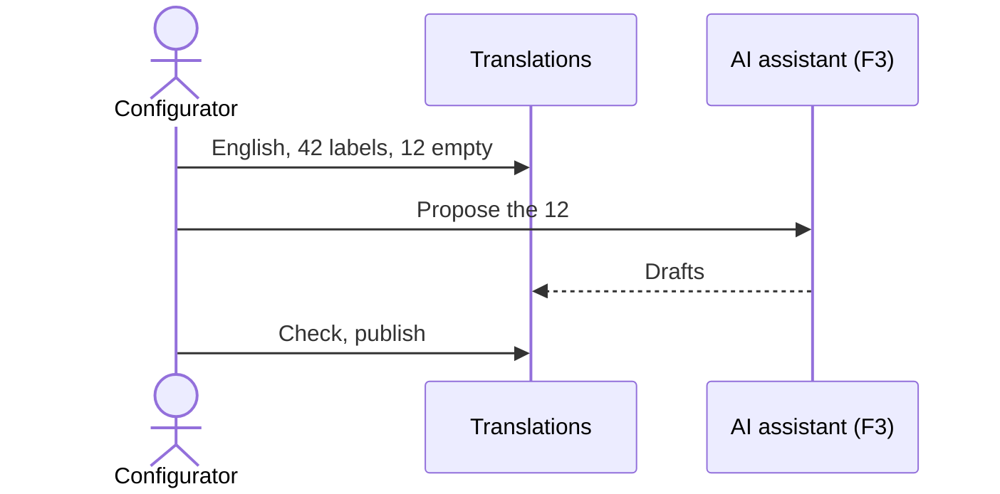

🏠 [Specs](../../../../README.md) › 🧩 [Functional capabilities](../../../README.md) ›
🔧 [F2 No-code configuration](../../README.md) › 📝 [Use cases](../README.md) ›
📝 [Use cases: FL-F2-11 Rights, translations and approvals](README.md) › 📝 UC-F2-28 Translate custom labels and statuses

# 📝 UC-F2-28 Translate custom labels and statuses

**Status:** ✅ specified

## Summary

A configurator translates the labels, help texts, statuses, list values and messages of custom fields and record types
into the company's languages.

## Personas

- [U07 Administrator](../../../../01-users/personas/u07-administrator.md)

## Goal

Every user sees the company's own configuration in their language.

## Trigger

A new language for users, or a new field.

## Frequency

At each configuration change in a company with several languages.

## Preconditions

- The company has more than one language
  ([D104](../../../../06-decisions/f02-no-code-configuration/d104-labels-per-language.md)).

## Postconditions

- **Succeeded:** each label shows in the user's language, or falls back,
  [BR-F2-26](../../business-rules/br-f02-26-a-missing-translation-falls-back-to-the-company-language.md).
- **Failed:** labels stay as they were.

## Main flow

1. The configurator opens Translations
   ([S-F2-27](../../screens/11-rights-translations-and-approvals/s-f02-27-translations.md)) and picks a language.
2. Every custom label, help text, status and list value shows with its translation or empty.
3. They type or import translations, or ask the AI assistant to propose them.
4. They publish; users of that language see the translations.

## Alternative flows

- 3a. Export and import as a file for a translator (XLIFF or CSV).

## Error flows

- 4e. A translation longer than the field's space: warned with a preview.

## Business rules

- [BR-F2-26 A missing translation falls back to the company language](../../business-rules/br-f02-26-a-missing-translation-falls-back-to-the-company-language.md)

## Entities

- [E-F2-23 Translation](../../data/e-f02-23-translation.md)

## Permissions

The Configurator role ([D96](../../../../06-decisions/f02-no-code-configuration/d96-configurator-role.md));
administrators. Record rules of the record type apply to the data shown.

## Notifications

None.

## Audit events

Translations changed.

## AI involvement

The build assistant can draft it from a plain description
([UC-F2-15](../07-benchmark-additions/uc-f02-15-build-with-plain-language.md)); what it builds is a draft for the
configurator to check and publish ([BR-F2-17](../../business-rules/br-f02-17-ai-built-items-are-drafts.md)).

## API, MCP and A2A exposure

T5 configuration operations with the Configurator rights; the MCP tool of F2 reads it; no A2A skill.

## Screens

- [S-F2-27 Translations](../../screens/11-rights-translations-and-approvals/s-f02-27-translations.md)

## Flowchart

See [FL-F2-11 Rights, translations and approvals](../../flows/fl-f02-11-rights-translations-and-approvals.md#flowchart).

## Sequence diagram

## Acceptance criteria

1. **Given** the status "À planifier" without English **when** an English user opens the list **then** she sees "À
   planifier", the company language, as fallback.
2. **Given** the English "To plan" published **when** she opens it again **then** she sees "To plan".
3. **Given** 12 empty labels **when** the AI assistant proposes them **then** they are drafts until the configurator
   publishes.

## Non-functional notes

None.

## Regulatory references

None.

## Related use cases

- [UC-F2-01 Add a custom field to a record type](../01-configure-a-record-type/uc-f02-01-add-a-custom-field-to-a-record-type.md)
- [UC-F2-02 Change the statuses of a record type](../01-configure-a-record-type/uc-f02-02-change-the-statuses-of-a-record-type.md)

## Open questions

None.

---

⬅️ [UC-F2-27 Set field-level rights and validation rules](uc-f02-27-set-field-level-rights-and-validation-rules.md) ·
⬆️ [Up](README.md) · ➡️ [UC-F2-29 Set up an approval chain](uc-f02-29-set-up-an-approval-chain.md)
