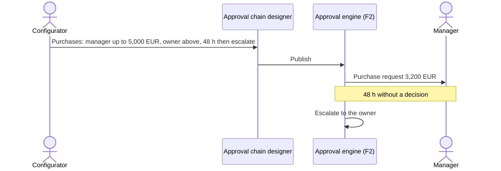

🏠 [Specs](../../../../README.md) › 🧩 [Functional capabilities](../../../README.md) ›
🔧 [F2 No-code configuration](../../README.md) › 📝 [Use cases](../README.md) ›
📝 [Use cases: FL-F2-11 Rights, translations and approvals](README.md) › 📝 UC-F2-29 Set up an approval chain

# 📝 UC-F2-29 Set up an approval chain

**Status:** ✅ specified

## Summary

A configurator sets one approval chain used by every block (purchases, expenses, leave, quotes, bookings, custom
records): levels by amount, parallel approvers, escalation on timeout.

## Personas

- [U07 Administrator](../../../../01-users/personas/u07-administrator.md)
- [U02 Manager](../../../../01-users/personas/u02-manager.md)
- [U13 Owner](../../../../01-users/personas/u13-owner.md)

## Goal

Approvals that work the same way everywhere and never wait forever.

## Trigger

A record type needs approval, or the company changes its limits.

## Frequency

At setup, then yearly.

## Preconditions

- Users have managers; amount limits per role or person.

## Postconditions

- **Succeeded:** records of that type follow the chain,
  [BR-F2-27](../../business-rules/br-f02-27-every-approval-follows-its-chain-and-never-waits-forever.md).
- **Failed:** the current chain stays.

## Main flow

1. The configurator opens the record type's Approvals
   ([S-F2-28](../../screens/11-rights-translations-and-approvals/s-f02-28-approval-chain-designer.md)).
2. They add levels: who approves (the manager, a role, a named person, the owner), from which amount, one or all of
   several approvers.
3. They set the time limit and the escalation: to the next level, or to the approver's manager.
4. They test with sample amounts ([UC-F2-24](../10-change-safely/uc-f02-24-test-rules-and-workflows-with-test-cases.md))
   and publish.
5. Requests follow the chain; approvers decide from their list,
   [UC-F1-17](../../../f01-administration/use-cases/11-team-delegation-and-access-review/uc-f01-17-see-my-teams-accounts-and-pending-requests.md),
   or the notification.

## Alternative flows

- 5a. The approver delegated,
  [UC-F1-16](../../../f01-administration/use-cases/11-team-delegation-and-access-review/uc-f01-16-delegate-approvals-during-an-absence.md),
  the deputy decides.
- 2a. A condition other than amount: a supplier category, a project, a site.

## Error flows

- 2e. A level with nobody to approve (role empty): refused at publish.
- 5e. The requester is the approver: it goes to the next level.

## Business rules

- [BR-F2-27 Every approval follows its chain and never waits forever](../../business-rules/br-f02-27-every-approval-follows-its-chain-and-never-waits-forever.md)
- [BR-F1-24 A deputy approves within the delegator's limits](../../../f01-administration/business-rules/br-f01-24-a-deputy-approves-within-the-delegators-limits.md)

## Entities

- [E-F2-24 Approval chain](../../data/e-f02-24-approval-chain.md)

## Permissions

The Configurator role ([D96](../../../../06-decisions/f02-no-code-configuration/d96-configurator-role.md));
administrators. Record rules of the record type apply to the data shown.

## Notifications

Approvers are told of each request, reminded before escalation, requesters of the decision.

## Audit events

Chain changes; each decision with level, approver and time.

## AI involvement

The build assistant can draft it from a plain description
([UC-F2-15](../07-benchmark-additions/uc-f02-15-build-with-plain-language.md)); what it builds is a draft for the
configurator to check and publish ([BR-F2-17](../../business-rules/br-f02-17-ai-built-items-are-drafts.md)).

## API, MCP and A2A exposure

T5 configuration operations with the Configurator rights; the MCP tool of F2 reads it; no A2A skill.

## Screens

- [S-F2-28 Approval chain designer](../../screens/11-rights-translations-and-approvals/s-f02-28-approval-chain-designer.md)
- [S-F1-17 My team](../../../f01-administration/screens/11-team-delegation-and-access-review/s-f01-17-my-team.md)

## Flowchart

See [FL-F2-11 Rights, translations and approvals](../../flows/fl-f02-11-rights-translations-and-approvals.md#flowchart).

## Sequence diagram

## Acceptance criteria

1. **Given** purchases above 5,000 EUR go to the owner **when** a request of 6,200 EUR is submitted **then** it goes to
   the manager, then to the owner.
2. **Given** a 48-hour limit **when** the manager does not decide in 48 hours **then** it escalates to the owner.
3. **Given** two parallel approvers, both required **when** one approves **then** it waits for the second.
4. **Given** a level whose role has no user **when** the chain is published **then** it is refused.

## Non-functional notes

None.

## Regulatory references

None.

## Related use cases

- [UC-F7-01 Request and approve a purchase](../../../f07-purchasing-and-stock/use-cases/01-procure/uc-f07-01-request-and-approve-a-purchase.md)
- [UC-F8-12 Submit and approve expenses](../../../f08-accounting/use-cases/02-purchase-to-pay/uc-f08-12-submit-and-approve-expenses.md)
- [UC-F9-09 Request and approve time off](../../../f09-hr-and-projects/use-cases/03-time/uc-f09-09-request-and-approve-time-off.md)
- [UC-F1-16 Delegate approvals during an absence](../../../f01-administration/use-cases/11-team-delegation-and-access-review/uc-f01-16-delegate-approvals-during-an-absence.md)

## Open questions

None.

---

⬅️ [UC-F2-28 Translate custom labels and statuses](uc-f02-28-translate-custom-labels-and-statuses.md) ·
⬆️ [Up](README.md) ·
➡️ [UC-F2-30 Set up a request type](../12-set-up-request-types/uc-f02-30-set-up-a-request-type.md)
