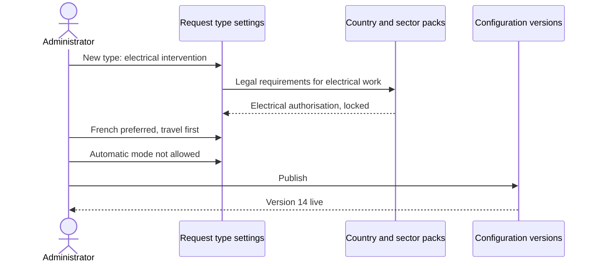

🏠 [Specs](../../../../README.md) › 🧩 [Functional capabilities](../../../README.md) ›
🔧 [F2 No-code configuration](../../README.md) › 📝 [Use cases](../README.md) ›
📝 [Use cases: FL-F2-12 Set up request types](README.md) › 📝 UC-F2-30 Set up a request type

# 📝 UC-F2-30 Set up a request type

**Status:** 🔄 draft (GH-2 step S4b, from VD-27 to VD-29, VD-32, VD-33 / D509 to D511, D514, D515)

## Summary

A configurator sets, for one type of customer request, what scheduling takes into account: the default duration, the
attributes chosen from the four families, each required or preferred with a weight, the weights of the objectives, and
whether the automatic mode is allowed. The legal requirements of the country and sector packs come with the type and
are always required.

## Personas

- [U07 Administrator](../../../../01-users/personas/u07-administrator.md), and the configurators of
  [D96](../../../../06-decisions/f02-no-code-configuration/d96-configurator-role.md)

## Goal

Each request type asks scheduling for the right people, in the order of what matters to the company.

## Trigger

A new kind of work; a change in what a kind of work requires; a new country or sector pack.

## Frequency

At set-up, then a few times a year.

## Preconditions

- The qualification types are loaded from the packs
  ([E-F9-30](../../../f09-hr-and-projects/data/e-f09-30-qualification-type.md)).

## Postconditions

- **Succeeded:** the request type is published; every new work request of that type uses it.
- **Failed:** the draft stays unpublished; work requests keep the previous version.

## Main flow

1. The configurator opens the request types and a type, or creates one
   ([S-F2-29](../../screens/12-set-up-request-types/s-f02-29-request-type-settings.md)).
2. They set the default duration.
3. SimpleERP shows the legal requirements the packs tie to this kind of work, marked "required by law", locked
   ([BR-F9-26](../../../f09-hr-and-projects/business-rules/br-f09-26-legal-requirements-never-relaxed.md)).
4. They choose attributes from the four families: degrees and qualifications; skills and languages; place and travel;
   person and contract.
5. For each, they choose "required" (excludes anyone without it) or "preferred" with a weight.
6. They order or weight the objectives: lateness, travel, customer preferences, fair workload, cost and margin; the
   default order comes from
   [BR-F9-35](../../../f09-hr-and-projects/business-rules/br-f09-35-default-order-of-objectives.md) (D517).
7. They allow or not the automatic mode for this type.
8. They publish, as any configuration change
   ([UC-F2-09](../05-publish-and-roll-back/uc-f02-09-draft-preview-and-publish-a-change.md)).

## Alternative flows

- 1a. From a template of the sector pack (a home-care visit, a delivery, an electrical intervention) (Proposed).
- 7a. (Proposed) Before publishing, a preview counts the people eligible today with the attributes chosen.

## Error flows

- 3e. The configurator tries to make a legal requirement preferred, or to remove it: refused, with the text it comes
  from.
- 5e. A required attribute that nobody has: a warning on publishing (Proposed); publishing stays possible.
- 8e. Publishing fails a check of the configuration (BR-F2-22, BR-F2-23): the draft is kept with the reasons.

## Business rules

- [BR-F9-25](../../../f09-hr-and-projects/business-rules/br-f09-25-required-attributes-exclude.md)
- [BR-F9-26](../../../f09-hr-and-projects/business-rules/br-f09-26-legal-requirements-never-relaxed.md)
- [BR-F9-35](../../../f09-hr-and-projects/business-rules/br-f09-35-default-order-of-objectives.md)
- [BR-F2-22](../../business-rules/br-f02-22-a-change-that-breaks-something-is-not-published-unread.md)
- [BR-F2-23](../../business-rules/br-f02-23-a-failing-test-case-blocks-the-publish.md)

## Entities

- [E-F2-25 Request type](../../data/e-f02-25-request-type.md): created, changed
- [E-F9-30 Qualification type](../../../f09-hr-and-projects/data/e-f09-30-qualification-type.md): read
- [E-F2-10 Configuration version](../../data/e-f02-10-configuration-version.md): created

## Permissions

The administrator; configurators on the record types their other roles can see
([D96](../../../../06-decisions/f02-no-code-configuration/d96-configurator-role.md)). Whether a type allows the
automatic mode is set here; switching the mode on is UC-F9-34.

## Notifications

- The planners of the teams using the type: the type changed, with what changed.

## Audit events

Request type created, changed (old and new attributes, weights, objectives), published, retired.

## AI involvement

The AI assistant may draft a request type from a description ("a bathing help visit needs a carer qualification, French
spoken if possible"); the draft is a draft (BR-F2-17) and the configurator publishes.

## API, MCP and A2A exposure

T5 configuration operations of F2 with the caller's rights; the MCP tool of F2; no A2A skill.

## Screens

- [S-F2-29 Request type settings](../../screens/12-set-up-request-types/s-f02-29-request-type-settings.md)
- [S-F2-10 Publish and versions](../../screens/05-publish-and-roll-back/s-f02-10-publish-and-versions.md)

## Flowchart

See [FL-F2-12 Set up request types](../../flows/fl-f02-12-set-up-request-types.md#flowchart).

## Sequence diagram

## Acceptance criteria

1. **Given** a new type "Electrical intervention" **when** it opens **then** the electrical authorisation the France
   pack ties to it shows as required by law and cannot be changed.
2. **Given** the type "Bathing help" **when** the configurator sets "carer qualification" required and "French"
   preferred **then** a work request of that type excludes carers without the qualification and ranks French speakers
   higher.
3. **Given** a type with the automatic mode not allowed **when** a manager opens the automatic scheduling settings
   **then** the type cannot be ticked.
4. **Given** a published change **when** a work request was already scheduled with the previous version **then** it
   keeps its assignment.

## Non-functional notes

D408's targets apply ([Performance](../../../../05-non-functional/performance.md)).

## Regulatory references

[CR-FR-208](../../../../10-country-packs/france/labour/cr-fr-208-young-workers-regulated-work.md);
[CR-FR-209](../../../../10-country-packs/france/labour/cr-fr-209-reinforced-medical-follow-up.md);
[CR-FR-210](../../../../10-country-packs/france/labour/cr-fr-210-qualifications-tied-to-tasks.md).

## Related use cases

- [UC-F2-09](../05-publish-and-roll-back/uc-f02-09-draft-preview-and-publish-a-change.md)
- [UC-F9-33](../../../f09-hr-and-projects/use-cases/12-schedule-customer-requests/uc-f09-33-schedule-a-work-request.md)
- [UC-F9-34](../../../f09-hr-and-projects/use-cases/12-schedule-customer-requests/uc-f09-34-run-the-automatic-scheduling.md)

## Open questions

None.

---

⬅️ [UC-F2-29 Set up an approval chain](../11-rights-translations-and-approvals/uc-f02-29-set-up-an-approval-chain.md) ·
⬆️ [Up](README.md) ·
➡️ [UC-F2-31 Add a low-code script step](../13-low-code-bulk-and-cleaning/uc-f02-31-add-a-low-code-script-step.md)
