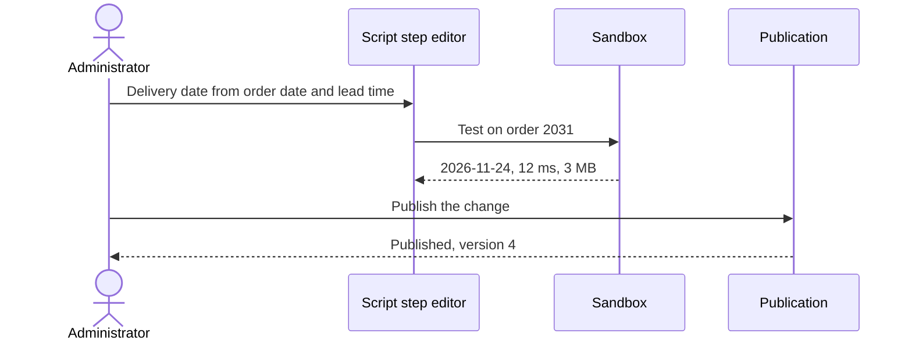

🏠 [Specs](../../../../README.md) › 🧩 [Functional capabilities](../../../README.md) ›
🔧 [F2 No-code configuration](../../README.md) › 📝 [Use cases](../README.md) ›
📝 [Use cases: FL-F2-13 Low code, bulk work and data cleaning](README.md) › 📝 UC-F2-31 Add a low-code script step

# 📝 UC-F2-31 Add a low-code script step

**Status:** ✅ specified

## Summary

When no ready-made step does what a rule or a workflow needs, the administrator or the IT administrator adds a script
step: a few lines in the platform's small scripting language that read the record, compute something and return named
values. The script is tested on a sample record, published like any change, and runs in a sandbox with time and memory
limits.

## Personas

- [U07 Administrator](../../../../01-users/personas/u07-administrator.md)
- [U11 IT provider administrator](../../../../01-users/personas/u11-provider-admin.md), who writes scripts for client
  companies

## Goal

A specific calculation or check is done inside a workflow without waiting for a new product feature.

## Trigger

A rule or workflow needs a computation the ready-made steps do not offer: a delivery date from three fields, a check of
a reference format, a rounding rule of a client.

## Frequency

A few scripts per company, written once and changed rarely.

## Preconditions

- A rule or a workflow exists to hold the step ([E-F2-08 Automation rule](../../data/e-f02-08-automation-rule.md),
  [E-F2-09 Workflow](../../data/e-f02-09-workflow.md)).
- The user has the right to edit rules and workflows and the sandbox is available
  ([UC-F2-16](../07-benchmark-additions/uc-f02-16-try-a-change-in-a-sandbox.md)).
- The rule account the script runs under never exceeds its author's rights
  ([BR-F2-12](../../business-rules/br-f02-12-rule-accounts-never-exceed-their-author.md)).

## Postconditions

- **Succeeded:** the script step is published in its workflow
  ([E-F2-30 Script step](../../data/e-f02-30-script-step.md)), each run is logged with its time and memory and its
  result, and a run that exceeds a limit is stopped.
- **Failed:** the step stays a draft and the workflow runs as before.

## Main flow

1. In the workflow designer ([S-F2-09](../../screens/04-design-a-visual-workflow/s-f02-09-workflow-designer.md)) the
   user adds a step of the kind Script; the script editor opens
   ([S-F2-31](../../screens/13-low-code-bulk-and-cleaning/s-f02-31-script-step-editor.md)).
2. The user names the inputs (fields of the record), writes the script and names the outputs, each with a type; the
   editor checks the syntax as the user types and lists what the script may call.
3. The user picks a sample record and runs the test: the editor shows the outputs, the time and the memory used.
4. The user checks the limits: 2 seconds and 64 MB by default, within the company's maximum
   ([BR-F2-28](../../business-rules/br-f02-28-scripts-run-sandboxed-within-time-and-memory-limits.md)).
5. The impact analysis shows the workflows, rules and documents that use the outputs
   ([UC-F2-23](../10-change-safely/uc-f02-23-see-the-impact-of-a-change-before-publishing.md)); the test cases run
   ([UC-F2-24](../10-change-safely/uc-f02-24-test-rules-and-workflows-with-test-cases.md)).
6. The user publishes the change with the other changes of the draft
   ([UC-F2-09](../05-publish-and-roll-back/uc-f02-09-draft-preview-and-publish-a-change.md)).
7. At run time the step runs in its sandbox; its outputs feed the next steps.

## Alternative flows

- 2a. The user asks the AI assistant to draft the script from a sentence; the draft is read and tested by the user
  before it can be published ([BR-F2-17](../../business-rules/br-f02-17-ai-built-items-are-drafts.md)).
- 3a. The user tests with a record that makes the script fail: the editor shows the error line and the values it had.
- 7a. A published script is changed: the previous version stays available to roll back
  ([UC-F2-10](../05-publish-and-roll-back/uc-f02-10-roll-a-configuration-back.md)).

## Error flows

- 4e. A test run exceeds a limit: it is stopped, shown as Over limit with the time or memory reached and the script
  cannot be published
  ([BR-F2-28](../../business-rules/br-f02-28-scripts-run-sandboxed-within-time-and-memory-limits.md)).
- 6e. The script reads a field the author may not read: refused
  ([BR-F2-25](../../business-rules/br-f02-25-field-rights-apply-on-every-channel.md)).
- 7e. At run time the script exceeds a limit or fails: the step is marked failed, its changes are not saved, and the
  workflow follows its error path ([BR-F2-13](../../business-rules/br-f02-13-rules-cannot-loop.md)).
- 2e. The script tries to reach the network, a file or another company's data: it cannot, those calls do not exist in
  the language.
- Any step: a service does not answer; the call is retried first
  ([BR-F3-32](../../../f03-assistant/business-rules/br-f03-32-retry-before-an-error.md)), then the message follows the
  error pattern ([D122](../../../../06-decisions/ux/d122-error-message-standard.md)) and the draft script stays as it
  was.

## Business rules

- [BR-F2-28 Scripts run sandboxed within time and memory limits](../../business-rules/br-f02-28-scripts-run-sandboxed-within-time-and-memory-limits.md)
- [BR-F2-12 Rule accounts never exceed their author](../../business-rules/br-f02-12-rule-accounts-never-exceed-their-author.md)
- [BR-F2-13 Rules cannot loop](../../business-rules/br-f02-13-rules-cannot-loop.md)
- [BR-F2-16 A sandbox never touches live data](../../business-rules/br-f02-16-sandbox-never-touches-live-data.md)
- [BR-F2-17 What the AI builds is a draft](../../business-rules/br-f02-17-ai-built-items-are-drafts.md)
- [BR-F2-25 Field rights apply on every channel](../../business-rules/br-f02-25-field-rights-apply-on-every-channel.md)

## Entities

- [E-F2-30 Script step](../../data/e-f02-30-script-step.md): created, changed
- [E-F2-09 Workflow](../../data/e-f02-09-workflow.md): changed
- [E-F2-08 Automation rule](../../data/e-f02-08-automation-rule.md): changed
- [E-F2-10 Configuration version](../../data/e-f02-10-configuration-version.md): created at publication

## Permissions

The users who may edit rules and workflows. A script runs with its author's rights at most
([BR-F2-12](../../business-rules/br-f02-12-rule-accounts-never-exceed-their-author.md)) and sees only the fields it
declares as inputs.

## Notifications

- The author: a published script step that failed in production, with the record and the error.
- The administrator: a script that reached 80 % of its limits several times.

## Audit events

Each version of a script with its author and test result, publication, each run that failed or went over a limit, each
change of the limits.

## AI involvement

The AI assistant may draft or explain a script
([BR-F2-17](../../business-rules/br-f02-17-ai-built-items-are-drafts.md)): the draft is never published without a
person's test and publication.

## API, MCP and A2A exposure

T5 operations of F2 to read scripts and their runs; publishing goes through the draft and publication screens.
An MCP tool may draft a script, never publish it. No A2A skill.

## Screens

- [S-F2-31 Script step editor](../../screens/13-low-code-bulk-and-cleaning/s-f02-31-script-step-editor.md)
- [S-F2-09 Workflow designer](../../screens/04-design-a-visual-workflow/s-f02-09-workflow-designer.md)

## Flowchart

See [FL-F2-13 Low code, bulk work and data cleaning](../../flows/fl-f02-13-low-code-bulk-and-cleaning.md#flowchart).

## Sequence diagram

## Acceptance criteria

1. **Given** a script that computes a delivery date **when** the user tests it on a sample record **then** the editor
   shows the result, the time and the memory.
2. **Given** a script that loops without end **when** the test runs **then** it is stopped at the time limit and cannot
   be published.
3. **Given** a script that tries to read a field its author may not read **when** it is saved **then** it is refused.
4. **Given** a published script that fails on one record **when** the workflow runs **then** the step is failed, nothing
   it changed is saved and the workflow takes its error path.
5. **Given** an AI draft of a script **when** the user has not tested it **then** it cannot be published.

## Non-functional notes

A script step adds less than 2 seconds to a workflow run; a sandbox is started in under 100 ms.

## Regulatory references

None: a configuration feature; personal data seen by a script follows the field rights
([BR-F2-25](../../business-rules/br-f02-25-field-rights-apply-on-every-channel.md)).

## Related use cases

- [UC-F2-07 Create a simple rule](../03-automate-with-a-rule/uc-f02-07-create-a-simple-rule.md)
- [UC-F2-08 Design a visual workflow](../04-design-a-visual-workflow/uc-f02-08-design-a-visual-workflow.md)
- [UC-F2-09 Draft, preview and publish a change](../05-publish-and-roll-back/uc-f02-09-draft-preview-and-publish-a-change.md)
- [UC-F2-16 Try a change in a sandbox](../07-benchmark-additions/uc-f02-16-try-a-change-in-a-sandbox.md)
- [UC-F2-24 Test rules and workflows with test cases](../10-change-safely/uc-f02-24-test-rules-and-workflows-with-test-cases.md)

## Open questions

None.

---

⬅️ [UC-F2-30 Set up a request type](../12-set-up-request-types/uc-f02-30-set-up-a-request-type.md) ·
⬆️ [Up](README.md) · ➡️ [UC-F2-32 Edit records in bulk](uc-f02-32-edit-records-in-bulk.md)
