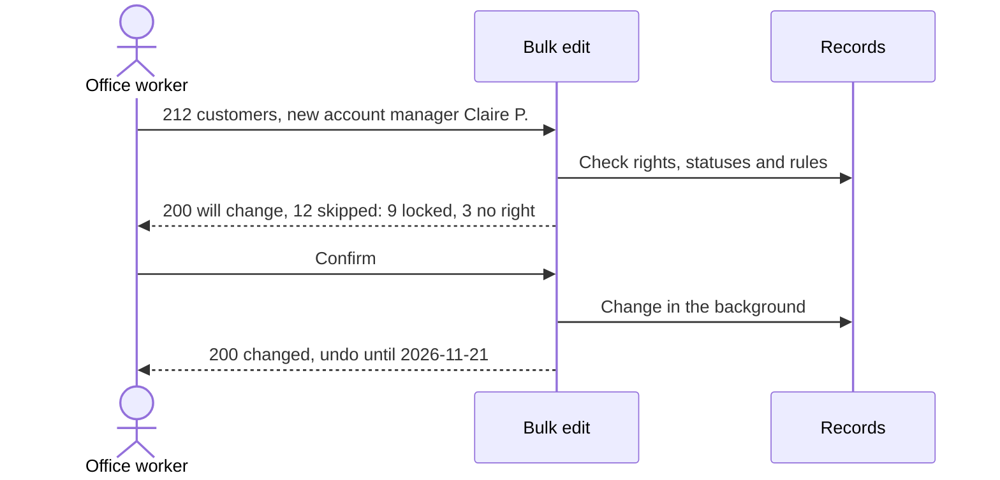

🏠 [Specs](../../../../README.md) › 🧩 [Functional capabilities](../../../README.md) ›
🔧 [F2 No-code configuration](../../README.md) › 📝 [Use cases](../README.md) ›
📝 [Use cases: FL-F2-13 Low code, bulk work and data cleaning](README.md) › 📝 UC-F2-32 Edit records in bulk

# 📝 UC-F2-32 Edit records in bulk

**Status:** ✅ specified

## Summary

From any list, a user selects many records and changes a field, a status, an owner or a tag on all of them in one go, or
runs a mass action. A preview shows what will change and what will be skipped, the change runs in the background, and it
can be undone for 7 days.

## Personas

- [U16 Office worker](../../../../01-users/personas/u16-office-worker.md)
- [U05 Accounting](../../../../01-users/personas/u05-accounting.md), for example to correct accounts on many documents

## Goal

Hundreds of records are corrected in minutes, with no surprise and a way back.

## Trigger

A wrong value found on many records, a reorganisation (a new owner, a new category), or a clean-up before a closing.

## Frequency

A few times a month per user of the back office.

## Preconditions

- The user sees the records in a list
  ([S-F2-04](../../screens/01-configure-a-record-type/s-f02-04-list-view-settings.md), any aggregated list).
- The user has the right to change the chosen field on each record
  ([BR-F2-25](../../business-rules/br-f02-25-field-rights-apply-on-every-channel.md)).
- The change is not on a locked status ([BR-F2-05](../../business-rules/br-f02-05-core-statuses-are-locked.md)).

## Postconditions

- **Succeeded:** the changes were applied to the records that allowed them, the others were skipped with a reason
  ([E-F2-31 Bulk operation](../../data/e-f02-31-bulk-operation.md)), and the operation can be undone until its end date.
- **Failed:** no record was changed.

## Main flow

1. The user filters a list and selects rows, or selects all the rows of the filter.
2. The user chooses Edit in bulk ([S-F2-32](../../screens/13-low-code-bulk-and-cleaning/s-f02-32-bulk-edit.md)) and
   picks one or more fields with their new values, or a mass action: change status, assign, tag, archive.
3. simple-ERP shows the preview: how many records will change, a sample before and after, and how many will be skipped
   with the reasons (locked status, no right on the field, a rule that refuses the value).
4. The user confirms; above the batch size limit the confirmation asks to type the number of records
   ([BR-F2-29](../../business-rules/br-f02-29-bulk-changes-are-previewed-and-can-be-undone.md)).
5. The operation runs in the background with its progress; each record is changed as its own user would, with the rules
   and validations of the record type.
6. The user reads the result: changed, skipped, failed.
7. Within 7 days the user may undo the whole operation; records changed since by someone else are left as they are and
   listed.

## Alternative flows

- 2a. The user asks the AI assistant to propose the change from a sentence; the proposal opens the same preview and
  nothing is applied without confirmation
  ([BR-F3-08](../../../f03-assistant/business-rules/br-f03-08-a-batch-is-undone-as-a-whole.md)).
- 7a. The user undoes only the records of a chosen filter of the result.
- 3a. The user exports the preview as a spreadsheet before confirming.

## Error flows

- 3e. The new value is invalid for the field: the preview refuses the change and says which rule.
- 5e. Some records fail while others pass: those that passed are changed, those that failed are listed and can be
  retried.
- 7e. A record changed again since the operation: it is not undone and is listed with its new value.
- Any step: a service does not answer; the call is retried first
  ([BR-F3-32](../../../f03-assistant/business-rules/br-f03-32-retry-before-an-error.md)), then the message follows the
  error pattern ([D122](../../../../06-decisions/ux/d122-error-message-standard.md)) and no record changes.

## Business rules

- [BR-F2-29 Bulk changes are previewed and can be undone](../../business-rules/br-f02-29-bulk-changes-are-previewed-and-can-be-undone.md)
- [BR-F2-25 Field rights apply on every channel](../../business-rules/br-f02-25-field-rights-apply-on-every-channel.md)
- [BR-F2-05 Core statuses are locked](../../business-rules/br-f02-05-core-statuses-are-locked.md)
- [BR-F2-01 Archive, never delete](../../business-rules/br-f02-01-archive-never-delete.md)
- [BR-F3-09 Batch size limit](../../../f03-assistant/business-rules/br-f03-09-batch-size-limit.md)

## Entities

- [E-F2-31 Bulk operation](../../data/e-f02-31-bulk-operation.md): created, changed
- [E-F2-01 Custom field](../../data/e-f02-01-custom-field.md): read
- [E-F2-02 Status and transition](../../data/e-f02-02-status-and-transition.md): read

## Permissions

A user changes only the records and fields their roles allow, record by record. The bulk bar is offered to users who may
change at least one field of the list
([BR-F2-25](../../business-rules/br-f02-25-field-rights-apply-on-every-channel.md)).

## Notifications

The user: the operation finished, with the counts, or failed with the reason.

## Audit events

Each operation with its selection, fields, old and new values, counts and the user; each record changed in its own
history; each undo.

## AI involvement

The AI assistant may prepare the selection and the change from words; the user confirms the preview
([BR-F3-08](../../../f03-assistant/business-rules/br-f03-08-a-batch-is-undone-as-a-whole.md),
[BR-F3-09](../../../f03-assistant/business-rules/br-f03-09-batch-size-limit.md)).

## API, MCP and A2A exposure

T5 operations of F2 for bulk changes with a preview and a confirmation; an MCP tool may prepare a preview,
never confirm it. No A2A skill.

## Screens

- [S-F2-32 Bulk edit](../../screens/13-low-code-bulk-and-cleaning/s-f02-32-bulk-edit.md)

## Flowchart

See [FL-F2-13 Low code, bulk work and data cleaning](../../flows/fl-f02-13-low-code-bulk-and-cleaning.md#flowchart).

## Sequence diagram

## Acceptance criteria

1. **Given** 212 customers selected **when** the user sets a new account manager **then** the preview shows 200 to
   change and 12 skipped with reasons.
2. **Given** a record on a locked status **when** the change runs **then** it is skipped, never forced.
3. **Given** a field the user may not change **when** the preview is shown **then** those records are skipped with the
   reason.
4. **Given** a finished operation **when** the user undoes it within 7 days **then** every record changed returns to its
   old value.
5. **Given** a record changed again by someone else **when** the operation is undone **then** that record is left as it
   is and listed.

## Non-functional notes

1,000 records are previewed in 5 seconds and changed in 2 minutes; the user keeps working while it runs.

## Regulatory references

None: a configuration and productivity feature; personal data changed in bulk is in the audit trail.

## Related use cases

- [UC-F2-27 Set field-level rights and validation rules](../11-rights-translations-and-approvals/uc-f02-27-set-field-level-rights-and-validation-rules.md)
- [UC-F2-35 Clean duplicates and stale records](uc-f02-35-clean-duplicates-and-stale-records.md)
- [UC-F3-03 Have the AI assistant create or change records](../../../f03-assistant/use-cases/03-act-through-the-assistant/uc-f03-03-have-the-assistant-create-or-change-records.md)
- [UC-F1-14 Invite users in bulk](../../../f01-administration/use-cases/10-bring-users-in-at-scale/uc-f01-14-invite-users-in-bulk.md)

## Open questions

None.

---

⬅️ [UC-F2-31 Add a low-code script step](uc-f02-31-add-a-low-code-script-step.md) · ⬆️ [Up](README.md) ·
➡️ [UC-F2-33 Set a time-based rule](uc-f02-33-set-a-time-based-rule.md)
