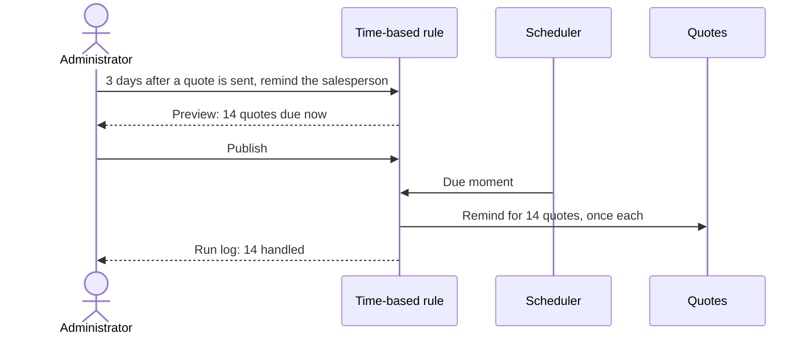

🏠 [Specs](../../../../README.md) › 🧩 [Functional capabilities](../../../README.md) ›
🔧 [F2 No-code configuration](../../README.md) › 📝 [Use cases](../README.md) ›
📝 [Use cases: FL-F2-13 Low code, bulk work and data cleaning](README.md) › 📝 UC-F2-33 Set a time-based rule

# 📝 UC-F2-33 Set a time-based rule

**Status:** ✅ specified

## Summary

The administrator makes a rule fire on time instead of on a change: a number of days after or before a date field (3
days after a quote is sent, 30 days before a contract ends), or on a recurring schedule (every Monday at 08:00, the
first of the month). The condition and the actions are those of any rule, and a time-based rule acts once per record and
period.

## Personas

- [U07 Administrator](../../../../01-users/personas/u07-administrator.md)

## Goal

Reminders, follow-ups and clean-ups happen on time without anyone remembering them.

## Trigger

A step that must happen a set time after or before something else: chase an unsigned quote, warn before a contract ends,
send a weekly digest.

## Frequency

A handful of time-based rules per company, set once.

## Preconditions

- A rule or the rule editor is available ([UC-F2-07](../03-automate-with-a-rule/uc-f02-07-create-a-simple-rule.md),
  [E-F2-08 Automation rule](../../data/e-f02-08-automation-rule.md)).
- The record type has the date field the rule counts from, or the rule is recurring.
- The company's time zone is set ([E-F1-01 Company](../../../f01-administration/data/e-f01-01-company.md)).

## Postconditions

- **Succeeded:** the time-based rule is active ([E-F2-32 Scheduled trigger](../../data/e-f02-32-scheduled-trigger.md)),
  each run handled the due records once and logged its result, and nothing ran twice for the same record and period.
- **Failed:** the rule stays a draft and nothing fires.

## Main flow

1. In the rule editor ([S-F2-08](../../screens/03-automate-with-a-rule/s-f02-08-rule-editor.md)) the user chooses a time
   trigger; the time rule screen opens
   ([S-F2-33](../../screens/13-low-code-bulk-and-cleaning/s-f02-33-time-based-rule.md)).
2. The user picks the kind: an offset from a date field (number, days or hours, before or after) or a recurring schedule
   (every day, week or month, at a time, in the company's time zone).
3. The user sets the condition and the actions as in a simple rule: send an email, create a task, change a status, call
   a workflow.
4. The user sets the window: how long after the due moment a missed run may still fire, 24 hours by default.
5. The preview lists the records that would fire now and those that fire in the next 7 days.
6. The user publishes the rule with the draft
   ([UC-F2-09](../05-publish-and-roll-back/uc-f02-09-draft-preview-and-publish-a-change.md)).
7. At each due moment the scheduler fires the rule for the records due, once per record and period, and writes the run
   log.

## Alternative flows

- 2a. The date field is changed on a record after the rule was planned: the next firing follows the new date, and a
  firing already done is not repeated
  ([BR-F2-30](../../business-rules/br-f02-30-time-based-rules-run-once-per-record-and-period.md)).
- 7a. The system was down at the due time: the missed runs fire when it is back, within the window; older ones are
  skipped and listed.
- 7b. A recurring rule runs for the records that match its condition at that moment.

## Error flows

- 3e. The actions could make the rule loop (a change that triggers another rule): refused as for any rule
  ([BR-F2-13](../../business-rules/br-f02-13-rules-cannot-loop.md)).
- 7e. An action fails for one record: that record is logged as failed, the others continue, and the failed one is
  retried at the next run within its period.
- 2e. The date field is empty on a record: it is skipped and counted.
- Any step: a service does not answer; the call is retried first
  ([BR-F3-32](../../../f03-assistant/business-rules/br-f03-32-retry-before-an-error.md)), then the message follows the
  error pattern ([D122](../../../../06-decisions/ux/d122-error-message-standard.md)) and the rule stays a draft.

## Business rules

- [BR-F2-30 Time-based rules run once per record and period](../../business-rules/br-f02-30-time-based-rules-run-once-per-record-and-period.md)
- [BR-F2-12 Rule accounts never exceed their author](../../business-rules/br-f02-12-rule-accounts-never-exceed-their-author.md)
- [BR-F2-13 Rules cannot loop](../../business-rules/br-f02-13-rules-cannot-loop.md)
- [BR-F2-22 A change that breaks something is not published unread](../../business-rules/br-f02-22-a-change-that-breaks-something-is-not-published-unread.md)

## Entities

- [E-F2-32 Scheduled trigger](../../data/e-f02-32-scheduled-trigger.md): created, changed
- [E-F2-08 Automation rule](../../data/e-f02-08-automation-rule.md): changed
- [E-F2-10 Configuration version](../../data/e-f02-10-configuration-version.md): created at publication

## Permissions

The users who may edit rules. A time-based rule acts with its rule account, never above its author's rights
([BR-F2-12](../../business-rules/br-f02-12-rule-accounts-never-exceed-their-author.md)).

## Notifications

- The author: a run that failed for several records.
- The administrator: a time-based rule that was down and skipped runs.

## Audit events

Each version of the rule, its publication, each run with the number of records due, handled, skipped and failed.

## AI involvement

The AI assistant may draft the rule from a sentence ("chase a quote 3 days after sending it"); it is a draft until a
person publishes it ([BR-F2-17](../../business-rules/br-f02-17-ai-built-items-are-drafts.md)).

## API, MCP and A2A exposure

T5 operations of F2 to read time-based rules and their runs. No MCP tool publishes one and there is no A2A skill.

## Screens

- [S-F2-33 Time-based rule](../../screens/13-low-code-bulk-and-cleaning/s-f02-33-time-based-rule.md)
- [S-F2-08 Rule editor](../../screens/03-automate-with-a-rule/s-f02-08-rule-editor.md)

## Flowchart

See [FL-F2-13 Low code, bulk work and data cleaning](../../flows/fl-f02-13-low-code-bulk-and-cleaning.md#flowchart).

## Sequence diagram

## Acceptance criteria

1. **Given** a rule 3 days after a quote is sent **when** a quote is sent on Monday **then** the reminder fires on
   Thursday.
2. **Given** the same quote **when** the rule runs again the next day **then** no second reminder for that period.
3. **Given** the system down on Thursday **when** it is back on Friday within the window **then** the reminder fires on
   Friday.
4. **Given** a recurring Monday rule **when** the first Monday comes **then** it fires at 08:00 in the company's time
   zone.
5. **Given** a quote without a sent date **when** the rule is due **then** it is skipped and counted.

## Non-functional notes

A run for 10,000 due records starts within 1 minute of the due moment and ends within 10 minutes.

## Regulatory references

None: a configuration feature.

## Related use cases

- [UC-F2-07 Create a simple rule](../03-automate-with-a-rule/uc-f02-07-create-a-simple-rule.md)
- [UC-F2-08 Design a visual workflow](../04-design-a-visual-workflow/uc-f02-08-design-a-visual-workflow.md)
- [UC-F2-09 Draft, preview and publish a change](../05-publish-and-roll-back/uc-f02-09-draft-preview-and-publish-a-change.md)
- [UC-F2-31 Add a low-code script step](uc-f02-31-add-a-low-code-script-step.md)

## Open questions

None.

---

⬅️ [UC-F2-32 Edit records in bulk](uc-f02-32-edit-records-in-bulk.md) · ⬆️ [Up](README.md) ·
➡️ [UC-F2-34 Translate the screens in place](uc-f02-34-translate-the-screens-in-place.md)
