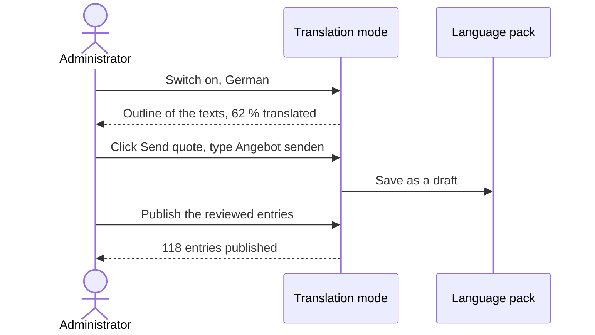

🏠 [Specs](../../../../README.md) › 🧩 [Functional capabilities](../../../README.md) ›
🔧 [F2 No-code configuration](../../README.md) › 📝 [Use cases](../README.md) ›
📝 [Use cases: FL-F2-13 Low code, bulk work and data cleaning](README.md) › 📝 UC-F2-34 Translate the screens in place

# 📝 UC-F2-34 Translate the screens in place

**Status:** ✅ specified

## Summary

The administrator turns on translation mode and clicks any label, button, status or help text on the real screen to
translate it into another language, instead of searching a long list of keys. Each entry is a draft until reviewed, and
the translations of a language ship as a pack that can be exported, imported and kept through product updates.

## Personas

- [U07 Administrator](../../../../01-users/personas/u07-administrator.md)

## Goal

Every screen reads naturally in each language the company uses, translated where it is seen.

## Trigger

A new language for the team or the customers, or a label that reads badly in a language.

## Frequency

Heavily when a language is added, then a few entries a month.

## Preconditions

- The company has at least a second active language
  ([E-F1-01 Company](../../../f01-administration/data/e-f01-01-company.md),
  [E-F2-23 Translation](../../data/e-f02-23-translation.md)).
- The user has the right to edit translations
  ([BR-F2-26](../../business-rules/br-f02-26-a-missing-translation-falls-back-to-the-company-language.md)).
- A source text exists for the label: the company's own or the product's.

## Postconditions

- **Succeeded:** the entries are saved in the pack of the language
  ([E-F2-33 Translation entry](../../data/e-f02-33-translation-entry.md)), shown in the screens once published, and the
  entries whose source text changed are marked outdated.
- **Failed:** the screens keep their previous text.

## Main flow

1. The user switches on translation mode on any screen and chooses the language to translate into
   ([S-F2-34](../../screens/13-low-code-bulk-and-cleaning/s-f02-34-translation-mode.md)).
2. Every translatable text of the screen is outlined; the user clicks one and sees its source text, its current
   translation and the screen it belongs to.
3. The user types the translation, or asks for a machine suggestion that they read and edit; the entry is saved as a
   draft.
4. The user moves through the texts with Next untranslated; the progress shows the share translated.
5. A reviewer (who may be the same user) marks the drafts Reviewed.
6. The user publishes the reviewed entries with the draft
   ([UC-F2-09](../05-publish-and-roll-back/uc-f02-09-draft-preview-and-publish-a-change.md)): the screens now show them
   to everyone who uses that language.
7. The user exports the language pack to keep or to share with another company
   ([BR-F2-31](../../business-rules/br-f02-31-in-place-translations-ship-as-packs.md)).

## Alternative flows

- 3a. The text is a field value or a record's own name, not a label: it is not translatable here; custom labels and
  statuses follow [UC-F2-28](../11-rights-translations-and-approvals/uc-f02-28-translate-custom-labels-and-statuses.md).
- 6a. A product update changes a source text: the entry is marked outdated, the old translation stays shown until a
  person reviews it.
- 7a. The user imports a language pack from another company: entries are added as drafts, never overwriting a reviewed
  entry without confirmation.

## Error flows

- 3e. A translation drops a placeholder (a number or a name the screen inserts): refused with the placeholder shown.
- 6e. A translation is missing at display time: the screen falls back to the company language
  ([BR-F2-26](../../business-rules/br-f02-26-a-missing-translation-falls-back-to-the-company-language.md)).
- 7e. The pack is for a newer product version: entries that do not exist are listed and skipped.
- Any step: a service does not answer; the call is retried first
  ([BR-F3-32](../../../f03-assistant/business-rules/br-f03-32-retry-before-an-error.md)), then the message follows the
  error pattern ([D122](../../../../06-decisions/ux/d122-error-message-standard.md)) and the screens keep their previous
  text.

## Business rules

- [BR-F2-31 In-place translations ship as packs](../../business-rules/br-f02-31-in-place-translations-ship-as-packs.md)
- [BR-F2-26 A missing translation falls back to the company language](../../business-rules/br-f02-26-a-missing-translation-falls-back-to-the-company-language.md)
- [BR-F2-15 Packs carry no data](../../business-rules/br-f02-15-packs-carry-no-data.md)
- [BR-F2-22 A change that breaks something is not published unread](../../business-rules/br-f02-22-a-change-that-breaks-something-is-not-published-unread.md)

## Entities

- [E-F2-33 Translation entry](../../data/e-f02-33-translation-entry.md): created, changed
- [E-F2-23 Translation](../../data/e-f02-23-translation.md): read
- [E-F2-11 Configuration pack](../../data/e-f02-11-configuration-pack.md): created for a pack

## Permissions

The users who may edit translations; a reviewer cannot review their own entry when the company asks for two people
. Everyone sees the published translations.

## Notifications

- The reviewer: entries waiting for review.
- The administrator: entries made outdated by an update.

## Audit events

Each entry created or changed, reviewed and published, with who and when; each import and export of a pack.

## AI involvement

The AI assistant may suggest a translation; it is a draft marked as machine suggested until reviewed
([BR-F2-17](../../business-rules/br-f02-17-ai-built-items-are-drafts.md)).

## API, MCP and A2A exposure

T5 operations of F2 to list, import and export entries and packs. No MCP tool publishes translations and there is no A2A
skill.

## Screens

- [S-F2-34 Translation mode](../../screens/13-low-code-bulk-and-cleaning/s-f02-34-translation-mode.md)
- [S-F2-27 Translations](../../screens/11-rights-translations-and-approvals/s-f02-27-translations.md)

## Flowchart

See [FL-F2-13 Low code, bulk work and data cleaning](../../flows/fl-f02-13-low-code-bulk-and-cleaning.md#flowchart).

## Sequence diagram

## Acceptance criteria

1. **Given** translation mode on in German **when** the user clicks a button **then** its source and its German text are
   shown for editing.
2. **Given** a translation that drops a placeholder **when** it is saved **then** it is refused.
3. **Given** a reviewed pack **when** the user publishes **then** the screens show the German texts to German users.
4. **Given** a product update that changes a source text **when** the update is installed **then** the entry is outdated
   and keeps showing its old text.
5. **Given** a text with no translation **when** a German user opens the screen **then** the company language is shown.

## Non-functional notes

Translation mode does not slow the screen; a pack of 5,000 entries imports in under 1 minute.

## Regulatory references

None: a configuration feature.

## Related use cases

- [UC-F2-28 Translate custom labels and statuses](../11-rights-translations-and-approvals/uc-f02-28-translate-custom-labels-and-statuses.md)
- [UC-F2-11 Export or import a configuration as a pack](../06-share-a-configuration/uc-f02-11-export-or-import-a-configuration-as-a-pack.md)
- [UC-F2-09 Draft, preview and publish a change](../05-publish-and-roll-back/uc-f02-09-draft-preview-and-publish-a-change.md)

## Open questions

None.

---

⬅️ [UC-F2-33 Set a time-based rule](uc-f02-33-set-a-time-based-rule.md) · ⬆️ [Up](README.md) ·
➡️ [UC-F2-35 Clean duplicates and stale records](uc-f02-35-clean-duplicates-and-stale-records.md)
