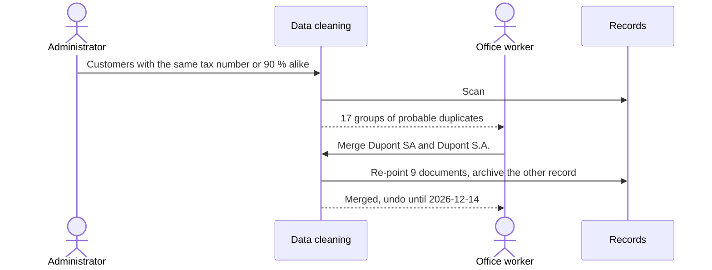

🏠 [Specs](../../../../README.md) › 🧩 [Functional capabilities](../../../README.md) ›
🔧 [F2 No-code configuration](../../README.md) › 📝 [Use cases](../README.md) ›
📝 [Use cases: FL-F2-13 Low code, bulk work and data cleaning](README.md) ›
📝 UC-F2-35 Clean duplicates and stale records

# 📝 UC-F2-35 Clean duplicates and stale records

**Status:** ✅ specified

## Summary

The administrator or an office worker sets cleaning rules that find duplicates (two customers with the same tax number
or a very similar name and address) and stale records (nothing happened for two years). The scan proposes merges and
archivals; a person checks each proposal, chooses what survives, and a merge keeps every link and can be undone for 30
days.

## Personas

- [U07 Administrator](../../../../01-users/personas/u07-administrator.md)
- [U16 Office worker](../../../../01-users/personas/u16-office-worker.md)

## Goal

Master data stays clean without losing a document, a history or a link.

## Trigger

Duplicates found by a user, a migration, an import, or a periodic review of the data.

## Frequency

A scan each night or week, and a review of the proposals a few times a month.

## Preconditions

- The record types to clean and their matching fields are known
  ([E-F2-05 Record type](../../data/e-f02-05-record-type.md)).
- The user may merge and archive records of that type
  ([BR-F2-25](../../business-rules/br-f02-25-field-rights-apply-on-every-channel.md)).
- Records under a legal hold or in a locked status are never proposed
  ([BR-F2-05](../../business-rules/br-f02-05-core-statuses-are-locked.md)).

## Postconditions

- **Succeeded:** the duplicates were merged into one record and the stale ones archived
  ([E-F2-34 Cleaning rule](../../data/e-f02-34-cleaning-rule.md)), every link and document now points to the survivor,
  and the merge can be undone until its end date.
- **Failed:** no record was merged or archived.

## Main flow

1. The administrator opens Data cleaning
   ([S-F2-35](../../screens/13-low-code-bulk-and-cleaning/s-f02-35-data-cleaning.md)) and creates a cleaning rule: the
   record type, the kind (duplicates or stale), the fields compared and the similarity needed, or the age of inactivity.
2. The rule is run as a preview: the screen lists the groups of probable duplicates, each with its similarity, and the
   stale records with their last activity.
3. A user opens a group: the records are shown side by side and the user picks the surviving record and, field by field,
   which value to keep.
4. The user merges: documents, history, tasks, files and relations of the other records are re-pointed to the survivor,
   and the others are archived with a link to it
   ([BR-F2-32](../../business-rules/br-f02-32-merges-keep-every-link-and-an-undo-window.md)).
5. For stale records the user archives the selection; nothing is deleted
   ([BR-F2-01](../../business-rules/br-f02-01-archive-never-delete.md)).
6. The rule is switched on to scan on a schedule and propose; automatic merging is off by default.
7. Within 30 days the user may undo a merge: the archived records come back with their own links.

## Alternative flows

- 2a. The AI assistant suggests the survivor and the values to keep, with its reasons; the user decides
  ([BR-F3-07](../../../f03-assistant/business-rules/br-f03-07-no-deletes-no-irreversible-acts.md)).
- 3a. Two records are not duplicates: the user marks Not a duplicate and the pair is never proposed again.
- 6a. A high-confidence rule is switched to merge by itself for exact tax numbers, after the administrator
  confirms; every automatic merge shows in the list and can be undone.

## Error flows

- 4e. The two records have conflicting values on a field that cannot be both (two tax numbers): the user must choose
  one; nothing is merged until then.
- 4f. A record to merge is locked or under a legal hold: it is left out and listed.
- 7e. A record of the group changed since the merge: it is merged back with its new values listed for the user to check.
- Any step: a service does not answer; the call is retried first
  ([BR-F3-32](../../../f03-assistant/business-rules/br-f03-32-retry-before-an-error.md)), then the message follows the
  error pattern ([D122](../../../../06-decisions/ux/d122-error-message-standard.md)) and the records stay as they were.

## Business rules

- [BR-F2-32 Merges keep every link and an undo window](../../business-rules/br-f02-32-merges-keep-every-link-and-an-undo-window.md)
- [BR-F2-01 Archive, never delete](../../business-rules/br-f02-01-archive-never-delete.md)
- [BR-F2-05 Core statuses are locked](../../business-rules/br-f02-05-core-statuses-are-locked.md)
- [BR-F2-25 Field rights apply on every channel](../../business-rules/br-f02-25-field-rights-apply-on-every-channel.md)
- [BR-F1-34 Purges are logged and never touch legal records](../../../f01-administration/business-rules/br-f01-34-purges-are-logged-and-never-touch-legal-records.md)

## Entities

- [E-F2-34 Cleaning rule](../../data/e-f02-34-cleaning-rule.md): created, changed
- [E-F2-05 Record type](../../data/e-f02-05-record-type.md): read

## Permissions

The administrator writes the cleaning rules; any user who may merge the record type reviews the proposals, each within
the fields they may see ([BR-F2-25](../../business-rules/br-f02-25-field-rights-apply-on-every-channel.md)).

## Notifications

- The reviewers: proposals waiting after a scan.
- The administrator: a rule that found an unusually high number of duplicates.

## Audit events

Each rule and its scans, each proposal accepted or refused, each merge with the survivor and the values kept, each
archival, each undo.

## AI involvement

The AI assistant may suggest which record survives and which values to keep, with reasons; a person confirms
([BR-F3-07](../../../f03-assistant/business-rules/br-f03-07-no-deletes-no-irreversible-acts.md)), and an AI agent never
merges on its own.

## API, MCP and A2A exposure

T5 operations of F2 for rules, proposals and merges with the caller's rights. An MCP tool may list proposals,
never merge. No A2A skill.

## Screens

- [S-F2-35 Data cleaning](../../screens/13-low-code-bulk-and-cleaning/s-f02-35-data-cleaning.md)

## Flowchart

See [FL-F2-13 Low code, bulk work and data cleaning](../../flows/fl-f02-13-low-code-bulk-and-cleaning.md#flowchart).

## Sequence diagram

## Acceptance criteria

1. **Given** two customers with the same tax number **when** the rule scans **then** they are proposed as one group.
2. **Given** a group of duplicates **when** the user merges them **then** every invoice, task and file points to the
   survivor.
3. **Given** a merge done 10 days ago **when** the user undoes it **then** the archived records come back with their
   links.
4. **Given** two records marked Not a duplicate **when** the next scan runs **then** that pair is not proposed again.
5. **Given** a record under a legal hold **when** the scan runs **then** it is never proposed.

## Non-functional notes

A scan of 100,000 records finishes in 15 minutes in the background; a merge of two records takes under 10 seconds.

## Regulatory references

Accurate data: GDPR, [Regulation (EU) 2016/679](https://eur-lex.europa.eu/eli/reg/2016/679/oj), article 5(1)(d);
[CR-FR-052](../../../../10-country-packs/france/data-protection/cr-fr-052-storage-limitation.md).

## Related use cases

- [UC-F2-32 Edit records in bulk](uc-f02-32-edit-records-in-bulk.md)
- [UC-F2-26 Find unused configuration](../10-change-safely/uc-f02-26-find-unused-configuration.md)
- [UC-F1-25 Set retention and purge personal data](../../../f01-administration/use-cases/15-security-and-group-data/uc-f01-25-set-retention-and-purge-personal-data.md)
- [UC-F1-26 Share master data across the group](../../../f01-administration/use-cases/15-security-and-group-data/uc-f01-26-share-master-data-across-the-group.md)

## Open questions

None.

---

⬅️ [UC-F2-34 Translate the screens in place](uc-f02-34-translate-the-screens-in-place.md) · ⬆️ [Up](README.md)
