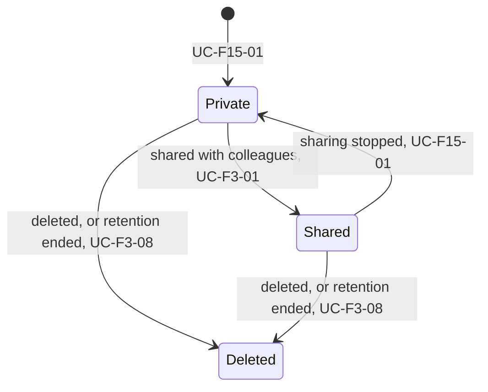

🏠 [Specs](../../../README.md) › 🧩 [Functional capabilities](../../README.md) › 🤖 [F3 Assistant](../README.md) ›
🗃️ [Data](README.md) › 🗃️ E-F3-01 Conversation

# 🗃️ E-F3-01 Conversation

**Status:** ✅ specified

## Purpose

A series of questions and answers between a user and the AI assistant (D141, D177 to D180).

## Fields

| Name | Type | Required | Validation | Default | Example | Personal data | Custom fields |
|---|---|---|---|---|---|---|---|
| title | text | yes | - | the first question, shortened | Turnover Durand | no | no |
| owner | user | yes | - | the user | Marie Dupont | yes | no |
| shared with | users and teams | no | colleagues of the company (BR-F3-26) | - | Paul Martin | yes | no |
| copied from | conversation | no | set by Continue (BR-F3-25) | - | Turnover analysis | no | no |
| folder | conversation folder | no | the owner's | - | Sales review | no | no |
| tags | list | no | - | - | q4 | no | no |
| pinned | yes or no | yes | - | no | yes | no | no |
| started | date and time | yes | - | now | 2026-11-10 15:20 | no | no |
| last message | date and time | yes | - | now | 2026-11-10 15:25 | no | no |
| provider | AI provider | yes | - | per F1 setting | local | no | no |

## Relations

Has many [assistant answers](e-f03-02-assistant-answer.md); may be in a [folder](e-f03-12-conversation-folder.md); may
be a copy of another conversation.

## Lifecycle

## Indexes and search

Full text, for its owner and those it is shared with; by folder and tag.

## Retention

Unused for the retention period (12 months by default, set by the administrator), deleted unless pinned (BR-F3-27);
deleted with the owner's account (GDPR).

## Audit

Shared, sharing stopped, deleted, exported.

## Import and export

Exported by its owner as a document (PDF or Word).

## Used by

- [UC-F3-01](../use-cases/01-ask-the-assistant/uc-f03-01-ask-a-question-about-the-company-s-data.md)
- [UC-F3-08](../use-cases/08-manage-and-share-conversations/uc-f03-08-manage-and-share-conversations.md)

## Open questions

None.

---

⬆️ [Up](README.md) · ➡️ [E-F3-02 Assistant answer](e-f03-02-assistant-answer.md)
