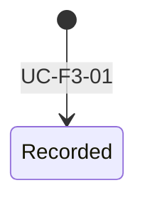

🏠 [Specs](../../../README.md) › 🧩 [Functional capabilities](../../README.md) › 🤖 [F3 Assistant](../README.md) ›
🗃️ [Data](README.md) › 🗃️ E-F3-02 Assistant answer

# 🗃️ E-F3-02 Assistant answer

**Status:** ✅ specified

## Purpose

One answer of the AI assistant, with what it used (D149 to D152).

## Fields

| Name | Type | Required | Validation | Default | Example | Personal data | Custom fields |
|---|---|---|---|---|---|---|---|
| question | text | yes | - | - | Turnover with Durand this year? | maybe | no |
| text | rich text | yes | - | - | 48,200 EUR from 12 invoices | maybe | no |
| sources | links to records and documents | no | the user may see each (BR-F3-02) | - | Durand SA | no | no |
| queries | query descriptions | no | record type, filters, period, fields, count | - | Invoices, 2026, 12 | no | no |
| kind | list | yes | answer, clarifying question, not found, error | answer | answer | no | no |

## Relations

Belongs to one [conversation](e-f03-01-conversation.md).

## Lifecycle

Written once; never changed; deleted with its conversation.

## Indexes and search

Within its conversation.

## Retention

As its conversation.

## Audit

See UC-F3-01's audit events.

## Import and export

Tables export as spreadsheets.

## Used by

- [UC-F3-01](../use-cases/01-ask-the-assistant/uc-f03-01-ask-a-question-about-the-company-s-data.md)
- [UC-F3-15 Defend against instructions hidden in content](../use-cases/11-trust-the-answers/uc-f03-15-defend-against-instructions-hidden-in-content.md)
- [UC-F3-16 See the query behind a figure](../use-cases/11-trust-the-answers/uc-f03-16-see-the-query-behind-a-figure.md)
- [UC-F3-18 See the cost before an expensive question](../use-cases/12-personal-cost-aware-and-learning/uc-f03-18-see-the-cost-before-an-expensive-question.md)

## Open questions

None.

---

⬅️ [E-F3-01 Conversation](e-f03-01-conversation.md) · ⬆️ [Up](README.md) ·
➡️ [E-F3-03 Suggested question](e-f03-03-suggested-question.md)
