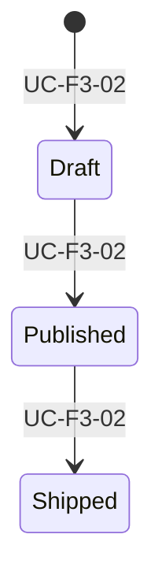

🏠 [Specs](../../../README.md) › 🧩 [Functional capabilities](../../README.md) › 🤖 [F3 Assistant](../README.md) ›
🗃️ [Data](README.md) › 🗃️ E-F3-03 Suggested question

# 🗃️ E-F3-03 Suggested question

**Status:** ✅ specified

## Purpose

A ready-made question shown in the panel for a record type (D154).

## Fields

| Name | Type | Required | Validation | Default | Example | Personal data | Custom fields |
|---|---|---|---|---|---|---|---|
| text | text, per language | yes | at most 60 characters | - | Summarise this customer | no | no |
| record type | record type | yes | - | - | Customer | no | no |
| where | record, list or both | yes | - | record | record | no | no |
| roles | roles | no | - | every role | Sales | no | no |
| origin | shipped, configured, pack | yes | - | configured | shipped | no | no |
| active | yes or no | yes | - | yes | yes | no | no |

## Relations

Part of a configuration pack (E-F2-11) when exported.

## Lifecycle

Drafted and published like any configuration (UC-F2-09); shipped ones can be turned off, not changed.

## Indexes and search

By record type.

## Retention

As configuration.

## Audit

Created, changed, turned on or off.

## Import and export

In configuration packs (UC-F2-11).

## Used by

- [UC-F3-02](../use-cases/02-ask-about-the-screen/uc-f03-02-ask-about-what-is-on-screen.md)

## Open questions

None.

---

⬅️ [E-F3-02 Assistant answer](e-f03-02-assistant-answer.md) · ⬆️ [Up](README.md) ·
➡️ [E-F3-04 Assistant change batch](e-f03-04-assistant-change-batch.md)
