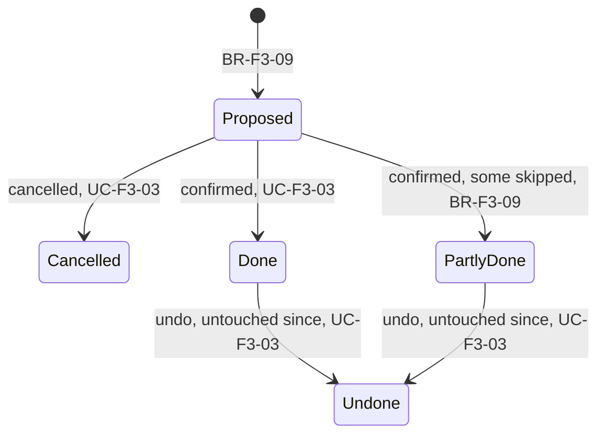

🏠 [Specs](../../../README.md) › 🧩 [Functional capabilities](../../README.md) › 🤖 [F3 Assistant](../README.md) ›
🗃️ [Data](README.md) › 🗃️ E-F3-04 Assistant change batch

# 🗃️ E-F3-04 Assistant change batch

**Status:** ✅ specified

## Purpose

A set of changes the AI assistant made after one confirmation (D157 to D160).

## Fields

| Name | Type | Required | Validation | Default | Example | Personal data | Custom fields |
|---|---|---|---|---|---|---|---|
| conversation | conversation | yes | - | - | Plan next week | no | no |
| user | user | yes | - | - | Marie Dupont | yes | no |
| changes | list of record, field, before, after | yes | at most the batch size (BR-F3-09) | - | 12 tasks, due date | maybe | no |
| status | list | yes | proposed, cancelled, done, partly done, undone | proposed | done | no | no |
| confirmed at | date and time | no | - | - | 2026-11-10 15:30 | no | no |

## Relations

Belongs to one [conversation](e-f03-01-conversation.md); its changes appear in each record's history.

## Lifecycle

## Indexes and search

By conversation and user.

## Retention

As the records' history.

## Audit

See UC-F3-03's audit events.

## Import and export

None.

## Used by

- [UC-F3-03](../use-cases/03-act-through-the-assistant/uc-f03-03-have-the-assistant-create-or-change-records.md)

## Open questions

None.

---

⬅️ [E-F3-03 Suggested question](e-f03-03-suggested-question.md) · ⬆️ [Up](README.md) ·
➡️ [E-F3-05 Company writing style](e-f03-05-company-writing-style.md)
