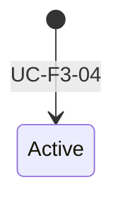

🏠 [Specs](../../../README.md) › 🧩 [Functional capabilities](../../README.md) › 🤖 [F3 Assistant](../README.md) ›
🗃️ [Data](README.md) › 🗃️ E-F3-05 Company writing style

# 🗃️ E-F3-05 Company writing style

**Status:** ✅ specified

## Purpose

How the AI assistant writes for the company (D162); one per company.

## Fields

| Name | Type | Required | Validation | Default | Example | Personal data | Custom fields |
|---|---|---|---|---|---|---|---|
| tone | warm, professional, very formal | yes | - | professional | professional | no | no |
| address | formal, informal | yes | - | formal | formal | no | no |
| words to use | list | no | - | - | our team | no | no |
| words to avoid | list | no | - | - | cheap | no | no |
| sample texts | files or text | no | 10 at most | - | 3 emails | maybe | no |
| AI mention | on, off | yes | always on for F5 | off | off | no | no |

## Relations

One per company (T1); each user's signature is on their profile (F1).

## Lifecycle

Changed at any time; applies to the next drafts.

## Indexes and search

None.

## Retention

As configuration.

## Audit

Every change, by whom.

## Import and export

Part of a configuration pack (UC-F2-11).

## Used by

- [UC-F3-04](../use-cases/04-summarise-or-draft/uc-f03-04-summarise-and-draft.md)

## Open questions

None.

---

⬅️ [E-F3-04 Assistant change batch](e-f03-04-assistant-change-batch.md) · ⬆️ [Up](README.md) ·
➡️ [E-F3-06 Configuration request](e-f03-06-configuration-request.md)
