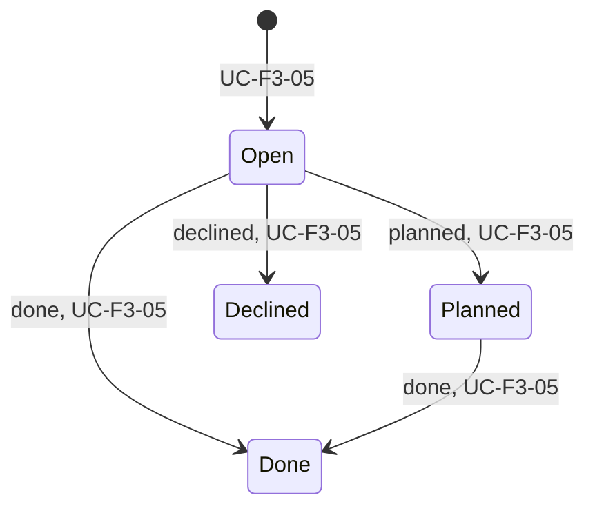

🏠 [Specs](../../../README.md) › 🧩 [Functional capabilities](../../README.md) › 🤖 [F3 Assistant](../README.md) ›
🗃️ [Data](README.md) › 🗃️ E-F3-06 Configuration request

# 🗃️ E-F3-06 Configuration request

**Status:** ✅ specified

## Purpose

What a user asked the ERP to do that it cannot do yet (D168).

## Fields

| Name | Type | Required | Validation | Default | Example | Personal data | Custom fields |
|---|---|---|---|---|---|---|---|
| text | text | yes | - | pre-filled by the AI assistant | Add a Vehicle field to visits | no | no |
| where | screen or record type | no | - | the current screen | Visits | no | no |
| requester | user | yes | - | the user | Paul Martin | yes | no |
| voters | users | no | - | - | Lea Morel | yes | no |
| status | list | yes | open, planned, done, declined | open | open | no | no |
| answer | text | no | - | - | Added on 12 November | no | no |

## Relations

Links to the configuration change that answered it (F2).

## Lifecycle

## Indexes and search

By status, record type and text; similar open requests are found before a new one.

## Retention

2 years after done or declined.

## Audit

Sent, answered, status changes.

## Import and export

Exported as a spreadsheet.

## Used by

- [UC-F3-05](../use-cases/05-find-and-get-guided/uc-f03-05-find-a-record-or-a-screen-get-guided.md)

## Open questions

None.

---

⬅️ [E-F3-05 Company writing style](e-f03-05-company-writing-style.md) · ⬆️ [Up](README.md) ·
➡️ [E-F3-07 Personal connection](e-f03-07-personal-connection.md)
