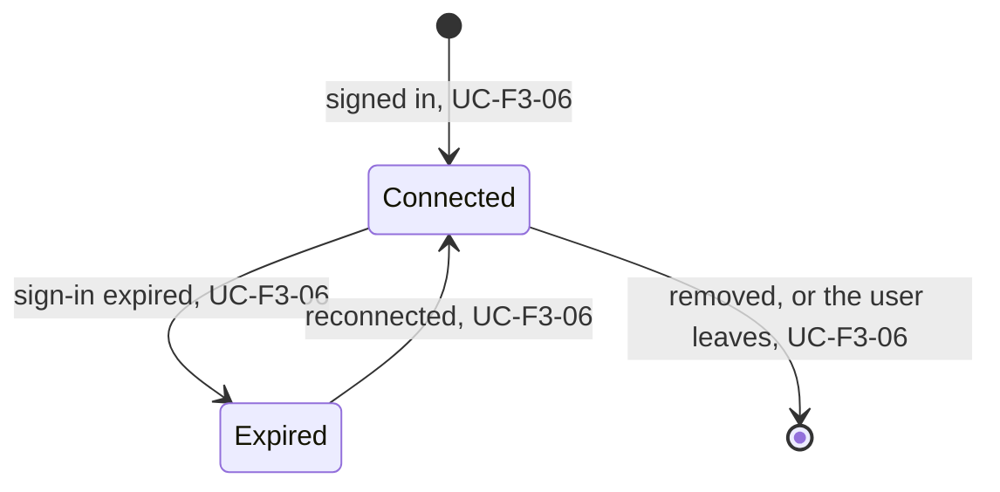

🏠 [Specs](../../../README.md) › 🧩 [Functional capabilities](../../README.md) › 🤖 [F3 Assistant](../README.md) ›
🗃️ [Data](README.md) › 🗃️ E-F3-07 Personal connection

# 🗃️ E-F3-07 Personal connection

**Status:** ✅ specified

## Purpose

A user's own account at an allowed service, used by the AI assistant for them only (D171).

## Fields

| Name | Type | Required | Validation | Default | Example | Personal data | Custom fields |
|---|---|---|---|---|---|---|---|
| user | user | yes | - | - | Marie Dupont | yes | no |
| service | allowed service | yes | allowed by the administrator | - | Google Calendar | no | no |
| account | text | yes | - | from the sign-in | marie@example.fr | yes | no |
| tokens | secret | yes | stored encrypted, never shown | - | (hidden) | yes | no |
| status | connected, expired | yes | - | connected | connected | no | no |

## Relations

Belongs to one user; its calls are [outside calls](e-f03-08-outside-call.md).

## Lifecycle

## Indexes and search

By user.

## Retention

Until removed, or the user's account is closed.

## Audit

Added, removed, expired.

## Import and export

None: tokens never leave.

## Used by

- [UC-F3-06](../use-cases/06-use-an-outside-tool/uc-f03-06-use-an-outside-tool-through-the-assistant.md)

## Open questions

None.

---

⬅️ [E-F3-06 Configuration request](e-f03-06-configuration-request.md) · ⬆️ [Up](README.md) ·
➡️ [E-F3-08 Outside call](e-f03-08-outside-call.md)
