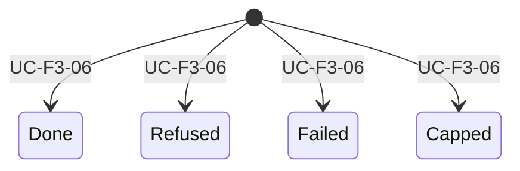

🏠 [Specs](../../../README.md) › 🧩 [Functional capabilities](../../README.md) › 🤖 [F3 Assistant](../README.md) ›
🗃️ [Data](README.md) › 🗃️ E-F3-08 Outside call

# 🗃️ E-F3-08 Outside call

**Status:** ✅ specified

## Purpose

One call of the AI assistant to an outside tool, for the log and the caps (D169, D172).

## Fields

| Name | Type | Required | Validation | Default | Example | Personal data | Custom fields |
|---|---|---|---|---|---|---|---|
| connection | connection or personal connection | yes | - | - | Shipping tool | no | no |
| user | user | yes | - | - | Marie Dupont | yes | no |
| operation | text | yes | - | - | track | no | no |
| categories sent | none, business, personal | yes | allowed by the connection | - | business | no | no |
| status | done, refused, failed, capped | yes | - | - | done | no | no |
| at | date and time | yes | - | now | 2026-11-10 15:40 | no | no |

## Relations

Belongs to a conversation and a connection.

## Lifecycle

Written once.

## Indexes and search

By connection, user and month, for the caps.

## Retention

13 months.

## Audit

It is the audit record of outside calls.

## Import and export

Exported by administrators as a spreadsheet.

## Used by

- [UC-F3-06](../use-cases/06-use-an-outside-tool/uc-f03-06-use-an-outside-tool-through-the-assistant.md)
- Shown in [S-F3-13 Assistant usage dashboard](../screens/01-ask-the-assistant/s-f03-13-assistant-usage-dashboard.md),
  call log tab.

## Open questions

None.

---

⬅️ [E-F3-07 Personal connection](e-f03-07-personal-connection.md) · ⬆️ [Up](README.md) ·
➡️ [E-F3-09 Knowledge item](e-f03-09-knowledge-item.md)
