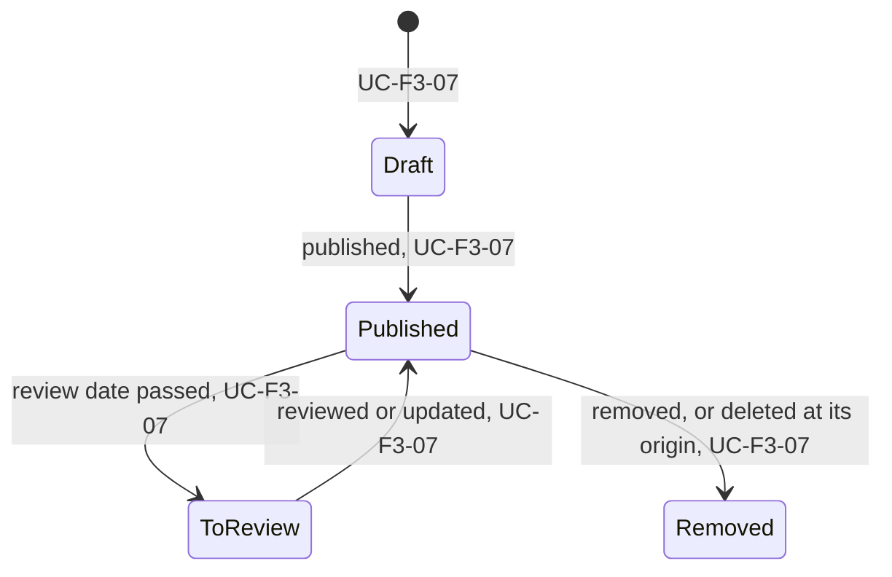

🏠 [Specs](../../../README.md) › 🧩 [Functional capabilities](../../README.md) › 🤖 [F3 Assistant](../README.md) ›
🗃️ [Data](README.md) › 🗃️ E-F3-09 Knowledge item

# 🗃️ E-F3-09 Knowledge item

**Status:** ✅ specified

## Purpose

One piece of company knowledge the AI assistant can use (D173 to D175).

## Fields

| Name | Type | Required | Validation | Default | Example | Personal data | Custom fields |
|---|---|---|---|---|---|---|---|
| title | text | yes | - | file name | Expense policy | no | no |
| origin | upload, page, synced | yes | - | upload | upload | no | no |
| content | file or rich text | yes | 100 MB at most | - | expense-policy.pdf | maybe | no |
| folder | knowledge folder | yes | - | - | HR policies | no | no |
| audience | everyone, roles, sites or teams | yes | - | the folder's | everyone | no | no |
| owner | user | yes | - | the author | Claire Petit | yes | no |
| review date | date | no | - | in one year | 2027-03-01 | no | no |
| status | draft, published, to review, removed | yes | - | draft | published | no | no |

## Relations

In one [folder](e-f03-10-knowledge-folder.md); may have [proposals](e-f03-11-knowledge-proposal.md).

## Lifecycle

## Indexes and search

Full text and meaning (T8), filtered by audience.

## Retention

Removed items are kept 30 days, then deleted with their index entries.

## Audit

See UC-F3-07's audit events.

## Import and export

Upload; a folder exported as a zip.

## Used by

- [UC-F3-07](../use-cases/07-manage-knowledge/uc-f03-07-manage-the-company-knowledge-base.md)

## Open questions

None.

---

⬅️ [E-F3-08 Outside call](e-f03-08-outside-call.md) · ⬆️ [Up](README.md) ·
➡️ [E-F3-10 Knowledge folder](e-f03-10-knowledge-folder.md)
