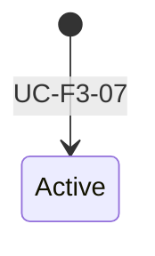

🏠 [Specs](../../../README.md) › 🧩 [Functional capabilities](../../README.md) › 🤖 [F3 Assistant](../README.md) ›
🗃️ [Data](README.md) › 🗃️ E-F3-10 Knowledge folder

# 🗃️ E-F3-10 Knowledge folder

**Status:** ✅ specified

## Purpose

A group of knowledge items with a default audience, editors and, maybe, a synced origin.

## Fields

| Name | Type | Required | Validation | Default | Example | Personal data | Custom fields |
|---|---|---|---|---|---|---|---|
| name | text | yes | unique in its parent | - | HR policies | no | no |
| parent | folder | no | - | - | - | no | no |
| audience | everyone, roles, sites or teams | yes | - | everyone | everyone | no | no |
| editors | users | no | - | - | Claire Petit | yes | no |
| synced origin | shared drive folder or website section | no | reachable | - | https://intranet/lyon | no | no |
| review period | months | yes | 3, 6, 12, 24, never | 12 | 12 | no | no |

## Relations

Holds [items](e-f03-09-knowledge-item.md) and folders.

## Lifecycle

Created, changed, removed with its items.

## Indexes and search

By name.

## Retention

As its items.

## Audit

Audience and editor changes.

## Import and export

As a zip.

## Used by

- [UC-F3-07](../use-cases/07-manage-knowledge/uc-f03-07-manage-the-company-knowledge-base.md)

## Open questions

None.

---

⬅️ [E-F3-09 Knowledge item](e-f03-09-knowledge-item.md) · ⬆️ [Up](README.md) ·
➡️ [E-F3-11 Knowledge proposal](e-f03-11-knowledge-proposal.md)
