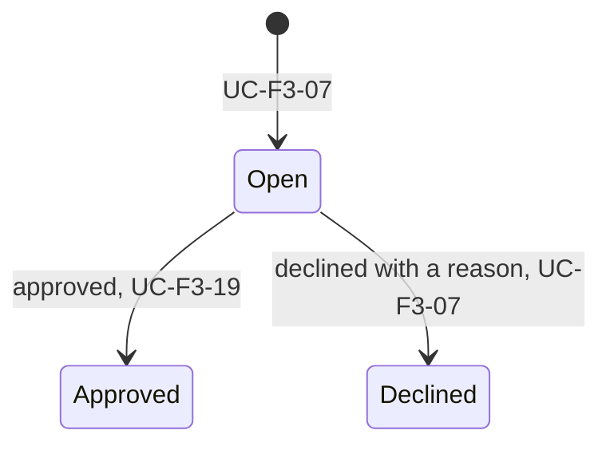

🏠 [Specs](../../../README.md) › 🧩 [Functional capabilities](../../README.md) › 🤖 [F3 Assistant](../README.md) ›
🗃️ [Data](README.md) › 🗃️ E-F3-11 Knowledge proposal

# 🗃️ E-F3-11 Knowledge proposal

**Status:** ✅ specified

## Purpose

A user's proposed item or fix, waiting for an editor (D176).

## Fields

| Name | Type | Required | Validation | Default | Example | Personal data | Custom fields |
|---|---|---|---|---|---|---|---|
| kind | new item, fix | yes | - | fix | fix | no | no |
| item | knowledge item | for a fix | the proposer may see it | - | Returns | no | no |
| text | text or file | yes | - | - | The phone number is now 04 72 ... | maybe | no |
| proposer | user | yes | - | - | Paul Martin | yes | no |
| status | open, approved, declined | yes | - | open | approved | no | no |
| reason | text | if declined | - | - | Already covered by Returns v2 | no | no |

## Relations

About one [item](e-f03-09-knowledge-item.md) or one [folder](e-f03-10-knowledge-folder.md).

## Lifecycle

## Indexes and search

By folder and status.

## Retention

One year after its decision.

## Audit

Proposed, approved, declined.

## Import and export

None.

## Used by

- [UC-F3-07](../use-cases/07-manage-knowledge/uc-f03-07-manage-the-company-knowledge-base.md)
- [UC-F3-19 Turn unanswered topics into knowledge proposals](../use-cases/12-personal-cost-aware-and-learning/uc-f03-19-turn-unanswered-topics-into-knowledge-proposals.md)

## Open questions

None.

---

⬅️ [E-F3-10 Knowledge folder](e-f03-10-knowledge-folder.md) · ⬆️ [Up](README.md) ·
➡️ [E-F3-12 Conversation folder](e-f03-12-conversation-folder.md)
