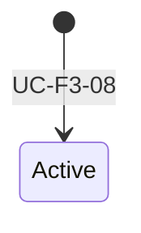

🏠 [Specs](../../../README.md) › 🧩 [Functional capabilities](../../README.md) › 🤖 [F3 Assistant](../README.md) ›
🗃️ [Data](README.md) › 🗃️ E-F3-12 Conversation folder

# 🗃️ E-F3-12 Conversation folder

**Status:** ✅ specified

## Purpose

A user's own folder of conversations (D180).

## Fields

| Name | Type | Required | Validation | Default | Example | Personal data | Custom fields |
|---|---|---|---|---|---|---|---|
| name | text | yes | unique for its owner | - | Sales review | no | no |
| owner | user | yes | - | the user | Marie Dupont | yes | no |
| parent | folder | no | - | - | - | no | no |

## Relations

Holds [conversations](e-f03-01-conversation.md) of its owner.

## Lifecycle

Created, renamed, deleted (with or without its conversations, asked).

## Indexes and search

By name.

## Retention

As its owner's account.

## Audit

None: personal organisation.

## Import and export

None.

## Used by

- [UC-F3-08](../use-cases/08-manage-and-share-conversations/uc-f03-08-manage-and-share-conversations.md)

## Open questions

None.

---

⬅️ [E-F3-11 Knowledge proposal](e-f03-11-knowledge-proposal.md) · ⬆️ [Up](README.md) ·
➡️ [E-F3-13 Queued question](e-f03-13-queued-question.md)
