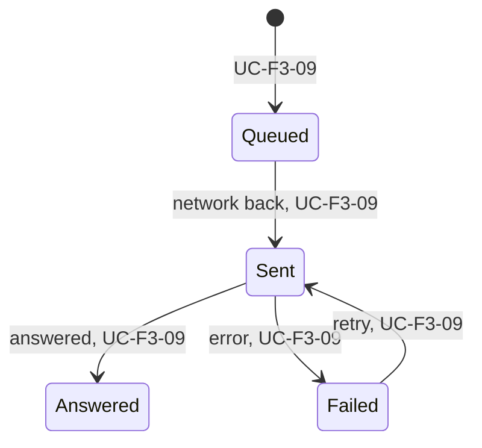

🏠 [Specs](../../../README.md) › 🧩 [Functional capabilities](../../README.md) › 🤖 [F3 Assistant](../README.md) ›
🗃️ [Data](README.md) › 🗃️ E-F3-13 Queued question

# 🗃️ E-F3-13 Queued question

**Status:** ✅ specified

## Purpose

A question asked offline on a phone, waiting for the network (D182).

## Fields

| Name | Type | Required | Validation | Default | Example | Personal data | Custom fields |
|---|---|---|---|---|---|---|---|
| question | text or photo | yes | - | - | Create a follow-up visit | maybe | no |
| context | task or visit | no | - | the open one | V-212 | no | no |
| asked at | date and time | yes | - | now | 2026-11-10 15:50 | no | no |
| status | queued, sent, answered, failed | yes | - | queued | queued | no | no |

## Relations

Becomes a question of a [conversation](e-f03-01-conversation.md) once sent.

## Lifecycle

## Indexes and search

On the phone, by time.

## Retention

On the phone until sent; then as its conversation.

## Audit

None until sent.

## Import and export

None.

## Used by

- [UC-F3-09](../use-cases/09-assistant-on-a-phone/uc-f03-09-use-the-assistant-on-a-phone.md)

## Open questions

None.

---

⬅️ [E-F3-12 Conversation folder](e-f03-12-conversation-folder.md) · ⬆️ [Up](README.md) ·
➡️ [E-F3-14 Answer feedback](e-f03-14-answer-feedback.md)
