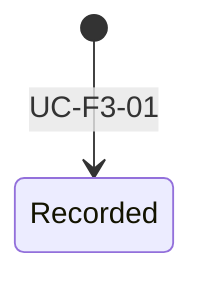

🏠 [Specs](../../../README.md) › 🧩 [Functional capabilities](../../README.md) › 🤖 [F3 Assistant](../README.md) ›
🗃️ [Data](README.md) › 🗃️ E-F3-14 Answer feedback

# 🗃️ E-F3-14 Answer feedback

**Status:** ✅ specified

## Purpose

A user's rating of one answer (D186).

## Fields

| Name | Type | Required | Validation | Default | Example | Personal data | Custom fields |
|---|---|---|---|---|---|---|---|
| answer | assistant answer | yes | - | - | 48,200 EUR from 12 invoices | no | no |
| rating | up, down | yes | - | - | down | no | no |
| reason | wrong, incomplete, out of date, too slow | no | for down only | - | out of date | no | no |
| comment | text | no | 500 characters | - | The policy changed in October | maybe | no |

## Relations

About one [assistant answer](e-f03-02-assistant-answer.md); may concern a [knowledge item](e-f03-09-knowledge-item.md).

## Lifecycle

Given, changed, removed by its author.

## Indexes and search

By reason and knowledge item, for the dashboard.

## Retention

Counts kept; the link to its author removed with the conversation.

## Audit

None.

## Import and export

Counts in the dashboard export.

## Used by

- [UC-F3-01](../use-cases/01-ask-the-assistant/uc-f03-01-ask-a-question-about-the-company-s-data.md)

## Open questions

None.

---

⬅️ [E-F3-13 Queued question](e-f03-13-queued-question.md) · ⬆️ [Up](README.md) · ➡️ [E-F3-15 Agent](e-f03-15-agent.md)
