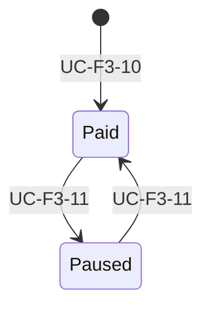

🏠 [Specs](../../../README.md) › 🧩 [Functional capabilities](../../README.md) › 🤖 [F3 Assistant](../README.md) ›
🗃️ [Data](README.md) › 🗃️ E-F3-15 Agent

# 🗃️ E-F3-15 Agent

**Status:** ✅ specified

## Purpose

An AI agent and its settings.

## Fields

| Name | Type | Required | Validation | Default | Example | Personal data | Custom fields |
|---|---|---|---|---|---|---|---|
| name, role | text | yes | - | - | Accrual agent | no | no |
| instructions | text | yes | checked by the audit agent | - | Propose accruals at month end | no | no |
| tools, sources | lists | yes | within the role | - | Ledger, contracts | no | no |
| run | always-on, scheduled, on demand | yes | - | on demand | scheduled | no | no |
| threshold, limits | percent, money | yes | BR-F3-35 | 95 %, role limits | 96 %, 10 000 | no | no |

## Relations

As its use cases.

## Lifecycle

## Indexes and search

By name, date, owner.

## Retention

Kept for the period of its kind of record in the country pack (D293), or else its kind's default in the
[retention schedule](../../../05-non-functional/data-retention.md).

## Audit

Every change.

## Import and export

CSV.

## Used by

- [UC-F3-10](../use-cases/10-benchmark-additions/uc-f03-10-create-and-run-ai-agents.md)
- [UC-F3-11](../use-cases/10-benchmark-additions/uc-f03-11-govern-ai-agents.md)

## Open questions

None.

---

⬅️ [E-F3-14 Answer feedback](e-f03-14-answer-feedback.md) · ⬆️ [Up](README.md) ·
➡️ [E-F3-16 AI field](e-f03-16-ai-field.md)
