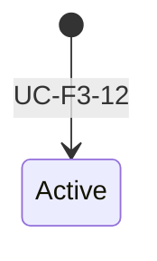

🏠 [Specs](../../../README.md) › 🧩 [Functional capabilities](../../README.md) › 🤖 [F3 Assistant](../README.md) ›
🗃️ [Data](README.md) › 🗃️ E-F3-16 AI field

# 🗃️ E-F3-16 AI field

**Status:** ✅ specified

## Purpose

A field filled by the AI.

## Fields

| Name | Type | Required | Validation | Default | Example | Personal data | Custom fields |
|---|---|---|---|---|---|---|---|
| record type | record type | yes | - | - | Customer | no | no |
| prompt | text | yes | - | - | Summarise the last 3 meetings | no | no |
| refresh | on change, daily, on demand | yes | - | on demand | daily | no | no |

## Relations

As its use cases.

## Lifecycle

## Indexes and search

By name, date, owner.

## Retention

Kept for the period of its kind of record in the country pack (D293), or else its kind's default in the
[retention schedule](../../../05-non-functional/data-retention.md).

## Audit

Every change.

## Import and export

CSV.

## Used by

- [UC-F3-12](../use-cases/10-benchmark-additions/uc-f03-12-add-ai-fields-to-records.md)

## Open questions

None.

---

⬅️ [E-F3-15 Agent](e-f03-15-agent.md) · ⬆️ [Up](README.md) ·
➡️ [E-F3-17 Evaluation question](e-f03-17-evaluation-question.md)
