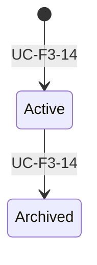

🏠 [Specs](../../../README.md) › 🧩 [Functional capabilities](../../README.md) › 🤖 [F3 Assistant](../README.md) ›
🗃️ [Data](README.md) › 🗃️ E-F3-17 Evaluation question

# 🗃️ E-F3-17 Evaluation question

**Status:** 🔄 waiting for the owner

## Purpose

A test question with its expected facts, sources and role.

## Fields

| Name | Type | Required | Validation | Default | Example | Personal data | Custom fields |
|---|---|---|---|---|---|---|---|
| question | text | yes | - | - | What is our paid-leave policy? | no | - |
| expected | facts or refusal | yes | - | - | 25 days, cites HR handbook | no | - |
| ask as | role | yes | - | Employee | Employee | no | - |
| status | list | yes | active, stale, archived | active | active | no | - |

## Relations

Scored in Evaluation runs.

## Lifecycle

Active, stale when its facts no longer exist, archived.

## Indexes and search

By topic and status.

## Retention

While active, then 1 year (Proposed).

## Audit

Added, changed, archived.

## Import and export

None.

## Used by

- [UC-F3-14 Run the quality evaluation set](../use-cases/11-trust-the-answers/uc-f03-14-run-the-quality-evaluation-set.md)

## Open questions

None.

---

⬅️ [E-F3-16 AI field](e-f03-16-ai-field.md) · ⬆️ [Up](README.md) ·
➡️ [E-F3-18 Evaluation run](e-f03-18-evaluation-run.md)
