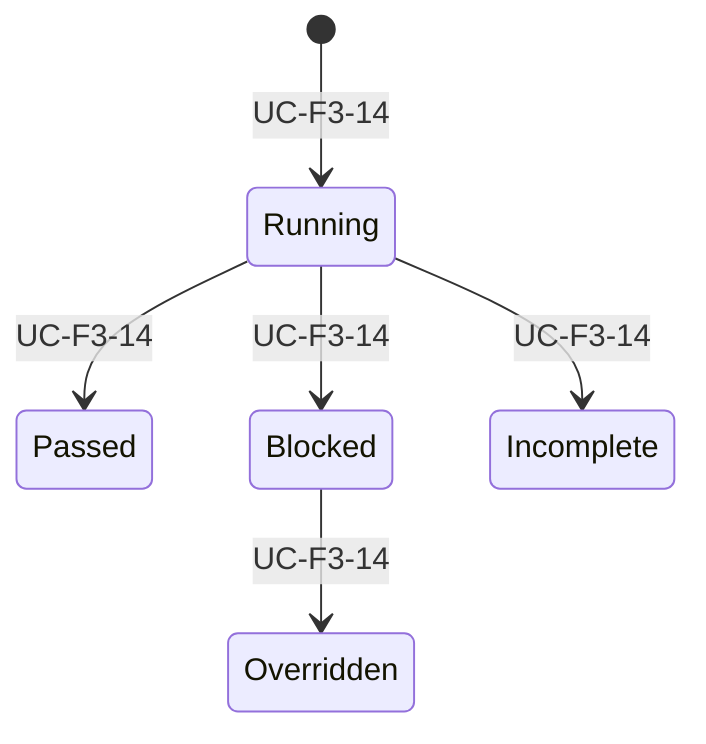

🏠 [Specs](../../../README.md) › 🧩 [Functional capabilities](../../README.md) › 🤖 [F3 Assistant](../README.md) ›
🗃️ [Data](README.md) › 🗃️ E-F3-18 Evaluation run

# 🗃️ E-F3-18 Evaluation run

**Status:** 🔄 waiting for the owner

## Purpose

One run of the evaluation set, with its scores and what triggered it.

## Fields

| Name | Type | Required | Validation | Default | Example | Personal data | Custom fields |
|---|---|---|---|---|---|---|---|
| trigger | model change, prompt change, schedule, manual | yes | - | - | model change | no | - |
| score | percent | yes | - | - | 88 | no | - |
| results | per question | yes | - | - | 37 passed, 3 failed | no | - |
| decision | live, blocked, overridden | yes | - | - | blocked | no | - |

## Relations

Scores Evaluation questions; linked to the AI feature setting changed (E-F1-09).

## Lifecycle

## Indexes and search

By date and trigger.

## Retention

2 years (Proposed).

## Audit

Run, decision, override.

## Import and export

None.

## Used by

- [UC-F3-14 Run the quality evaluation set](../use-cases/11-trust-the-answers/uc-f03-14-run-the-quality-evaluation-set.md)

## Open questions

None.

---

⬅️ [E-F3-17 Evaluation question](e-f03-17-evaluation-question.md) · ⬆️ [Up](README.md) ·
➡️ [E-F3-19 Injection alert](e-f03-19-injection-alert.md)
