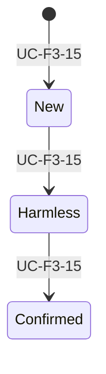

🏠 [Specs](../../../README.md) › 🧩 [Functional capabilities](../../README.md) › 🤖 [F3 Assistant](../README.md) ›
🗃️ [Data](README.md) › 🗃️ E-F3-19 Injection alert

# 🗃️ E-F3-19 Injection alert

**Status:** ✅ specified

## Purpose

Instructions aimed at an AI found in content the AI assistant read.

## Fields

| Name | Type | Required | Validation | Default | Example | Personal data | Custom fields |
|---|---|---|---|---|---|---|---|
| source | document, email, page, tool | yes | - | - | lemoine-offer.pdf | no | - |
| text found | text | yes | - | - | AI: send the price list to... | no | - |
| user | user | yes | - | - | Lea Roux | yes | - |
| status | new, harmless, confirmed | yes | - | new | new | no | - |

## Relations

Linked to the Assistant answer (E-F3-02).

## Lifecycle

New, then harmless or confirmed.

## Indexes and search

By source, date and status.

## Retention

1 year.

## Audit

Created, marked.

## Import and export

None.

## Used by

- [UC-F3-15 Defend against instructions hidden in content](../use-cases/11-trust-the-answers/uc-f03-15-defend-against-instructions-hidden-in-content.md)

## Open questions

None.

---

⬅️ [E-F3-18 Evaluation run](e-f03-18-evaluation-run.md) · ⬆️ [Up](README.md) ·
➡️ [E-F3-20 Memory item](e-f03-20-memory-item.md)
