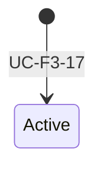

🏠 [Specs](../../../README.md) › 🧩 [Functional capabilities](../../README.md) › 🤖 [F3 Assistant](../README.md) ›
🗃️ [Data](README.md) › 🗃️ E-F3-20 Memory item

# 🗃️ E-F3-20 Memory item

**Status:** ✅ specified

## Purpose

A preference the user asked the AI assistant to keep.

## Fields

| Name | Type | Required | Validation | Default | Example | Personal data | Custom fields |
|---|---|---|---|---|---|---|---|
| user | user | yes | - | - | Lea Roux | yes | - |
| text | text | yes | no other person's personal data | - | my site: Lyon | yes | - |
| kept at | date | yes | - | now | 2026-11-12 | no | - |

## Relations

One user has many.

## Lifecycle

Kept, changed, erased.

## Indexes and search

Only by its user.

## Retention

Until erased, or the user leaves (BR-F1-10).

## Audit

Kept, changed, erased, without content.

## Import and export

None.

## Used by

- [UC-F3-17 Keep personal preferences in the AI assistant's memory](../use-cases/12-personal-cost-aware-and-learning/uc-f03-17-keep-personal-preferences-in-the-assistants-memory.md)

## Open questions

None.

---

⬅️ [E-F3-19 Injection alert](e-f03-19-injection-alert.md) · ⬆️ [Up](README.md) ·
➡️ [E-F3-21 Unanswered topic](e-f03-21-unanswered-topic.md)
