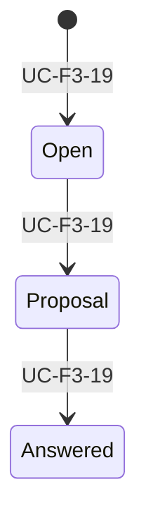

🏠 [Specs](../../../README.md) › 🧩 [Functional capabilities](../../README.md) › 🤖 [F3 Assistant](../README.md) ›
🗃️ [Data](README.md) › 🗃️ E-F3-21 Unanswered topic

# 🗃️ E-F3-21 Unanswered topic

**Status:** ✅ specified

## Purpose

Questions the AI assistant could not answer, grouped by topic, without who asked.

## Fields

| Name | Type | Required | Validation | Default | Example | Personal data | Custom fields |
|---|---|---|---|---|---|---|---|
| topic | text | yes | - | - | parental leave for fathers | no | - |
| count | number per month | yes | - | - | 14 | no | - |
| samples | masked questions | no | personal data masked | - | How many days for... | no | - |
| status | open, proposal, answered | yes | - | open | proposal | no | - |

## Relations

May lead to a Knowledge proposal (E-F3-11).

## Lifecycle

Open, proposal, answered.

## Indexes and search

By count and status.

## Retention

12 months.

## Audit

Turned into a proposal, answered.

## Import and export

None.

## Used by

- [UC-F3-19 Turn unanswered topics into knowledge proposals](../use-cases/12-personal-cost-aware-and-learning/uc-f03-19-turn-unanswered-topics-into-knowledge-proposals.md)

## Open questions

None.

---

⬅️ [E-F3-20 Memory item](e-f03-20-memory-item.md) · ⬆️ [Up](README.md) ·
➡️ [E-F3-22 AI assistant request](e-f03-22-ai-assistant-request.md)
