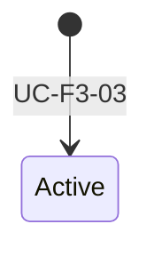

🏠 [Specs](../../../README.md) › 🧩 [Functional capabilities](../../README.md) › 🤖 [F3 Assistant](../README.md) ›
🗃️ [Data](README.md) › 🗃️ E-F3-22 AI assistant request

# 🗃️ E-F3-22 AI assistant request

**Status:** 🔄 waiting for the owner

## Purpose

(Proposed) The AI assistant request the flow charts name with the words "Request"
([FL-F3-03](../flows/fl-f03-03-act-through-the-assistant.md), [FL-F3-04](../flows/fl-f03-04-summarise-or-draft.md),
[FL-F3-06](../flows/fl-f03-06-use-an-outside-tool.md)). The owner decided to create it
([D516](../../../06-decisions/foundations/d516-naming-rules-and-the-seven-classes-of-names.md)); what it holds waits for
the owner's confirmation.

## Fields

(Proposed) To define with the owner: the flow charts name the record, not its fields.

## Relations

(Proposed) To define with the owner, from the use cases below.

## Lifecycle

## Indexes and search

(Proposed) To define with the owner.

## Retention

(Proposed) As the other records of its capability, to confirm with the owner.

## Audit

(Proposed) Every change, as the other records of its capability.

## Import and export

(Proposed) To define with the owner.

## Used by

- [UC-F3-03 Have the AI assistant create or change records](../use-cases/03-act-through-the-assistant/uc-f03-03-have-the-assistant-create-or-change-records.md)
- [UC-F3-04 Summarise and draft](../use-cases/04-summarise-or-draft/uc-f03-04-summarise-and-draft.md)
- [UC-F3-06 Use an outside tool through the AI assistant](../use-cases/06-use-an-outside-tool/uc-f03-06-use-an-outside-tool-through-the-assistant.md)

## Open questions

(Proposed) Its fields, relations and states wait for the owner (waiting list, step 36e).

---

⬅️ [E-F3-21 Unanswered topic](e-f03-21-unanswered-topic.md) · ⬆️ [Up](README.md) · ➡️ [E-F3-23 Team](e-f03-23-team.md)
