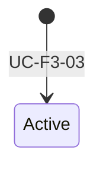

🏠 [Specs](../../../README.md) › 🧩 [Functional capabilities](../../README.md) › 🤖 [F3 Assistant](../README.md) ›
🗃️ [Data](README.md) › 🗃️ E-F3-22 AI assistant request

# 🗃️ E-F3-22 AI assistant request

**Status:** ✅ specified

## Purpose

The AI assistant request the flow charts name with the words "Request"
([FL-F3-03](../flows/fl-f03-03-act-through-the-assistant.md), [FL-F3-04](../flows/fl-f03-04-summarise-or-draft.md),
[FL-F3-06](../flows/fl-f03-06-use-an-outside-tool.md)). The owner decided to create it
([D516](../../../06-decisions/foundations/d516-naming-rules-and-the-seven-classes-of-names.md)); its fields are derived
from the specifications and confirmed by the owner (D572).

## Fields

| Name | Type | Required | Validation | Default | Example | Personal data | Custom fields |
|---|---|---|---|---|---|---|---|
| text | text | yes | - | - | Move Paul's tasks to next week | maybe | no |
| kind | create or change, delete, irreversible or outward act, summary, draft, outside tool | yes | - | - | create or change | no | no |
| user | user | yes | - | the user | Marie Dupont | yes | no |
| conversation | conversation | yes | - | the current one | Plan next week | no | no |
| context | record or screen | no | - | the open one | PO-2026-077 | no | no |
| asked at | date and time | yes | - | now | 2026-11-10 15:30 | no | no |
| result | change batch, answer or draft, outside call, refused with its reason | no | - | - | change batch of 5 tasks | no | no |
| state | active | yes | the lifecycle below | active | active | no | no |

Derived from the flow charts' "Request" and its branches ([FL-F3-03](../flows/fl-f03-03-act-through-the-assistant.md):
delete, irreversible or outward, create or change; [FL-F3-04](../flows/fl-f03-04-summarise-or-draft.md): summary or
draft; [FL-F3-06](../flows/fl-f03-06-use-an-outside-tool.md): an outside tool),
[UC-F3-03](../use-cases/03-act-through-the-assistant/uc-f03-03-have-the-assistant-create-or-change-records.md),
[UC-F3-04](../use-cases/04-summarise-or-draft/uc-f03-04-summarise-and-draft.md),
[UC-F3-06](../use-cases/06-use-an-outside-tool/uc-f03-06-use-an-outside-tool-through-the-assistant.md),
[S-F3-01 Assistant panel](../screens/01-ask-the-assistant/s-f03-01-assistant-panel.md) and the list
[S-F3-L22](../screens/00-lists/s-f03-l22-ai-assistant-requests.md).

## Relations

Asked in one [conversation](e-f03-01-conversation.md), by one [user](../../f01-administration/data/e-f01-03-user.md),
about the record or screen open at the time; answered by an [assistant change batch](e-f03-04-assistant-change-batch.md)
for a change, an [assistant answer](e-f03-02-assistant-answer.md) for a summary or a draft, or an
[outside call](e-f03-08-outside-call.md) for an outside tool; a draft follows the
[company writing style](e-f03-05-company-writing-style.md). With no tool for it, a
[configuration request](e-f03-06-configuration-request.md) is offered (BR-F3-16).

## Lifecycle

## Indexes and search

By text, user, kind, state.

## Retention

As the other records of its capability.

## Audit

Every change, as the other records of its capability.

## Import and export

CSV or XLSX of the visible rows and columns from [S-F3-L22](../screens/00-lists/s-f03-l22-ai-assistant-requests.md); no
import.

## Used by

- [UC-F3-03 Have the AI assistant create or change records](../use-cases/03-act-through-the-assistant/uc-f03-03-have-the-assistant-create-or-change-records.md)
- [UC-F3-04 Summarise and draft](../use-cases/04-summarise-or-draft/uc-f03-04-summarise-and-draft.md)
- [UC-F3-06 Use an outside tool through the AI assistant](../use-cases/06-use-an-outside-tool/uc-f03-06-use-an-outside-tool-through-the-assistant.md)

## Open questions

None.

---

⬅️ [E-F3-21 Unanswered topic](e-f03-21-unanswered-topic.md) · ⬆️ [Up](README.md) · ➡️ [E-F3-23 Team](e-f03-23-team.md)
