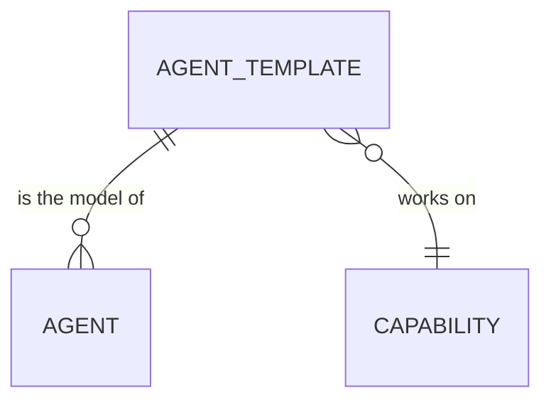
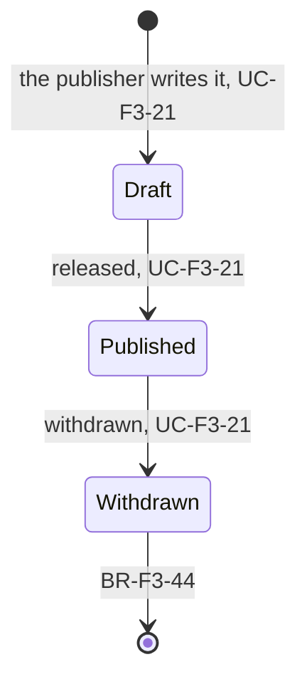

🏠 [Specs](../../../README.md) › 🧩 [Functional capabilities](../../README.md) › 🤖 [F3 Assistant](../README.md) ›
🗃️ [Data](README.md) › 🗃️ E-F3-24 Agent template

# 🗃️ E-F3-24 Agent template

**Status:** ✅ specified

## Purpose

A ready-made agent a company can switch on: what it reads, what it suggests, what it may do alone later and its default
thresholds ([D522](../../../06-decisions/f03-assistant/d522-benchmark-gaps-f03-assistant.md)).

## Fields

| Name | Type | Required | Validation | Default | Example | Personal data | Custom fields |
|---|---|---|---|---|---|---|---|
| name | text | yes | unique | - | Chase overdue invoices | no | no |
| purpose | text | yes | up to 300 characters | - | Reminds customers of unpaid invoices | no | no |
| capability | capability | yes | - | - | F6 Customers and sales | no | no |
| data read | list of record types | yes | - | - | invoices, customers | no | no |
| actions suggested | list | yes | - | - | draft a reminder email | no | no |
| actions alone later | list | no | never a delete or a payment (BR-F3-07) | - | send the reminder | no | no |
| default thresholds | numbers | yes | within the company maximum | - | 30 days, 50 a day | no | no |
| default mode | suggestion | yes | always suggestion | suggestion | suggestion | no | no |
| languages | list | yes | - | - | French, English | no | no |
| version | number | yes | - | 1 | 3 | no | no |
| state | draft, published, withdrawn | yes | the lifecycle below | draft | published | no | no |

## Relations

- [E-F3-15 Agent](e-f03-15-agent.md)

## Lifecycle

## Indexes and search

By capability, name and state.

## Retention

A withdrawn template is kept while an agent still uses it.

## Audit

Each version, release and withdrawal, with who and when.

## Import and export

Templates ship with the product and plugins; a company may export an agent as a template of its own.

## Used by

- [UC-F3-21 Switch on a ready-made agent](../use-cases/13-voice-agents-and-briefings/uc-f03-21-switch-on-a-ready-made-agent.md)

## Open questions

None.

---

⬅️ [E-F3-23 Team](e-f03-23-team.md) · ⬆️ [Up](README.md) ·
➡️ [E-F3-25 Add-in connection](e-f03-25-add-in-connection.md)
