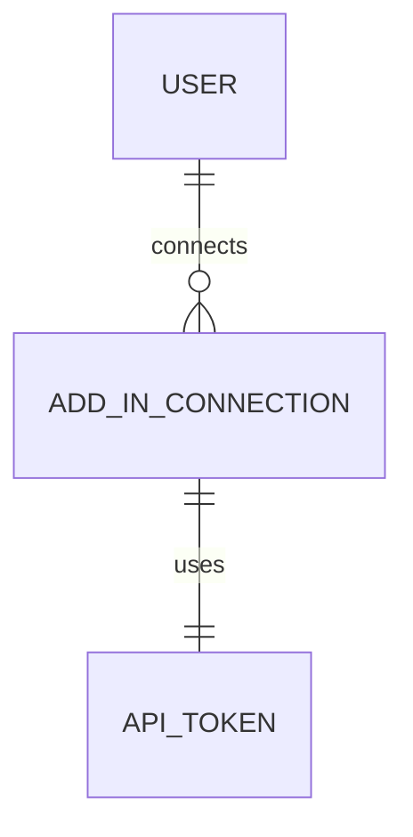
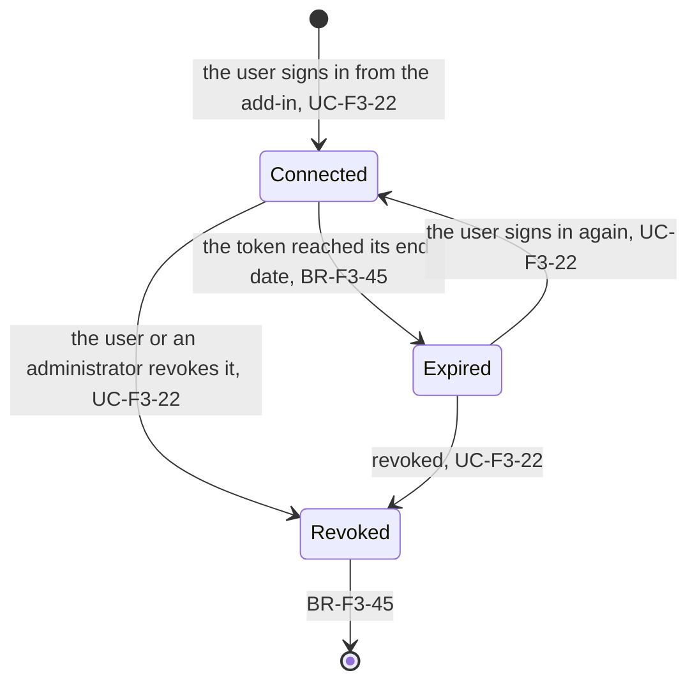

🏠 [Specs](../../../README.md) › 🧩 [Functional capabilities](../../README.md) › 🤖 [F3 Assistant](../README.md) ›
🗃️ [Data](README.md) › 🗃️ E-F3-25 Add-in connection

# 🗃️ E-F3-25 Add-in connection

**Status:** ✅ specified

## Purpose

The link between a user's spreadsheet application and SimpleERP: who, which application, what scope and when it was
last used ([D522](../../../06-decisions/f03-assistant/d522-benchmark-gaps-f03-assistant.md)).

## Fields

| Name | Type | Required | Validation | Default | Example | Personal data | Custom fields |
|---|---|---|---|---|---|---|---|
| user | user | yes | - | - | Claire P. | yes | no |
| application | text | yes | - | - | spreadsheet, web | no | no |
| scope | read, read and ask | yes | never write | read and ask | read and ask | no | no |
| personal token | secret reference | yes | shown once, never in the workbook | - | hidden | no | no |
| connected at | date and time | yes | - | now | 2026-11-14 09:10 | no | no |
| expires at | date | yes | within 90 days | 90 days | 2027-02-12 | no | no |
| last used | date and time | no | - | - | 2026-11-14 09:12 | no | no |
| refreshes today | number | no | - | 0 | 6 | no | no |
| state | connected, expired, revoked | yes | the lifecycle below | connected | connected | no | no |

## Relations

- [E-F1-03 User](../../f01-administration/data/e-f01-03-user.md)
- [E-F1-18 API token](../../f01-administration/data/e-f01-18-api-token.md)

## Lifecycle

## Indexes and search

By user, state and last used.

## Retention

A revoked connection is kept 13 months for the audit.

## Audit

Each connection, sign-in again and revocation, each refresh with its list and row count.

## Import and export

No import or export.

## Used by

- [UC-F3-22 Use ERP data in a spreadsheet add-in](../use-cases/13-voice-agents-and-briefings/uc-f03-22-use-erp-data-in-a-spreadsheet-add-in.md)

## Open questions

None.

---

⬅️ [E-F3-24 Agent template](e-f03-24-agent-template.md) · ⬆️ [Up](README.md) ·
➡️ [E-F3-26 Briefing](e-f03-26-briefing.md)
