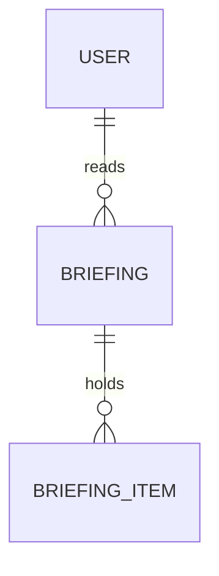
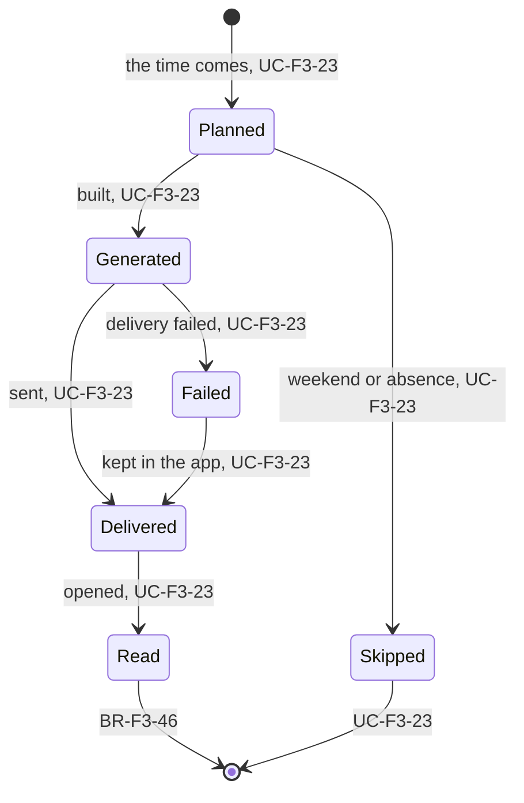

🏠 [Specs](../../../README.md) › 🧩 [Functional capabilities](../../README.md) › 🤖 [F3 Assistant](../README.md) ›
🗃️ [Data](README.md) › 🗃️ E-F3-26 Briefing

# 🗃️ E-F3-26 Briefing

**Status:** ✅ specified

## Purpose

The daily briefing of one user for one day: its sections, its items, its delivery and what the reader did with it
([D522](../../../06-decisions/f03-assistant/d522-benchmark-gaps-f03-assistant.md)).

## Fields

| Name | Type | Required | Validation | Default | Example | Personal data | Custom fields |
|---|---|---|---|---|---|---|---|
| user | user | yes | - | - | Marc D. | yes | no |
| date | date | yes | one per user and day | today | 2026-11-14 | no | no |
| sections | list | yes | - | the user's choice | meetings, approvals, money, stock | no | no |
| items | list of text, source, record | yes | - | - | 5 invoices overdue, 12,400 EUR | yes | no |
| delivery | time and channel | yes | app, email or chat | 07:30, app | 07:30, app | no | no |
| generated at, delivered at, read at | date and time | when set | - | - | 07:31 | no | no |
| marks | per item: done, snoozed, not useful | no | - | - | snoozed | no | no |
| state | planned, generated, delivered, read, failed, skipped | yes | the lifecycle below | planned | read | no | no |
| missing sections | list | no | - | - | stock | no | no |

## Relations

- [E-F1-03 User](../../f01-administration/data/e-f01-03-user.md)

## Lifecycle

## Indexes and search

By user, date and state.

## Retention

30 days, then deleted: a briefing repeats data that stays in its source
([CR-FR-052](../../../10-country-packs/france/data-protection/cr-fr-052-storage-limitation.md)).

## Audit

Each briefing generated and delivered, with sections and counts, never the items for others.

## Import and export

No import or export.

## Used by

- [UC-F3-23 Read the daily briefing](../use-cases/13-voice-agents-and-briefings/uc-f03-23-read-the-daily-briefing.md)

## Open questions

None.

---

⬅️ [E-F3-25 Add-in connection](e-f03-25-add-in-connection.md) · ⬆️ [Up](README.md) ·
➡️ [E-F3-27 To-do](e-f03-27-to-do.md)
