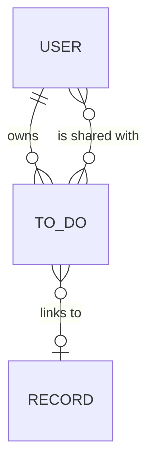
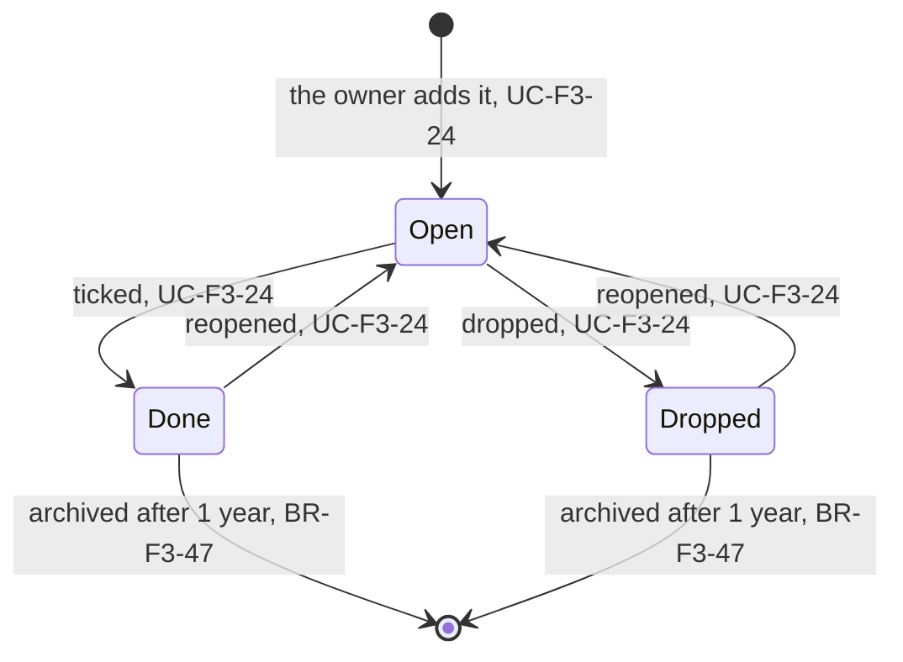

🏠 [Specs](../../../README.md) › 🧩 [Functional capabilities](../../README.md) › 🤖 [F3 Assistant](../README.md) ›
🗃️ [Data](README.md) › 🗃️ E-F3-27 To-do

# 🗃️ E-F3-27 To-do

**Status:** ✅ specified

## Purpose

A personal to-do or memo of one user, private unless shared
([D522](../../../06-decisions/f03-assistant/d522-benchmark-gaps-f03-assistant.md)).

## Fields

| Name | Type | Required | Validation | Default | Example | Personal data | Custom fields |
|---|---|---|---|---|---|---|---|
| owner | user | yes | - | the creator | Claire P. | yes | no |
| title | text | yes | up to 200 characters | - | Call Dupont about the quote | yes | no |
| note | text | no | up to 5,000 characters | - | Ask about the delivery date | yes | no |
| due date | date | no | - | - | 2026-11-20 | no | no |
| reminder | date and time | no | - | 9:00 on the due date | 2026-11-20 09:00 | no | no |
| linked record | any record | no | one the owner may see | - | Quote 2031 | no | no |
| source | typed, voice, AI assistant, meeting, email | yes | - | typed | meeting | no | no |
| shared with | list of users | no | colleagues of the company | nobody | Claire P. | yes | no |
| state | open, done, dropped | yes | the lifecycle below | open | open | no | no |
| done by, at | user, date and time | when done | - | - | Claire P., 2026-11-18 | yes | no |

## Relations

- [E-F1-03 User](../../f01-administration/data/e-f01-03-user.md)
- [E-F4-04 Action item](../../f04-meetings/data/e-f04-04-action-item.md)

## Lifecycle

## Indexes and search

By owner, state, due date and linked record; full-text search of the owner's own items only.

## Retention

Done and dropped items are archived after 1 year and deleted with the owner's data when they leave
([BR-F1-10](../../f01-administration/business-rules/br-f01-10-leavers-assistant-history-deleted.md)).

## Audit

Creation, deletion, shares and ticks by others, never the text.

## Import and export

The owner exports their own list as a spreadsheet or text file.

## Used by

- [UC-F3-24 Keep personal to-dos and memos](../use-cases/13-voice-agents-and-briefings/uc-f03-24-keep-personal-to-dos-and-memos.md)

## Open questions

None.

---

⬅️ [E-F3-26 Briefing](e-f03-26-briefing.md) · ⬆️ [Up](README.md)
