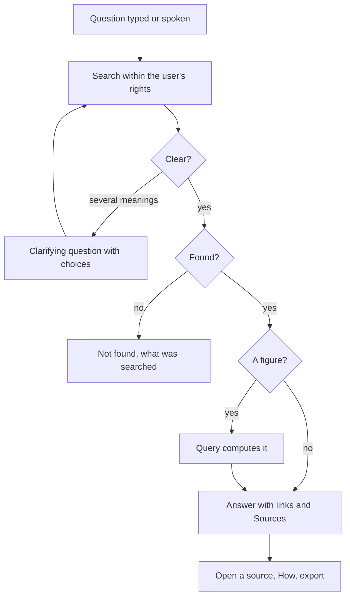

🏠 [Specs](../../../README.md) › 🧩 [Functional capabilities](../../README.md) › 🤖 [F3 Assistant](../README.md) ›
🔀 [Flows](README.md) › 🔀 FL-F3-01 Ask the AI assistant

# 🔀 FL-F3-01 Ask the AI assistant

**Status:** ✅ specified

## Summary

From a question to an answer with sources, or a clarifying question, or "not found".

## Personas

Every internal persona (D142): [U01](../../../01-users/personas/u01-employee.md),
[U02](../../../01-users/personas/u02-manager.md), [U03](../../../01-users/personas/u03-sales.md),
[U04](../../../01-users/personas/u04-purchasing.md), [U05](../../../01-users/personas/u05-accounting.md),
[U06](../../../01-users/personas/u06-hr.md), [U07](../../../01-users/personas/u07-administrator.md),
[U12](../../../01-users/personas/u12-marketing.md), [U13](../../../01-users/personas/u13-owner.md),
[U14](../../../01-users/personas/u14-field-worker.md), [U15](../../../01-users/personas/u15-warehouse-operator.md),
[U16](../../../01-users/personas/u16-office-worker.md).

## Flowchart

## Sequence diagram

See [UC-F3-01](../use-cases/01-ask-the-assistant/uc-f03-01-ask-a-question-about-the-company-s-data.md#sequence-diagram).

## Steps

| Step | Persona | Screen | Use case | What happens |
|---|---|---|---|---|
| 1 | Every internal persona | [S-F3-01](../screens/01-ask-the-assistant/s-f03-01-assistant-panel.md) | [UC-F3-01](../use-cases/01-ask-the-assistant/uc-f03-01-ask-a-question-about-the-company-s-data.md) | Ask |
| 2 | Every internal persona | [S-F3-01](../screens/01-ask-the-assistant/s-f03-01-assistant-panel.md) | [UC-F3-01](../use-cases/01-ask-the-assistant/uc-f03-01-ask-a-question-about-the-company-s-data.md) | Clarify, if ambiguous |
| 3 | Every internal persona | [S-F3-01](../screens/01-ask-the-assistant/s-f03-01-assistant-panel.md) | [UC-F3-01](../use-cases/01-ask-the-assistant/uc-f03-01-ask-a-question-about-the-company-s-data.md) | Answer with sources and figures |
| 4 | Every internal persona | [S-F3-01](../screens/01-ask-the-assistant/s-f03-01-assistant-panel.md) | [UC-F3-01](../use-cases/01-ask-the-assistant/uc-f03-01-ask-a-question-about-the-company-s-data.md) | Open a source, How, export |
| 5 | U07, U13 | [S-F3-13](../screens/01-ask-the-assistant/s-f03-13-assistant-usage-dashboard.md) | [UC-F3-01](../use-cases/01-ask-the-assistant/uc-f03-01-ask-a-question-about-the-company-s-data.md) | Usage dashboard and answer feedback |

### Entities and screens

| Entity | States in this flow | Shown at step and screen | Aggregated view |
|---|---|---|---|
| [E-F3-02 Assistant answer](../data/e-f03-02-assistant-answer.md) | Recorded | 1, 2, 3, 4 [S-F3-01](../screens/01-ask-the-assistant/s-f03-01-assistant-panel.md) | Assistant answers |
| [E-F1-03 User](../../f01-administration/data/e-f01-03-user.md) | Invited, Active, Deactivated | Shown elsewhere: [S-F1-03 Users](../../f01-administration/screens/03-user-lifecycle/s-f01-03-users.md) | Users |
| [E-F3-14 Answer feedback](../data/e-f03-14-answer-feedback.md) | Recorded | 1, 2, 3, 4 [S-F3-01](../screens/01-ask-the-assistant/s-f03-01-assistant-panel.md) | Answer feedbacks |

## Errors

Nothing found; cannot be computed; model unavailable; answer too long, stopped.

## Images

Every step and error, for each persona taking part, in light and dark mode (D120). Steps are numbered as in the Steps
table; E rows are the error cases.

| Step | Persona | Device | Light | Dark |
|---|---|---|---|---|
| 1 | U03 | desktop | [light](../images/01-ask-the-assistant/u03-sales/1-ask-desktop-light.png) | [dark](../images/01-ask-the-assistant/u03-sales/1-ask-desktop-dark.png) |
| 1 | U01 | phone | [light](../images/01-ask-the-assistant/u01-employee/1-ask-phone-light.png) | [dark](../images/01-ask-the-assistant/u01-employee/1-ask-phone-dark.png) |
| 2 | U03 | desktop | [light](../images/01-ask-the-assistant/u03-sales/2-clarify-desktop-light.png) | [dark](../images/01-ask-the-assistant/u03-sales/2-clarify-desktop-dark.png) |
| 3 | U03 | desktop | [light](../images/01-ask-the-assistant/u03-sales/3-answer-with-sources-desktop-light.png) | [dark](../images/01-ask-the-assistant/u03-sales/3-answer-with-sources-desktop-dark.png) |
| 3 | U13 | desktop | [light](../images/01-ask-the-assistant/u13-owner/3-answer-with-sources-desktop-light.png) | [dark](../images/01-ask-the-assistant/u13-owner/3-answer-with-sources-desktop-dark.png) |
| 3 | U01 | phone | [light](../images/01-ask-the-assistant/u01-employee/3-answer-with-sources-phone-light.png) | [dark](../images/01-ask-the-assistant/u01-employee/3-answer-with-sources-phone-dark.png) |
| 4 | U03 | desktop | [light](../images/01-ask-the-assistant/u03-sales/4-how-this-was-computed-desktop-light.png) | [dark](../images/01-ask-the-assistant/u03-sales/4-how-this-was-computed-desktop-dark.png) |
| 5 | U07 | desktop | [light](../images/01-ask-the-assistant/u07-administrator/5-usage-dashboard-desktop-light.png) | [dark](../images/01-ask-the-assistant/u07-administrator/5-usage-dashboard-desktop-dark.png) |
| 5 | U13 | desktop | [light](../images/01-ask-the-assistant/u13-owner/5-usage-dashboard-desktop-light.png) | [dark](../images/01-ask-the-assistant/u13-owner/5-usage-dashboard-desktop-dark.png) |
| 5 | U13 | phone | [light](../images/01-ask-the-assistant/u13-owner/5-usage-dashboard-phone-light.png) | [dark](../images/01-ask-the-assistant/u13-owner/5-usage-dashboard-phone-dark.png) |
| E1 | U03 | desktop | [light](../images/01-ask-the-assistant/u03-sales/e1-nothing-found-desktop-light.png) | [dark](../images/01-ask-the-assistant/u03-sales/e1-nothing-found-desktop-dark.png) |
| E1 | U03 | phone | [light](../images/01-ask-the-assistant/u03-sales/e1-nothing-found-phone-light.png) | [dark](../images/01-ask-the-assistant/u03-sales/e1-nothing-found-phone-dark.png) |
| E1 | U03 | tablet | [light](../images/01-ask-the-assistant/u03-sales/e1-nothing-found-tablet-light.png) | [dark](../images/01-ask-the-assistant/u03-sales/e1-nothing-found-tablet-dark.png) |
| E2 | U03 | desktop | [light](../images/01-ask-the-assistant/u03-sales/e2-cannot-be-computed-desktop-light.png) | [dark](../images/01-ask-the-assistant/u03-sales/e2-cannot-be-computed-desktop-dark.png) |
| E2 | U03 | phone | [light](../images/01-ask-the-assistant/u03-sales/e2-cannot-be-computed-phone-light.png) | [dark](../images/01-ask-the-assistant/u03-sales/e2-cannot-be-computed-phone-dark.png) |
| E2 | U03 | tablet | [light](../images/01-ask-the-assistant/u03-sales/e2-cannot-be-computed-tablet-light.png) | [dark](../images/01-ask-the-assistant/u03-sales/e2-cannot-be-computed-tablet-dark.png) |
| E3 | U03 | desktop | [light](../images/01-ask-the-assistant/u03-sales/e3-model-unavailable-desktop-light.png) | [dark](../images/01-ask-the-assistant/u03-sales/e3-model-unavailable-desktop-dark.png) |
| E3 | U03 | phone | [light](../images/01-ask-the-assistant/u03-sales/e3-model-unavailable-phone-light.png) | [dark](../images/01-ask-the-assistant/u03-sales/e3-model-unavailable-phone-dark.png) |
| E3 | U03 | tablet | [light](../images/01-ask-the-assistant/u03-sales/e3-model-unavailable-tablet-light.png) | [dark](../images/01-ask-the-assistant/u03-sales/e3-model-unavailable-tablet-dark.png) |
| E4 | U03 | desktop | [light](../images/01-ask-the-assistant/u03-sales/e4-stopped-desktop-light.png) | [dark](../images/01-ask-the-assistant/u03-sales/e4-stopped-desktop-dark.png) |
| E4 | U03 | phone | [light](../images/01-ask-the-assistant/u03-sales/e4-stopped-phone-light.png) | [dark](../images/01-ask-the-assistant/u03-sales/e4-stopped-phone-dark.png) |
| E4 | U03 | tablet | [light](../images/01-ask-the-assistant/u03-sales/e4-stopped-tablet-light.png) | [dark](../images/01-ask-the-assistant/u03-sales/e4-stopped-tablet-dark.png) |

## Open questions

None.

---

⬆️ [Up](README.md) · ➡️ [FL-F3-02 Ask about the screen](fl-f03-02-ask-about-the-screen.md)
