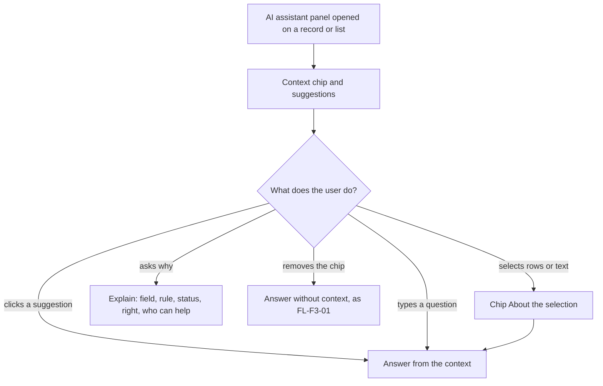

🏠 [Specs](../../../README.md) › 🧩 [Functional capabilities](../../README.md) › 🤖 [F3 Assistant](../README.md) ›
🔀 [Flows](README.md) › 🔀 FL-F3-02 Ask about the screen

# 🔀 FL-F3-02 Ask about the screen

**Status:** ✅ specified

## Summary

From the screen in front of the user to an answer or an explanation.

## Personas

Every internal persona (D142): [U01](../../../01-users/personas/u01-employee.md),
[U02](../../../01-users/personas/u02-manager.md), [U03](../../../01-users/personas/u03-sales.md),
[U04](../../../01-users/personas/u04-purchasing.md), [U05](../../../01-users/personas/u05-accounting.md),
[U06](../../../01-users/personas/u06-hr.md), [U07](../../../01-users/personas/u07-administrator.md),
[U12](../../../01-users/personas/u12-marketing.md), [U13](../../../01-users/personas/u13-owner.md),
[U14](../../../01-users/personas/u14-field-worker.md), [U15](../../../01-users/personas/u15-warehouse-operator.md),
[U16](../../../01-users/personas/u16-office-worker.md).

## Flowchart

## Sequence diagram

See [UC-F3-02](../use-cases/02-ask-about-the-screen/uc-f03-02-ask-about-what-is-on-screen.md#sequence-diagram).

## Steps

| Step | Persona | Screen | Use case | What happens |
|---|---|---|---|---|
| 1 | Every internal persona | [S-F3-01](../screens/01-ask-the-assistant/s-f03-01-assistant-panel.md) | [UC-F3-02](../use-cases/02-ask-about-the-screen/uc-f03-02-ask-about-what-is-on-screen.md) | Context chip and suggestions |
| 2 | Every internal persona | [S-F3-01](../screens/01-ask-the-assistant/s-f03-01-assistant-panel.md) | [UC-F3-02](../use-cases/02-ask-about-the-screen/uc-f03-02-ask-about-what-is-on-screen.md) | Ask about the selection |
| 3 | Every internal persona | [S-F3-01](../screens/01-ask-the-assistant/s-f03-01-assistant-panel.md) | [UC-F3-02](../use-cases/02-ask-about-the-screen/uc-f03-02-ask-about-what-is-on-screen.md) | Answer from the context |
| 4 | Every internal persona | [S-F3-01](../screens/01-ask-the-assistant/s-f03-01-assistant-panel.md) | [UC-F3-02](../use-cases/02-ask-about-the-screen/uc-f03-02-ask-about-what-is-on-screen.md) | Explain a greyed-out action |

### Entities and screens

| Entity | States in this flow | Shown at step and screen | Aggregated view |
|---|---|---|---|
| [E-F2-04 List view](../../f02-no-code-configuration/data/e-f02-04-list-view.md) | Draft, Published | Shown elsewhere: [S-F2-04 List view settings](../../f02-no-code-configuration/screens/01-configure-a-record-type/s-f02-04-list-view-settings.md) | List views |
| [E-F3-03 Suggested question](../data/e-f03-03-suggested-question.md) | Draft, Published, Shipped | 1, 2, 3, 4 [S-F3-01](../screens/01-ask-the-assistant/s-f03-01-assistant-panel.md) | Suggested questions |
| [E-F1-03 User](../../f01-administration/data/e-f01-03-user.md) | Invited, Active, Deactivated | Shown elsewhere: [S-F1-03 Users](../../f01-administration/screens/03-user-lifecycle/s-f01-03-users.md) | Users |
| [E-F3-02 Assistant answer](../data/e-f03-02-assistant-answer.md) | Recorded | 1, 2, 3, 4 [S-F3-01](../screens/01-ask-the-assistant/s-f03-01-assistant-panel.md) | Assistant answers |
| [E-F2-01 Custom field](../../f02-no-code-configuration/data/e-f02-01-custom-field.md) | Draft, Live, Archived | Shown elsewhere: [S-F2-30 Custom report](../../f02-no-code-configuration/screens/10-change-safely/s-f02-30-custom-report.md) | Custom fields |
| [E-F2-22 Field rule](../../f02-no-code-configuration/data/e-f02-22-field-rule.md) | Draft, Published | Shown elsewhere: [S-F2-26 Field rights and validation](../../f02-no-code-configuration/screens/11-rights-translations-and-approvals/s-f02-26-field-rights-and-validation.md) | Field rules |
| [E-F2-02 Status and transition](../../f02-no-code-configuration/data/e-f02-02-status-and-transition.md) | Draft, Published | Shown elsewhere: [S-F2-02 Status designer](../../f02-no-code-configuration/screens/01-configure-a-record-type/s-f02-02-status-designer.md) | Status and transitions |
| [E-F1-06 Role](../../f01-administration/data/e-f01-06-role.md) | Active | Shown elsewhere: [S-F1-06 Role editor](../../f01-administration/screens/04-edit-a-role/s-f01-06-role-editor.md) | Roles |

## Errors

As FL-F3-01; a selection too large.

## Images

Every step and error, for each persona taking part, in light and dark mode (D120). Steps are numbered as in the Steps
table; E rows are the error cases.

| Step | Persona | Device | Light | Dark |
|---|---|---|---|---|
| 1 | U03 | desktop | [light](../images/02-ask-about-the-screen/u03-sales/1-context-and-suggestions-desktop-light.png) | [dark](../images/02-ask-about-the-screen/u03-sales/1-context-and-suggestions-desktop-dark.png) |
| 2 | U02 | desktop | [light](../images/02-ask-about-the-screen/u02-manager/2-ask-about-selection-desktop-light.png) | [dark](../images/02-ask-about-the-screen/u02-manager/2-ask-about-selection-desktop-dark.png) |
| 3 | U03 | desktop | [light](../images/02-ask-about-the-screen/u03-sales/3-answer-from-context-desktop-light.png) | [dark](../images/02-ask-about-the-screen/u03-sales/3-answer-from-context-desktop-dark.png) |
| 4 | U03 | desktop | [light](../images/02-ask-about-the-screen/u03-sales/4-explain-a-greyed-action-desktop-light.png) | [dark](../images/02-ask-about-the-screen/u03-sales/4-explain-a-greyed-action-desktop-dark.png) |
| E1 | U02 | desktop | [light](../images/02-ask-about-the-screen/u02-manager/e1-selection-too-large-desktop-light.png) | [dark](../images/02-ask-about-the-screen/u02-manager/e1-selection-too-large-desktop-dark.png) |
| E1 | U02 | phone | [light](../images/02-ask-about-the-screen/u02-manager/e1-selection-too-large-phone-light.png) | [dark](../images/02-ask-about-the-screen/u02-manager/e1-selection-too-large-phone-dark.png) |

## Open questions

None.

---

⬅️ [FL-F3-01 Ask the AI assistant](fl-f03-01-ask-the-assistant.md) · ⬆️ [Up](README.md) ·
➡️ [FL-F3-03 Act through the AI assistant](fl-f03-03-act-through-the-assistant.md)
