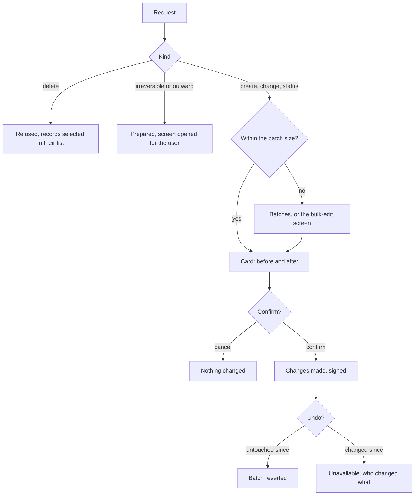

🏠 [Specs](../../../README.md) › 🧩 [Functional capabilities](../../README.md) › 🤖 [F3 Assistant](../README.md) ›
🔀 [Flows](README.md) › 🔀 FL-F3-03 Act through the AI assistant

# 🔀 FL-F3-03 Act through the AI assistant

**Status:** ✅ specified

## Summary

From a request to changes made, signed and undoable.

## Personas

Every internal persona (D142): [U01](../../../01-users/personas/u01-employee.md),
[U02](../../../01-users/personas/u02-manager.md), [U03](../../../01-users/personas/u03-sales.md),
[U04](../../../01-users/personas/u04-purchasing.md), [U05](../../../01-users/personas/u05-accounting.md),
[U06](../../../01-users/personas/u06-hr.md), [U07](../../../01-users/personas/u07-administrator.md),
[U12](../../../01-users/personas/u12-marketing.md), [U13](../../../01-users/personas/u13-owner.md),
[U14](../../../01-users/personas/u14-field-worker.md), [U15](../../../01-users/personas/u15-warehouse-operator.md),
[U16](../../../01-users/personas/u16-office-worker.md).

## Flowchart

## Sequence diagram

See
[UC-F3-03](../use-cases/03-act-through-the-assistant/uc-f03-03-have-the-assistant-create-or-change-records.md#sequence-diagram).

## Steps

| Step | Persona | Screen | Use case | What happens |
|---|---|---|---|---|
| 1 | Every internal persona | [S-F3-01](../screens/01-ask-the-assistant/s-f03-01-assistant-panel.md) | [UC-F3-03](../use-cases/03-act-through-the-assistant/uc-f03-03-have-the-assistant-create-or-change-records.md) | Request |
| 2 | Every internal persona | [S-F3-02](../screens/03-act-through-the-assistant/s-f03-02-change-confirmation-card.md) | [UC-F3-03](../use-cases/03-act-through-the-assistant/uc-f03-03-have-the-assistant-create-or-change-records.md) | Card, before and after |
| 3 | Every internal persona | [S-F3-02](../screens/03-act-through-the-assistant/s-f03-02-change-confirmation-card.md) | [UC-F3-03](../use-cases/03-act-through-the-assistant/uc-f03-03-have-the-assistant-create-or-change-records.md) | Done, with Undo |
| 4 | U07, U13 | [S-F3-12](../screens/03-act-through-the-assistant/s-f03-12-assistant-settings.md) | [UC-F3-03](../use-cases/03-act-through-the-assistant/uc-f03-03-have-the-assistant-create-or-change-records.md) | Set the batch size and the other AI assistant settings |

### Entities and screens

| Entity | States in this flow | Shown at step and screen | Aggregated view |
|---|---|---|---|
| [E-F3-22 AI assistant request](../data/e-f03-22-ai-assistant-request.md) | Active | 1 [S-F3-01](../screens/01-ask-the-assistant/s-f03-01-assistant-panel.md); 2, 3 [S-F3-02](../screens/03-act-through-the-assistant/s-f03-02-change-confirmation-card.md) | AI assistant requests |
| [E-F2-04 List view](../../f02-no-code-configuration/data/e-f02-04-list-view.md) | Draft, Published | Shown elsewhere: [S-F2-04 List view settings](../../f02-no-code-configuration/screens/01-configure-a-record-type/s-f02-04-list-view-settings.md) | List views |
| [E-F1-03 User](../../f01-administration/data/e-f01-03-user.md) | Invited, Active, Deactivated | Shown elsewhere: [S-F1-03 Users](../../f01-administration/screens/03-user-lifecycle/s-f01-03-users.md) | Users |
| [E-F3-04 Assistant change batch](../data/e-f03-04-assistant-change-batch.md) | Proposed, Done | 1 [S-F3-01](../screens/01-ask-the-assistant/s-f03-01-assistant-panel.md); 2, 3 [S-F3-02](../screens/03-act-through-the-assistant/s-f03-02-change-confirmation-card.md) | Assistant change batches |

## Errors

Delete asked; missing right; a record changed meanwhile; a business rule refuses; Undo unavailable.

## Images

Every step and error, for each persona taking part, in light and dark mode (D120). Steps are numbered as in the Steps
table; E rows are the error cases.

| Step | Persona | Device | Light | Dark |
|---|---|---|---|---|
| 1 | U02 | desktop | [light](../images/03-act-through-the-assistant/u02-manager/1-request-desktop-light.png) | [dark](../images/03-act-through-the-assistant/u02-manager/1-request-desktop-dark.png) |
| 2 | U02 | desktop | [light](../images/03-act-through-the-assistant/u02-manager/2-confirmation-card-desktop-light.png) | [dark](../images/03-act-through-the-assistant/u02-manager/2-confirmation-card-desktop-dark.png) |
| 2 | U03 | desktop | [light](../images/03-act-through-the-assistant/u03-sales/2-confirmation-card-desktop-light.png) | [dark](../images/03-act-through-the-assistant/u03-sales/2-confirmation-card-desktop-dark.png) |
| 3 | U02 | desktop | [light](../images/03-act-through-the-assistant/u02-manager/3-done-with-undo-desktop-light.png) | [dark](../images/03-act-through-the-assistant/u02-manager/3-done-with-undo-desktop-dark.png) |
| 4 | U07 | desktop | [light](../images/03-act-through-the-assistant/u07-administrator/4-assistant-settings-desktop-light.png) | [dark](../images/03-act-through-the-assistant/u07-administrator/4-assistant-settings-desktop-dark.png) |
| 4 | U13 | desktop | [light](../images/03-act-through-the-assistant/u13-owner/4-assistant-settings-desktop-light.png) | [dark](../images/03-act-through-the-assistant/u13-owner/4-assistant-settings-desktop-dark.png) |
| 4 | U13 | phone | [light](../images/03-act-through-the-assistant/u13-owner/4-assistant-settings-phone-light.png) | [dark](../images/03-act-through-the-assistant/u13-owner/4-assistant-settings-phone-dark.png) |
| E1 | U03 | desktop | [light](../images/03-act-through-the-assistant/u03-sales/e1-delete-refused-desktop-light.png) | [dark](../images/03-act-through-the-assistant/u03-sales/e1-delete-refused-desktop-dark.png) |
| E1 | U03 | phone | [light](../images/03-act-through-the-assistant/u03-sales/e1-delete-refused-phone-light.png) | [dark](../images/03-act-through-the-assistant/u03-sales/e1-delete-refused-phone-dark.png) |
| E1 | U03 | tablet | [light](../images/03-act-through-the-assistant/u03-sales/e1-delete-refused-tablet-light.png) | [dark](../images/03-act-through-the-assistant/u03-sales/e1-delete-refused-tablet-dark.png) |
| E2 | U03 | desktop | [light](../images/03-act-through-the-assistant/u03-sales/e2-missing-right-desktop-light.png) | [dark](../images/03-act-through-the-assistant/u03-sales/e2-missing-right-desktop-dark.png) |
| E2 | U03 | phone | [light](../images/03-act-through-the-assistant/u03-sales/e2-missing-right-phone-light.png) | [dark](../images/03-act-through-the-assistant/u03-sales/e2-missing-right-phone-dark.png) |
| E2 | U03 | tablet | [light](../images/03-act-through-the-assistant/u03-sales/e2-missing-right-tablet-light.png) | [dark](../images/03-act-through-the-assistant/u03-sales/e2-missing-right-tablet-dark.png) |
| E3 | U02 | desktop | [light](../images/03-act-through-the-assistant/u02-manager/e3-partly-done-desktop-light.png) | [dark](../images/03-act-through-the-assistant/u02-manager/e3-partly-done-desktop-dark.png) |
| E3 | U02 | phone | [light](../images/03-act-through-the-assistant/u02-manager/e3-partly-done-phone-light.png) | [dark](../images/03-act-through-the-assistant/u02-manager/e3-partly-done-phone-dark.png) |
| E4 | U02 | desktop | [light](../images/03-act-through-the-assistant/u02-manager/e4-undo-unavailable-desktop-light.png) | [dark](../images/03-act-through-the-assistant/u02-manager/e4-undo-unavailable-desktop-dark.png) |
| E4 | U02 | phone | [light](../images/03-act-through-the-assistant/u02-manager/e4-undo-unavailable-phone-light.png) | [dark](../images/03-act-through-the-assistant/u02-manager/e4-undo-unavailable-phone-dark.png) |

## Open questions

None.

---

⬅️ [FL-F3-02 Ask about the screen](fl-f03-02-ask-about-the-screen.md) · ⬆️ [Up](README.md) ·
➡️ [FL-F3-04 Summarise or draft](fl-f03-04-summarise-or-draft.md)
