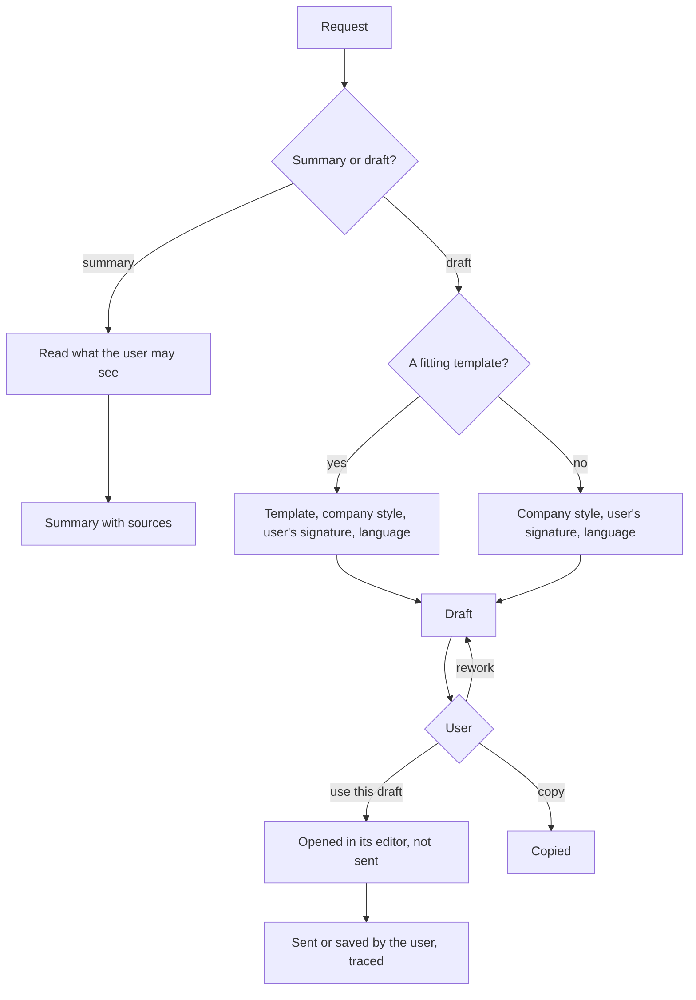

🏠 [Specs](../../../README.md) › 🧩 [Functional capabilities](../../README.md) › 🤖 [F3 Assistant](../README.md) ›
🔀 [Flows](README.md) › 🔀 FL-F3-04 Summarise or draft

# 🔀 FL-F3-04 Summarise or draft

**Status:** ✅ specified

## Summary

From a request to a summary, or to a draft in its editor.

## Personas

Every internal persona (D142): [U01](../../../01-users/personas/u01-employee.md),
[U02](../../../01-users/personas/u02-manager.md), [U03](../../../01-users/personas/u03-sales.md),
[U04](../../../01-users/personas/u04-purchasing.md), [U05](../../../01-users/personas/u05-accounting.md),
[U06](../../../01-users/personas/u06-hr.md), [U07](../../../01-users/personas/u07-administrator.md),
[U12](../../../01-users/personas/u12-marketing.md), [U13](../../../01-users/personas/u13-owner.md),
[U14](../../../01-users/personas/u14-field-worker.md), [U15](../../../01-users/personas/u15-warehouse-operator.md),
[U16](../../../01-users/personas/u16-office-worker.md).

## Flowchart

## Sequence diagram

See [UC-F3-04](../use-cases/04-summarise-or-draft/uc-f03-04-summarise-and-draft.md#sequence-diagram).

## Steps

| Step | Persona | Screen | Use case | What happens |
|---|---|---|---|---|
| 1 | Every internal persona | [S-F3-01](../screens/01-ask-the-assistant/s-f03-01-assistant-panel.md) | [UC-F3-04](../use-cases/04-summarise-or-draft/uc-f03-04-summarise-and-draft.md) | Ask for a summary or a draft |
| 2 | Every internal persona | [S-F3-01](../screens/01-ask-the-assistant/s-f03-01-assistant-panel.md) | [UC-F3-04](../use-cases/04-summarise-or-draft/uc-f03-04-summarise-and-draft.md) | Draft shown, rework |
| 3 | Every internal persona | [S-F3-01](../screens/01-ask-the-assistant/s-f03-01-assistant-panel.md) | [UC-F3-04](../use-cases/04-summarise-or-draft/uc-f03-04-summarise-and-draft.md) | Use this draft |
| 4 | U07, U13 | [S-F3-03](../screens/04-summarise-or-draft/s-f03-03-writing-style-settings.md) | [UC-F3-04](../use-cases/04-summarise-or-draft/uc-f03-04-summarise-and-draft.md) | Set the company writing style |

### Entities and screens

| Entity | States in this flow | Shown at step and screen | Aggregated view |
|---|---|---|---|
| [E-F3-22 AI assistant request](../data/e-f03-22-ai-assistant-request.md) | Active | 1, 2, 3 [S-F3-01](../screens/01-ask-the-assistant/s-f03-01-assistant-panel.md); 4 [S-F3-03](../screens/04-summarise-or-draft/s-f03-03-writing-style-settings.md) | AI assistant requests |
| [E-F3-02 Assistant answer](../data/e-f03-02-assistant-answer.md) | Recorded | 1, 2, 3 [S-F3-01](../screens/01-ask-the-assistant/s-f03-01-assistant-panel.md); 4 [S-F3-03](../screens/04-summarise-or-draft/s-f03-03-writing-style-settings.md) | Assistant answers |
| [E-F1-03 User](../../f01-administration/data/e-f01-03-user.md) | Invited, Active, Deactivated | Shown elsewhere: [S-F1-03 Users](../../f01-administration/screens/03-user-lifecycle/s-f01-03-users.md) | Users |
| [E-F2-06 Document template](../../f02-no-code-configuration/data/e-f02-06-document-template.md) | Draft | Shown elsewhere: [S-F2-06 Document template editor](../../f02-no-code-configuration/screens/02-customise-documents-and-emails/s-f02-06-document-template-editor.md) | Document templates |
| [E-F3-05 Company writing style](../data/e-f03-05-company-writing-style.md) | Active | 1, 2, 3 [S-F3-01](../screens/01-ask-the-assistant/s-f03-01-assistant-panel.md); 4 [S-F3-03](../screens/04-summarise-or-draft/s-f03-03-writing-style-settings.md) | Company writing styles |

## Errors

Nothing to summarise; a document too long; model unavailable.

## Images

Every step and error, for each persona taking part, in light and dark mode (D120). Steps are numbered as in the Steps
table; E rows are the error cases.

| Step | Persona | Device | Light | Dark |
|---|---|---|---|---|
| 1 | U03 | desktop | [light](../images/04-summarise-or-draft/u03-sales/1-ask-for-a-draft-desktop-light.png) | [dark](../images/04-summarise-or-draft/u03-sales/1-ask-for-a-draft-desktop-dark.png) |
| 2 | U03 | desktop | [light](../images/04-summarise-or-draft/u03-sales/2-draft-and-rework-desktop-light.png) | [dark](../images/04-summarise-or-draft/u03-sales/2-draft-and-rework-desktop-dark.png) |
| 3 | U03 | desktop | [light](../images/04-summarise-or-draft/u03-sales/3-use-this-draft-desktop-light.png) | [dark](../images/04-summarise-or-draft/u03-sales/3-use-this-draft-desktop-dark.png) |
| 4 | U07 | desktop | [light](../images/04-summarise-or-draft/u07-administrator/4-writing-style-desktop-light.png) | [dark](../images/04-summarise-or-draft/u07-administrator/4-writing-style-desktop-dark.png) |
| 4 | U13 | desktop | [light](../images/04-summarise-or-draft/u13-owner/4-writing-style-desktop-light.png) | [dark](../images/04-summarise-or-draft/u13-owner/4-writing-style-desktop-dark.png) |
| 4 | U13 | phone | [light](../images/04-summarise-or-draft/u13-owner/4-writing-style-phone-light.png) | [dark](../images/04-summarise-or-draft/u13-owner/4-writing-style-phone-dark.png) |
| E1 | U03 | desktop | [light](../images/04-summarise-or-draft/u03-sales/e1-nothing-to-summarise-desktop-light.png) | [dark](../images/04-summarise-or-draft/u03-sales/e1-nothing-to-summarise-desktop-dark.png) |
| E1 | U03 | phone | [light](../images/04-summarise-or-draft/u03-sales/e1-nothing-to-summarise-phone-light.png) | [dark](../images/04-summarise-or-draft/u03-sales/e1-nothing-to-summarise-phone-dark.png) |
| E1 | U03 | tablet | [light](../images/04-summarise-or-draft/u03-sales/e1-nothing-to-summarise-tablet-light.png) | [dark](../images/04-summarise-or-draft/u03-sales/e1-nothing-to-summarise-tablet-dark.png) |
| E2 | U03 | desktop | [light](../images/04-summarise-or-draft/u03-sales/e2-model-unavailable-desktop-light.png) | [dark](../images/04-summarise-or-draft/u03-sales/e2-model-unavailable-desktop-dark.png) |
| E2 | U03 | phone | [light](../images/04-summarise-or-draft/u03-sales/e2-model-unavailable-phone-light.png) | [dark](../images/04-summarise-or-draft/u03-sales/e2-model-unavailable-phone-dark.png) |
| E2 | U03 | tablet | [light](../images/04-summarise-or-draft/u03-sales/e2-model-unavailable-tablet-light.png) | [dark](../images/04-summarise-or-draft/u03-sales/e2-model-unavailable-tablet-dark.png) |

## Open questions

None.

---

⬅️ [FL-F3-03 Act through the AI assistant](fl-f03-03-act-through-the-assistant.md) · ⬆️ [Up](README.md) ·
➡️ [FL-F3-05 Find and get guided](fl-f03-05-find-and-get-guided.md)
