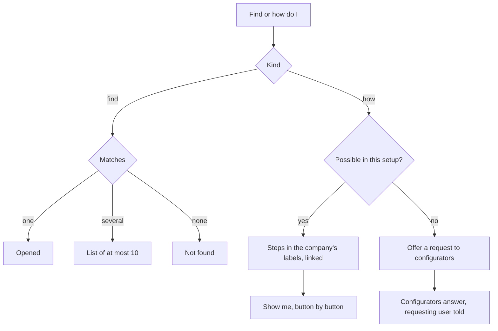

🏠 [Specs](../../../README.md) › 🧩 [Functional capabilities](../../README.md) › 🤖 [F3 Assistant](../README.md) ›
🔀 [Flows](README.md) › 🔀 FL-F3-05 Find and get guided

# 🔀 FL-F3-05 Find and get guided

**Status:** ✅ specified

## Summary

From a find or "how do I" to the record, the way, or a request.

## Personas

Every internal persona (D142): [U01](../../../01-users/personas/u01-employee.md),
[U02](../../../01-users/personas/u02-manager.md), [U03](../../../01-users/personas/u03-sales.md),
[U04](../../../01-users/personas/u04-purchasing.md), [U05](../../../01-users/personas/u05-accounting.md),
[U06](../../../01-users/personas/u06-hr.md), [U07](../../../01-users/personas/u07-administrator.md),
[U12](../../../01-users/personas/u12-marketing.md), [U13](../../../01-users/personas/u13-owner.md),
[U14](../../../01-users/personas/u14-field-worker.md), [U15](../../../01-users/personas/u15-warehouse-operator.md),
[U16](../../../01-users/personas/u16-office-worker.md).

## Flowchart

## Sequence diagram

See [UC-F3-05](../use-cases/05-find-and-get-guided/uc-f03-05-find-a-record-or-a-screen-get-guided.md#sequence-diagram).

## Steps

| Step | Persona | Screen | Use case | What happens |
|---|---|---|---|---|
| 1 | Every internal persona | [S-F3-01](../screens/01-ask-the-assistant/s-f03-01-assistant-panel.md) | [UC-F3-05](../use-cases/05-find-and-get-guided/uc-f03-05-find-a-record-or-a-screen-get-guided.md) | Find: opened or listed |
| 2 | Every internal persona | [S-F3-01](../screens/01-ask-the-assistant/s-f03-01-assistant-panel.md) | [UC-F3-05](../use-cases/05-find-and-get-guided/uc-f03-05-find-a-record-or-a-screen-get-guided.md) | How do I: steps |
| 3 | Every internal persona | [S-F3-04](../screens/05-find-and-get-guided/s-f03-04-show-me-overlay.md) | [UC-F3-05](../use-cases/05-find-and-get-guided/uc-f03-05-find-a-record-or-a-screen-get-guided.md) | Show me |
| 4 | Every internal persona | [S-F3-01](../screens/01-ask-the-assistant/s-f03-01-assistant-panel.md) | [UC-F3-05](../use-cases/05-find-and-get-guided/uc-f03-05-find-a-record-or-a-screen-get-guided.md) | Not possible yet: request |
| 5 | U07, Configurator | [S-F3-05](../screens/05-find-and-get-guided/s-f03-05-configuration-requests.md) | [UC-F3-05](../use-cases/05-find-and-get-guided/uc-f03-05-find-a-record-or-a-screen-get-guided.md) | Answer requests |

### Entities and screens

| Entity | States in this flow | Shown at step and screen | Aggregated view |
|---|---|---|---|
| [E-F2-23 Translation](../../f02-no-code-configuration/data/e-f02-23-translation.md) | Draft, Published | Shown elsewhere: [S-F2-27 Translations](../../f02-no-code-configuration/screens/11-rights-translations-and-approvals/s-f02-27-translations.md) | Translations |
| [E-F3-06 Configuration request](../data/e-f03-06-configuration-request.md) | Open, Planned, Done, Declined | 1, 2, 4 [S-F3-01](../screens/01-ask-the-assistant/s-f03-01-assistant-panel.md); 3 [S-F3-04](../screens/05-find-and-get-guided/s-f03-04-show-me-overlay.md); 5 [S-F3-05](../screens/05-find-and-get-guided/s-f03-05-configuration-requests.md) | Configuration requests |
| [E-F1-03 User](../../f01-administration/data/e-f01-03-user.md) | Invited, Active, Deactivated | Shown elsewhere: [S-F1-03 Users](../../f01-administration/screens/03-user-lifecycle/s-f01-03-users.md) | Users |

## Errors

Nothing found; not reachable; Show me lost its place.

## Images

Every step and error, for each persona taking part, in light and dark mode (D120). Steps are numbered as in the Steps
table; E rows are the error cases.

| Step | Persona | Device | Light | Dark |
|---|---|---|---|---|
| 1 | U16 | desktop | [light](../images/05-find-and-get-guided/u16-office-worker/1-find-desktop-light.png) | [dark](../images/05-find-and-get-guided/u16-office-worker/1-find-desktop-dark.png) |
| 2 | U16 | desktop | [light](../images/05-find-and-get-guided/u16-office-worker/2-how-do-i-desktop-light.png) | [dark](../images/05-find-and-get-guided/u16-office-worker/2-how-do-i-desktop-dark.png) |
| 3 | U16 | desktop | [light](../images/05-find-and-get-guided/u16-office-worker/3-show-me-desktop-light.png) | [dark](../images/05-find-and-get-guided/u16-office-worker/3-show-me-desktop-dark.png) |
| 4 | U16 | desktop | [light](../images/05-find-and-get-guided/u16-office-worker/4-request-offered-desktop-light.png) | [dark](../images/05-find-and-get-guided/u16-office-worker/4-request-offered-desktop-dark.png) |
| 5 | U07 | desktop | [light](../images/05-find-and-get-guided/u07-administrator/5-answer-requests-desktop-light.png) | [dark](../images/05-find-and-get-guided/u07-administrator/5-answer-requests-desktop-dark.png) |
| E1 | U16 | desktop | [light](../images/05-find-and-get-guided/u16-office-worker/e1-not-reachable-desktop-light.png) | [dark](../images/05-find-and-get-guided/u16-office-worker/e1-not-reachable-desktop-dark.png) |
| E1 | U16 | phone | [light](../images/05-find-and-get-guided/u16-office-worker/e1-not-reachable-phone-light.png) | [dark](../images/05-find-and-get-guided/u16-office-worker/e1-not-reachable-phone-dark.png) |
| E2 | U16 | desktop | [light](../images/05-find-and-get-guided/u16-office-worker/e2-show-me-lost-desktop-light.png) | [dark](../images/05-find-and-get-guided/u16-office-worker/e2-show-me-lost-desktop-dark.png) |
| E2 | U16 | phone | [light](../images/05-find-and-get-guided/u16-office-worker/e2-show-me-lost-phone-light.png) | [dark](../images/05-find-and-get-guided/u16-office-worker/e2-show-me-lost-phone-dark.png) |

## Open questions

None.

---

⬅️ [FL-F3-04 Summarise or draft](fl-f03-04-summarise-or-draft.md) · ⬆️ [Up](README.md) ·
➡️ [FL-F3-06 Use an outside tool](fl-f03-06-use-an-outside-tool.md)
