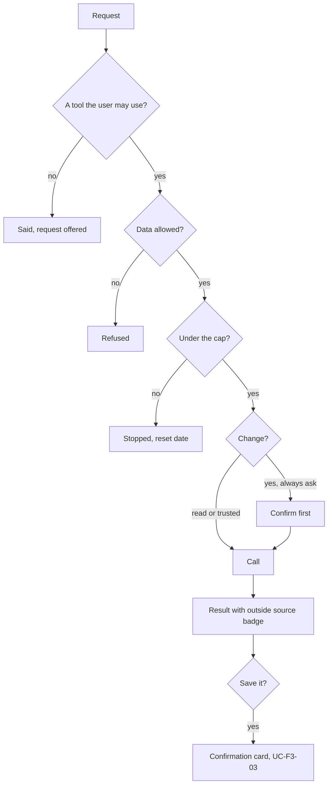

🏠 [Specs](../../../README.md) › 🧩 [Functional capabilities](../../README.md) › 🤖 [F3 Assistant](../README.md) ›
🔀 [Flows](README.md) › 🔀 FL-F3-06 Use an outside tool

# 🔀 FL-F3-06 Use an outside tool

**Status:** ✅ specified

## Summary

From a request to an outside result, within rights, data categories and caps.

## Personas

Roles allowed per connection (D80); every internal persona can be: [U01](../../../01-users/personas/u01-employee.md),
[U02](../../../01-users/personas/u02-manager.md), [U03](../../../01-users/personas/u03-sales.md),
[U04](../../../01-users/personas/u04-purchasing.md), [U05](../../../01-users/personas/u05-accounting.md),
[U06](../../../01-users/personas/u06-hr.md), [U07](../../../01-users/personas/u07-administrator.md),
[U12](../../../01-users/personas/u12-marketing.md), [U13](../../../01-users/personas/u13-owner.md),
[U14](../../../01-users/personas/u14-field-worker.md), [U15](../../../01-users/personas/u15-warehouse-operator.md),
[U16](../../../01-users/personas/u16-office-worker.md).

## Flowchart

## Sequence diagram

See
[UC-F3-06](../use-cases/06-use-an-outside-tool/uc-f03-06-use-an-outside-tool-through-the-assistant.md#sequence-diagram).

## Steps

| Step | Persona | Screen | Use case | What happens |
|---|---|---|---|---|
| 1 | Every internal persona | [S-F3-01](../screens/01-ask-the-assistant/s-f03-01-assistant-panel.md) | [UC-F3-06](../use-cases/06-use-an-outside-tool/uc-f03-06-use-an-outside-tool-through-the-assistant.md) | Request, Sent to |
| 2 | Every internal persona | [S-F3-01](../screens/01-ask-the-assistant/s-f03-01-assistant-panel.md) | [UC-F3-06](../use-cases/06-use-an-outside-tool/uc-f03-06-use-an-outside-tool-through-the-assistant.md) | Outside result |
| 3 | Every internal persona | [S-F3-06](../screens/06-use-an-outside-tool/s-f03-06-my-connections.md) | [UC-F3-06](../use-cases/06-use-an-outside-tool/uc-f03-06-use-an-outside-tool-through-the-assistant.md) | Connect a personal account |

### Entities and screens

| Entity | States in this flow | Shown at step and screen | Aggregated view |
|---|---|---|---|
| [E-F3-22 AI assistant request](../data/e-f03-22-ai-assistant-request.md) | Active | 1, 2 [S-F3-01](../screens/01-ask-the-assistant/s-f03-01-assistant-panel.md); 3 [S-F3-06](../screens/06-use-an-outside-tool/s-f03-06-my-connections.md) | AI assistant requests |
| [E-F3-06 Configuration request](../data/e-f03-06-configuration-request.md) | Open, Planned, Done, Declined | 1, 2 [S-F3-01](../screens/01-ask-the-assistant/s-f03-01-assistant-panel.md) | Configuration requests |
| [E-T06-01 Tool](../../../03-technical/t06-mcp-and-a2a-gateway/data/e-t06-01-tool.md) | Active | Shown elsewhere: [S-T06-01 Tool](../../../03-technical/t06-mcp-and-a2a-gateway/screens/s-t06-01-tool.md), from the admin list [S-T06-L01](../../../03-technical/t06-mcp-and-a2a-gateway/screens/00-lists/s-t06-l01-tools.md) | Tools |
| [E-F1-03 User](../../f01-administration/data/e-f01-03-user.md) | Invited, Active, Deactivated | Shown elsewhere: [S-F1-03 Users](../../f01-administration/screens/03-user-lifecycle/s-f01-03-users.md) | Users |
| [E-F3-08 Outside call](../data/e-f03-08-outside-call.md) | Refused | 1, 2 [S-F3-01](../screens/01-ask-the-assistant/s-f03-01-assistant-panel.md); 3 [S-F3-06](../screens/06-use-an-outside-tool/s-f03-06-my-connections.md) | Outside calls |

## Errors

No tool; data not allowed; outside tool down; cap reached; personal sign-in expired.

## Images

Every step and error, for each persona taking part, in light and dark mode (D120). Steps are numbered as in the Steps
table; E rows are the error cases.

| Step | Persona | Device | Light | Dark |
|---|---|---|---|---|
| 1 | U04 | desktop | [light](../images/06-use-an-outside-tool/u04-purchasing/1-request-sent-to-desktop-light.png) | [dark](../images/06-use-an-outside-tool/u04-purchasing/1-request-sent-to-desktop-dark.png) |
| 2 | U04 | desktop | [light](../images/06-use-an-outside-tool/u04-purchasing/2-outside-result-desktop-light.png) | [dark](../images/06-use-an-outside-tool/u04-purchasing/2-outside-result-desktop-dark.png) |
| 3 | U01 | desktop | [light](../images/06-use-an-outside-tool/u01-employee/3-my-connections-desktop-light.png) | [dark](../images/06-use-an-outside-tool/u01-employee/3-my-connections-desktop-dark.png) |
| 3 | U01 | phone | [light](../images/06-use-an-outside-tool/u01-employee/3-my-connections-phone-light.png) | [dark](../images/06-use-an-outside-tool/u01-employee/3-my-connections-phone-dark.png) |
| E1 | U04 | desktop | [light](../images/06-use-an-outside-tool/u04-purchasing/e1-data-not-allowed-desktop-light.png) | [dark](../images/06-use-an-outside-tool/u04-purchasing/e1-data-not-allowed-desktop-dark.png) |
| E2 | U04 | desktop | [light](../images/06-use-an-outside-tool/u04-purchasing/e2-tool-not-answering-desktop-light.png) | [dark](../images/06-use-an-outside-tool/u04-purchasing/e2-tool-not-answering-desktop-dark.png) |
| E3 | U04 | desktop | [light](../images/06-use-an-outside-tool/u04-purchasing/e3-cap-reached-desktop-light.png) | [dark](../images/06-use-an-outside-tool/u04-purchasing/e3-cap-reached-desktop-dark.png) |
| E4 | U01 | phone | [light](../images/06-use-an-outside-tool/u01-employee/e4-sign-in-expired-phone-light.png) | [dark](../images/06-use-an-outside-tool/u01-employee/e4-sign-in-expired-phone-dark.png) |
| E4 | U01 | desktop | [light](../images/06-use-an-outside-tool/u01-employee/e4-sign-in-expired-desktop-light.png) | [dark](../images/06-use-an-outside-tool/u01-employee/e4-sign-in-expired-desktop-dark.png) |

## Open questions

None.

---

⬅️ [FL-F3-05 Find and get guided](fl-f03-05-find-and-get-guided.md) · ⬆️ [Up](README.md) ·
➡️ [FL-F3-07 Manage knowledge](fl-f03-07-manage-knowledge.md)
